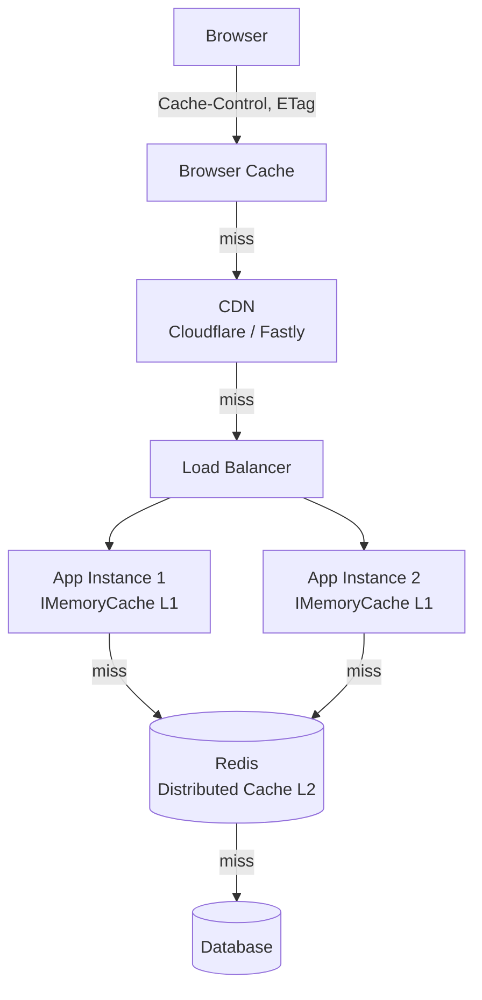

# Уровни кеширования

> Цена кеша, hit ratio и путь Browser → L1 → L2 → DB.

## Содержание

- [Зачем кеширование](#зачем-кеширование)
- [Подводные камни](#подводные-камни)
- [См. также](#см-также)

## Зачем кеширование

### Latency как аргумент

Каждое обращение к внешнему ресурсу стоит времени:

| Ресурс | Типичная задержка |
|--------|------------------|
| L1 CPU cache | ~1 нс |
| RAM | ~100 нс |
| SSD (локальный) | ~100 мкс |
| In-process cache (RAM) | ~1 мкс |
| Redis (localhost) | ~0.1–0.5 мс |
| PostgreSQL (простой запрос) | ~1–10 мс |
| PostgreSQL (тяжёлый JOIN) | ~50–500 мс |
| Внешнее HTTP API | ~50–500 мс |
| HDD (случайный I/O) | ~10 мс |

Кеш — это компромисс: **скорость в обмен на актуальность данных**.

### Cache Hit/Miss Ratio

**Cache Hit** — данные найдены в кеше.
**Cache Miss** — данных нет, нужно идти в источник.

```
Hit Ratio = Hits / (Hits + Misses)
```

При Hit Ratio = 90% и 1000 rps → 100 запросов в секунду идут в БД вместо 1000. При Hit Ratio = 50% нагрузка на БД уменьшается примерно вдвое, если один miss означает один запрос.

**Эффективность** оценивают по latency, стоимости, нагрузке на источник и допустимой свежести, а не по универсальному порогу hit ratio. Задержки в таблице — ориентиры для сравнения порядков величин, не обещание для конкретной системы.

### Уровни кеширования



- **Browser Cache:** HTTP заголовки `Cache-Control`, `ETag`, `Last-Modified`. Нулевые затраты сервера.
- **CDN:** кеш на edge-серверах рядом с пользователем. Для статики и публичного контента.
- **In-process (L1):** `IMemoryCache` в памяти процесса. Наибыстрее, но не разделяется между инстансами.
- **Distributed Cache (L2):** Redis/Memcached — общий для всех инстансов. Разделяется между процессами, но актуальность относительно БД требует отдельной стратегии.
- **Database Cache:** PostgreSQL shared_buffers, query plan cache — прозрачно для приложения.

## Подводные камни

Измеряй tail latency, нагрузку на источник и стоимость сериализации; средний hit ratio может скрывать hot keys.

## См. также

- [Стратегии кеширования](./02-cache-strategies.md)
- [Практические паттерны Redis](./09-practical-patterns.md)
- [Оглавление раздела](./README.md)
