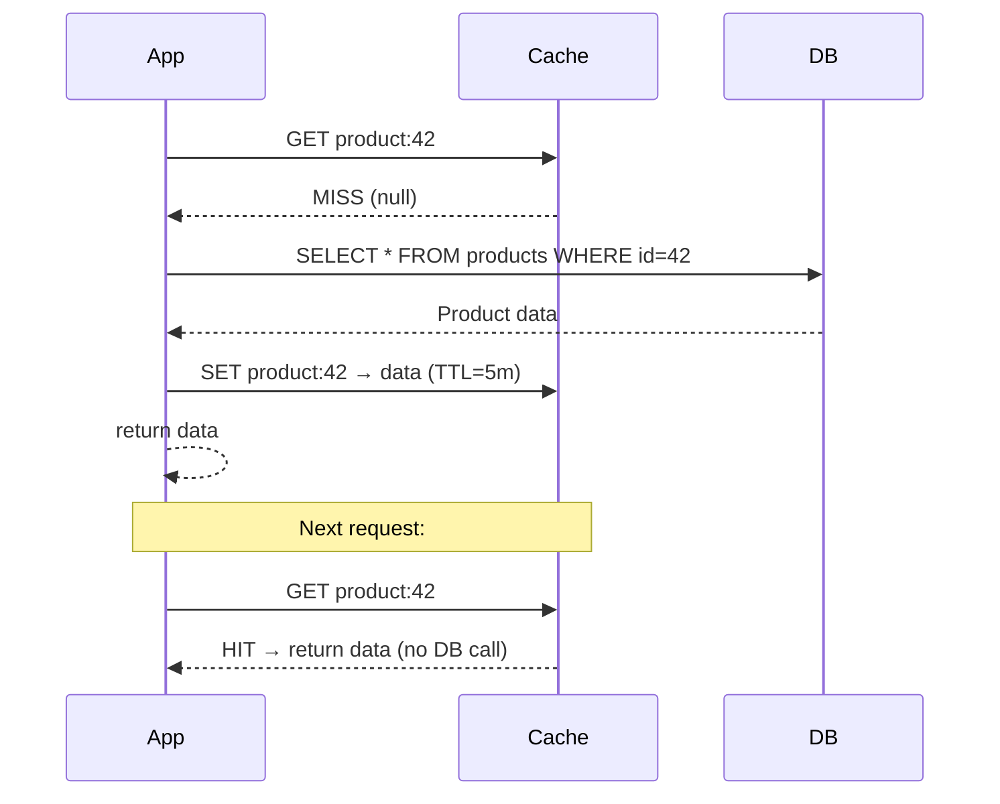
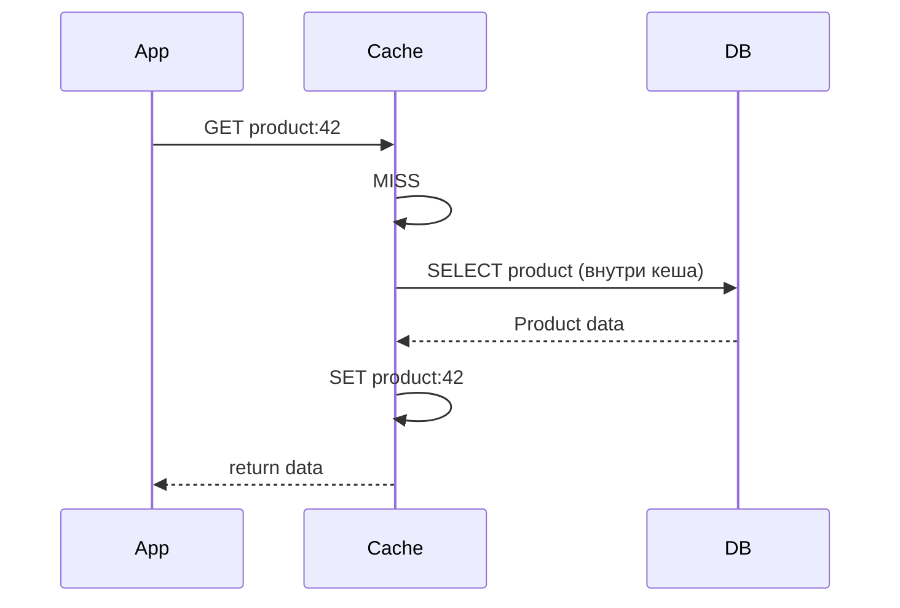
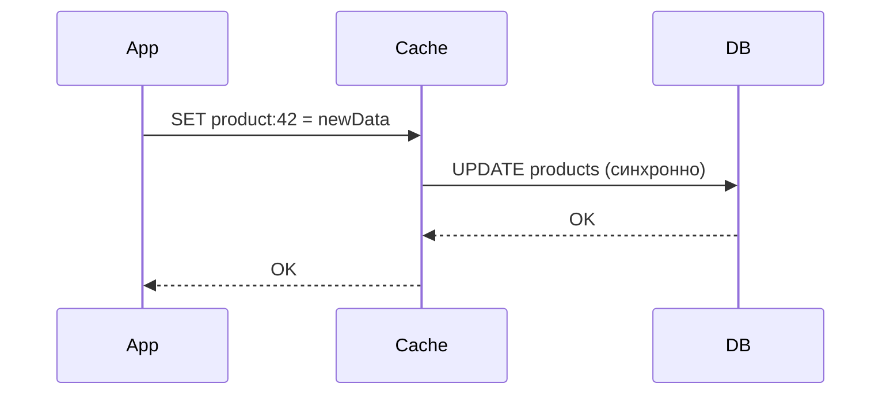
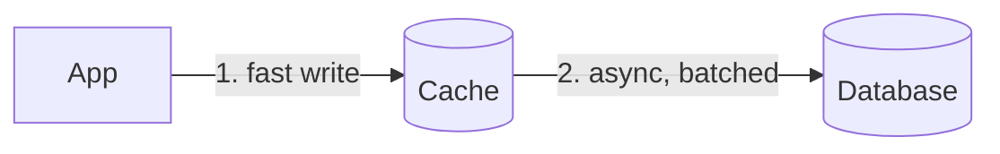

# Стратегии кеширования

> Cache-aside, read-through, write-through, write-behind и refresh-ahead.

## Содержание

- [Стратегии](#стратегии)
- [Подводные камни](#подводные-камни)
- [См. также](#см-также)

## Стратегии

### Cache-Aside (Lazy Loading)

Приложение само управляет кешем: сначала ищет в кеше, при miss — идёт в БД и кладёт результат в кеш.



```csharp
public async Task<Product?> GetProductAsync(int id, CancellationToken ct)
{
    var key = $"product:{id}";

    // 1. Пробуем кеш
    var cached = await _cache.GetStringAsync(key, ct);
    if (cached is not null)
        return JsonSerializer.Deserialize<Product>(cached);

    // 2. Miss → БД
    var product = await _db.Products.FindAsync(new object[] { id }, ct);
    if (product is null) return null;

    // 3. Кладём в кеш
    await _cache.SetStringAsync(key,
        JsonSerializer.Serialize(product),
        new DistributedCacheEntryOptions { AbsoluteExpirationRelativeToNow = TimeSpan.FromMinutes(5) },
        ct);

    return product;
}
```

**Плюсы:** простота, кешируется только то, что реально запрашивается.
**Минусы:** первый запрос всегда медленный (cold start), риск stampede при одновременных miss.

### Read-Through

Кеш сам обращается к БД при miss. Приложение всегда читает только из кеша.



Реализуется через кастомный адаптер или библиотеки (CacheCow, Polly с Cache Policy). Read-through можно реализовать адаптером, вызывающим фабрику загрузки; наличие соответствующего API зависит от библиотеки и версии.

**Плюсы:** логика кеширования скрыта от приложения.
**Минусы:** сложнее настроить, кеш должен знать о схеме данных.

### Write-Through

Запись происходит одновременно в кеш и в БД (синхронно).



```csharp
public async Task UpdateProductAsync(Product product, CancellationToken ct)
{
    // Запись в БД
    _db.Products.Update(product);
    await _db.SaveChangesAsync(ct);

    // Синхронно обновляем кеш
    var key = $"product:{product.Id}";
    await _cache.SetStringAsync(key,
        JsonSerializer.Serialize(product),
        new DistributedCacheEntryOptions { AbsoluteExpirationRelativeToNow = TimeSpan.FromMinutes(5) },
        ct);
}
```

**Плюсы:** после успешной синхронной записи кеш содержит новое значение. Частичный сбой и конкурентные записи всё равно требуют обработки.
**Минусы:** write latency выше (два хранилища), при редких чтениях записываем в кеш зря.

### Write-Behind (Write-Back)

Запись сначала в кеш, потом асинхронно в БД. Приложение получает быстрое подтверждение.



**Плюсы:** минимальный write latency, batching для БД.
**Минусы:** риск потери данных (кеш упал до записи в БД), сложность реализации, не подходит для финансовых данных.

### Refresh-Ahead (Prefetching)

Кеш предсказывает, что данные скоро понадобятся, и обновляет их до истечения TTL.

```
TTL=10 мин, refresh threshold=80%
→ После 8 минут → фоновое обновление кеша
→ Вероятность miss уменьшается, если фоновое обновление успело завершиться
```

**Плюсы:** нет cold miss, актуальные данные.
**Минусы:** сложность определения "популярных" ключей, лишние обращения к БД.

### Сравнение стратегий

| Стратегия | Read Latency | Write Latency | Актуальность | Сложность |
|-----------|-------------|--------------|-------------|----------|
| Cache-Aside | Высокий на miss | Стандартный | Через TTL | Низкая |
| Read-Through | Высокий на miss | Стандартный | Через TTL | Средняя |
| Write-Through | Низкий | Высокий | После успешной записи | Средняя |
| Write-Behind | Низкий | Минимальный | Задержка | Высокая |
| Refresh-Ahead | Минимальный | Стандартный | Почти всегда | Высокая |

В примере `UpdateProductAsync` БД и кеш обновляются последовательно, без общей транзакции. Если запись в кеш упадёт после commit БД, значения разойдутся. Это упрощённая иллюстрация, а не гарантия согласованности.

## Подводные камни

Синхронные две записи не создают общей транзакции. Выбери допустимое устаревание и поведение при частичном сбое.

## См. также

- [Инвалидация и консистентность](./07-invalidation-consistency.md)
- [Stampede, penetration, avalanche и hot key](./08-cache-problems.md)
- [Оглавление раздела](./README.md)
