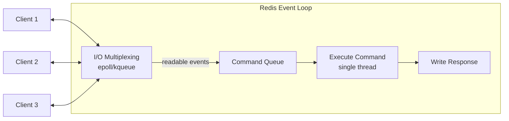
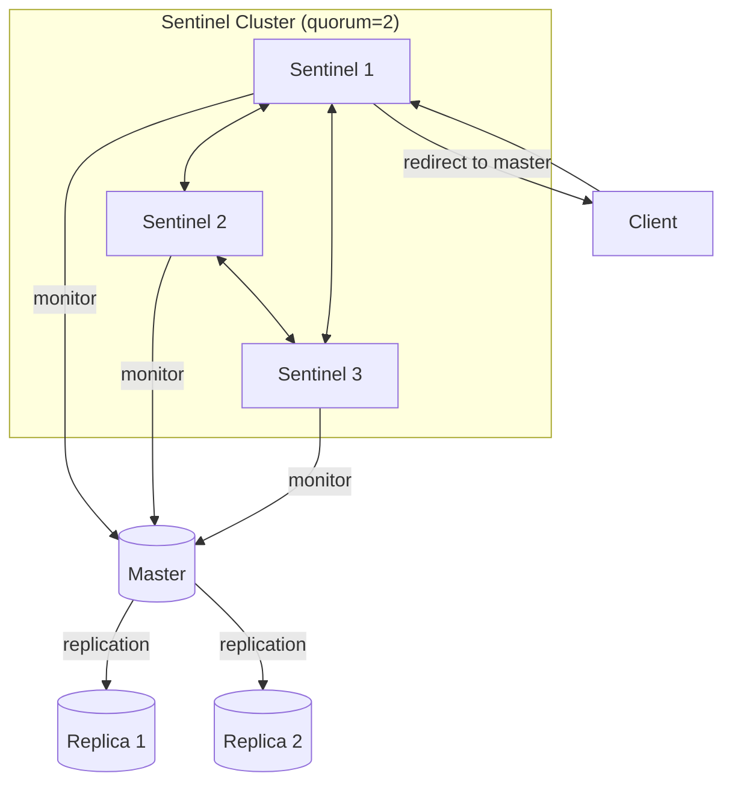
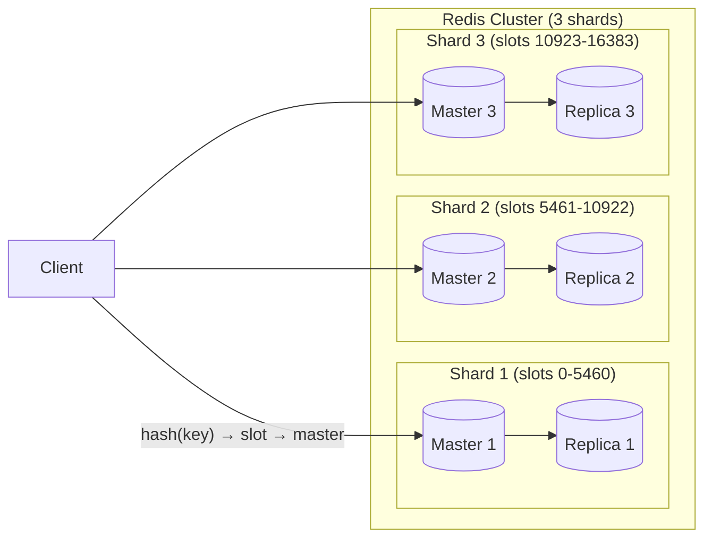

# Основы Redis для кеширования

> Структуры данных, RDB/AOF, Pub/Sub, Sentinel, Cluster и Lua.

## Содержание

- [Внутреннее устройство](#внутреннее-устройство)
- [Подводные камни](#подводные-камни)
- [См. также](#см-также)

## Внутреннее устройство

### Single-Threaded Event Loop

Redis (до версии 6) — однопоточный. Все команды выполняются последовательно в одном потоке. Нет race conditions, нет mutex.



`epoll` (Linux) / `kqueue` (macOS) — позволяет одному потоку мониторить тысячи сокетов одновременно без блокировки.

**Redis 6+** — добавлены I/O threads для чтения/записи сетевых данных, но выполнение команд по-прежнему однопоточное. Включение и поведение I/O threads зависят от версии и конфигурации; наличие потоков не означает параллельное выполнение всех команд.

**Следствие:** долгие команды (`KEYS *`, `SMEMBERS` на огромном Set) **блокируют весь Redis**. Используй `SCAN` вместо `KEYS *`.

### Persistence — RDB и AOF

**RDB (Redis Database Snapshot):**
- Полный снимок данных в бинарный файл через заданные интервалы
- `SAVE` — синхронный (блокирует), `BGSAVE` — фоновой записью после `fork()` (сам fork может вызвать паузу)
- Быстрый перезапуск (загрузка одного файла)
- Риск: потеря данных между снапшотами

```bash
# redis.conf
save 900 1      # снапшот если >= 1 изменение за 900 сек
save 300 10     # снапшот если >= 10 изменений за 300 сек
save 60 10000   # снапшот если >= 10000 изменений за 60 сек
dbfilename dump.rdb
```

**AOF (Append-Only File):**
- Каждая команда записи дописывается в файл (append-only)
- Восстановление = воспроизведение всех команд из файла
- Durability: `appendfsync always` (каждая запись), `everysec` (раз в секунду), `no` (ОС решает)
- Файл растёт → `BGREWRITEAOF` компактирует (убирает промежуточные состояния)

```bash
appendonly yes
appendfsync everysec   # компромисс: обычно около секунды потенциальной потери, не жёсткая гарантия
auto-aof-rewrite-percentage 100
auto-aof-rewrite-min-size 64mb
```

**RDB + AOF:** можно использовать одновременно — при перезапуске AOF используется для восстановления (более полный), RDB — для быстрого бэкапа.

| | RDB | AOF |
|-|-----|-----|
| Дурабилити | Низкая (периодически) | Высокая (`everysec` ≈ 1с при штатном fsync) |
| Восстановление | Быстрое | Медленное (replay команд) |
| Размер файла | Меньше | Больше (grows over time) |
| CPU overhead | Низкий | Умеренный |

### Структуры данных Redis

#### String

Базовый тип — бинарная строка до 512 MB. Умеет хранить int/float и делать атомарные инкременты.

```bash
SET user:42:name "Alice"          # простая строка
SET user:42:lock "owner-token" NX PX 30000  # lease with expiration
SETEX session:abc123 3600 "data"  # set + TTL (секунды)
INCR page:42:views                # атомарный инкремент
INCRBY balance:user1 100          # атомарный += 100
GETSET old_value new_value        # GET + SET атомарно
MSET k1 v1 k2 v2 k3 v3           # multi-set
MGET k1 k2 k3                    # multi-get
```

Внутренняя кодировка: `int` (если число), `embstr` (строки до 44 байт), `raw` (длиннее).

#### List

Реализация зависит от версии и размера: современные Redis используют компактное хранение и quicklist/listpack, а не отдельный узел на каждый элемент. O(1) push/pop с обоих концов, O(N) для доступа по индексу.

```bash
LPUSH queue task1 task2 task3     # добавить в начало (или RPUSH в конец)
RPOP queue                        # извлечь из конца (FIFO-очередь)
LRANGE mylist 0 -1                # все элементы
BLPOP queue 30                    # blocking pop, ждёт 30 секунд
LLEN queue                        # длина списка
```

**Применение:** очереди задач (`LPUSH` + `BRPOP`), последние N активностей (`LPUSH` + `LTRIM`).

#### Set

Неупорядоченное множество уникальных строк. O(1) add/remove/check.

```bash
SADD tags:post:1 "redis" "cache" "nosql"
SISMEMBER tags:post:1 "redis"     # проверка вхождения
SMEMBERS tags:post:1              # все элементы (осторожно: O(N))
SCARD tags:post:1                 # количество элементов
SUNION tags:post:1 tags:post:2    # объединение множеств
SINTER tags:post:1 tags:post:2    # пересечение
SDIFF tags:post:1 tags:post:2     # разность
SSCAN tags:post:1 0 COUNT 100     # итерация (вместо SMEMBERS для больших)
```

**Применение:** уникальные посетители, теги, online users.

#### Sorted Set (ZSet)

Множество строк, каждая с числовым score. Упорядочено по score. O(log N) операции.

```bash
ZADD leaderboard 1500 "alice"
ZADD leaderboard 2000 "bob"
ZADD leaderboard 1750 "charlie"

ZRANGE leaderboard 0 -1 WITHSCORES    # по возрастанию score
ZREVRANGE leaderboard 0 2             # топ-3 (убывание)
ZRANK leaderboard "alice"             # позиция (0-based)
ZINCRBY leaderboard 50 "alice"        # +50 к score
ZRANGEBYSCORE leaderboard 1000 2000   # по диапазону score
ZCOUNT leaderboard 1000 2000          # количество в диапазоне
```

**Применение:** лидерборды, приоритетные очереди, временны́е series (score = timestamp), rate limiting (sliding window).

#### Hash

Словарь строк внутри одного ключа. Эффективен для хранения объектов.

```bash
HSET user:42 name "Alice" email "alice@example.com" age 30
HGET user:42 name                 # получить одно поле
HMGET user:42 name email          # несколько полей
HGETALL user:42                   # все поля и значения
HINCRBY user:42 age 1             # атомарный инкремент поля
HDEL user:42 age                  # удалить поле
HEXISTS user:42 email             # проверить наличие поля
```

Внутри: если мало полей и значения маленькие — `listpack` в современных версиях (`ziplist` в старых), иначе `hashtable`.

**Применение:** хранение объектов (вместо JSON-строки + десериализации на каждое поле).

#### Stream

Append-only лог с consumer groups (как Kafka-lite). Введён в Redis 5.

```bash
# Producer
XADD orders * userId 42 productId 100 amount 500

# Consumer (с consumer group)
XGROUP CREATE orders payment-group $ MKSTREAM
XREADGROUP GROUP payment-group consumer1 COUNT 10 BLOCK 0 STREAMS orders >
XACK orders payment-group 1234567890123-0  # подтверждение
```

**ID записи:** `timestamp-sequence` (например `1701234567890-0`). Уникален в потоке.

#### HyperLogLog

Probabilistic структура для подсчёта уникальных элементов. Погрешность ~0.81%, памяти — максимум 12KB независимо от числа элементов.

```bash
PFADD unique-visitors user1 user2 user3
PFADD unique-visitors user1 user4   # дубль user1 не считается
PFCOUNT unique-visitors             # ≈4 (с погрешностью)
PFMERGE total uv:day1 uv:day2       # объединение
```

**Применение:** подсчёт уникальных посетителей сайта, уникальные запросы — там где точность не критична и данных огромно.

#### Bitmap и Bitfield

```bash
# Bitmap: присутствие пользователя по дням (битовый массив)
SETBIT activity:user:42 15 1      # день 15 → активен
GETBIT activity:user:42 15        # был ли активен в день 15
BITCOUNT activity:user:42         # сколько дней был активен
BITOP AND result key1 key2        # AND двух bitmap (общие активные дни)
```

**Применение:** ежедневная активность (1 бит на пользователя × 365 дней = 45 байт на пользователя), feature flags.

### Pub/Sub

```bash
# Subscriber
SUBSCRIBE channel:notifications

# Publisher
PUBLISH channel:notifications "New message!"

# Pattern subscribe (wildcard)
PSUBSCRIBE channel:*
```

**Ограничения Redis Pub/Sub:**
- Нет персистентности: если subscriber отключён — сообщения потеряны
- Нет consumer groups
- Нет acknowledgement

Для надёжного messaging используй **Redis Streams** (XADD/XREADGROUP) или Kafka.

### Redis Sentinel

Sentinel — мониторинг и failover для нешардированного primary-replica развёртывания:



При падении Master: Sentinel использует quorum для признания primary недоступным; для запуска failover нужна авторизация большинства Sentinel. Выбранная replica становится primary; Sentinel сообщает новое расположение клиентам.

**StackExchange.Redis** автоматически работает с Sentinel:
```csharp
var options = new ConfigurationOptions();
options.EndPoints.Add("sentinel1:26379");
options.EndPoints.Add("sentinel2:26379");
options.ServiceName = "mymaster";  // имя master в Sentinel
using var connection = ConnectionMultiplexer.Connect(options);
```

### Redis Cluster

Redis Cluster — горизонтальное масштабирование через шардирование:



**16384 hash slots:** каждый ключ хешируется → номер слота 0..16383 → назначен определённому мастеру.

```
slot = CRC16(key) % 16384
```

**Hash Tags:** `{user}.profile` и `{user}.cart` → один слот (только часть в `{}` хешируется) → можно выполнять multi-key команды вроде MGET для этой группы. Pipeline сам по себе не требует общего slot и не делает команды атомарными.

**Ограничения кластера:** нельзя делать команды на ключи из разных слотов (`MGET key1 key2` если key1 и key2 на разных шардах → ошибка). Используй Hash Tags или pipeline с routing.

### Lua Scripting (EVAL)

Lua-скрипты выполняются **атомарно** — никакие другие команды не прерывают скрипт. Решает проблему TOCTOU (check-then-act).

```lua
-- Distributed lock release (атомарно: проверить + удалить)
-- KEYS[1] = lock key, ARGV[1] = expected value
local current = redis.call('GET', KEYS[1])
if current == ARGV[1] then
    return redis.call('DEL', KEYS[1])
else
    return 0
end
```

```csharp
// Вызов Lua через StackExchange.Redis
var script = @"
    local current = redis.call('GET', KEYS[1])
    if current == ARGV[1] then
        return redis.call('DEL', KEYS[1])
    else
        return 0
    end
";

var result = await _db.ScriptEvaluateAsync(script,
    keys: new RedisKey[] { lockKey },
    values: new RedisValue[] { lockValue });
```

`EVALSHA` — вычислить SHA1 скрипта один раз через `SCRIPT LOAD`, затем вызывать по хешу (быстрее, нет передачи кода).

Асинхронная репликация допускает потерю подтверждённых записей при failover. Sentinel не заменяет persistence и backups. Для проверки реализации конкретного типа используй `OBJECT ENCODING`; пороги компактного хранения зависят от версии и настроек.

[Redis persistence](https://redis.io/docs/latest/operate/oss_and_stack/management/persistence/), [оптимизация памяти Redis](https://redis.io/docs/latest/operate/oss_and_stack/management/optimization/memory-optimization/).

## Подводные камни

Replication, persistence и backup решают разные задачи. Долгая команда или Lua-скрипт задерживает другие операции; SCAN тоже требует контроля объёма работы.

## См. также

- [Кеширование в .NET](./06-dotnet-cache.md)
- [Практические паттерны Redis](./09-practical-patterns.md)
- [Оглавление раздела](./README.md)
