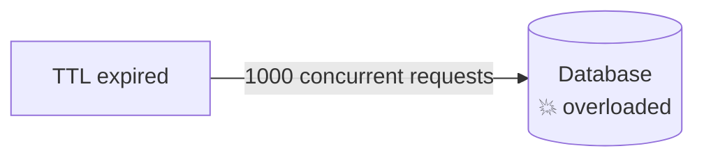

# Stampede, penetration, avalanche и hot key

> Как кеш может перегрузить источник и какие меры помогают.

## Содержание

- [Cache Stampede (Thundering Herd)](#cache-stampede-thundering-herd)
- [Cache Penetration (пробивание кеша)](#cache-penetration-пробивание-кеша)
- [Cache Avalanche (лавина)](#cache-avalanche-лавина)
- [Hot Key](#hot-key)
- [Подводные камни](#подводные-камни)
- [См. также](#см-также)

## Cache Stampede (Thundering Herd)

**Проблема:** TTL истёк у популярного ключа → одновременно N запросов идут в БД → перегрузка.



**Решение 1: Lock per key (Mutex)**

```csharp
private readonly ConcurrentDictionary<string, SemaphoreSlim> _locks = new();

public async Task<T?> GetOrCreateAsync<T>(string key, Func<Task<T>> factory, TimeSpan ttl)
{
    // Быстрый путь: кеш есть
    var cached = await _cache.GetStringAsync(key);
    if (cached is not null) return JsonSerializer.Deserialize<T>(cached);

    // Медленный путь: берём лок на ключ
    var semaphore = _locks.GetOrAdd(key, _ => new SemaphoreSlim(1, 1));
    await semaphore.WaitAsync();
    try
    {
        // Double-check после получения лока
        cached = await _cache.GetStringAsync(key);
        if (cached is not null) return JsonSerializer.Deserialize<T>(cached);

        var value = await factory();
        await _cache.SetStringAsync(key,
            JsonSerializer.Serialize(value),
            new DistributedCacheEntryOptions { AbsoluteExpirationRelativeToNow = ttl });
        return value;
    }
    finally
    {
        semaphore.Release();
    }
}
```

**Решение 2: раннее обновление**

Можно начать refresh до окончания TTL — по порогу либо с вероятностью, которая растёт по мере приближения expiration. Обновление тоже должно иметь защиту от дублирования. В XFetch вероятность учитывает время предыдущего пересчёта: фиксированная случайная величина без этой оценки — лишь эвристика.

Локальный `SemaphoreSlim` защищает только один процесс. Словарь `_locks` в учебном примере растёт с числом уникальных ключей; в production нужен ограниченный жизненный цикл keyed locks. Простое удаление semaphore после `Release` небезопасно: другие запросы уже могут ждать старый объект.


## Cache Penetration (пробивание кеша)

**Проблема:** запросы по несуществующим ключам всегда идут в БД (кеш не кешируется miss).

```
GET user:99999999  → cache MISS → DB → not found → cache MISS → DB → not found → ...
```

**Решение 1: Null Caching** — кешировать отсутствие значения:

```csharp
var product = await _db.FindAsync(id);

// Кешируем и null (короткий TTL)
var json = product is null ? "null" : JsonSerializer.Serialize(product);
await _cache.SetStringAsync(key, json,
    new DistributedCacheEntryOptions
    {
        AbsoluteExpirationRelativeToNow = product is null
            ? TimeSpan.FromMinutes(1)   // null кешируем ненадолго
            : TimeSpan.FromMinutes(30)
    });
```

**Решение 2: Bloom Filter** — вероятностная структура, отвечающая «точно нет / возможно есть»:

```csharp
// BloomFilter проверяет: есть ли этот ID в БД?
// False positive возможен, false negative — нет
if (!_bloomFilter.MightContain(id))
{
    return null;  // точно нет → не идём в БД
}

// Идём в кеш/БД только для потенциально существующих ID
```

Bloom Filter хранится в Redis как Bitmap. NRedisBloom — .NET клиент для RedisBloom модуля.

Отрицательный ответ может устареть после создания записи — инвалидируй его при записи. Bloom filter не имеет false negatives только при корректном наполнении: пропущенное обновление фильтра превращается в ошибочное «нет».

## Cache Avalanche (лавина)

**Проблема:** массовое истечение TTL у многих ключей одновременно → резкий рост нагрузки на БД.

**Происходит когда:** кеш прогревается после деплоя, все ключи устанавливаются с одинаковым TTL.

**Решение: Jitter (случайный разброс TTL)**

```csharp
private TimeSpan GetJitteredTtl(TimeSpan baseTtl, double jitterFactor = 0.1)
{
    // Разброс ±10% от базового TTL
    var jitter = baseTtl.TotalSeconds * jitterFactor * (Random.Shared.NextDouble() * 2 - 1);
    return TimeSpan.FromSeconds(baseTtl.TotalSeconds + jitter);
}

// Использование
await _cache.SetStringAsync(key, value,
    new DistributedCacheEntryOptions
    {
        AbsoluteExpirationRelativeToNow = GetJitteredTtl(TimeSpan.FromMinutes(30))
        // Реальный TTL: от 27 до 33 минут → равномерное распределение истечений
    });
```

**Решение 2:** предварительный прогрев кеша через `IHostedService` при старте.

## Hot Key

**Проблема:** один ключ читается миллионы раз в секунду → один Redis-шард перегружен.

**Решение 1: Локальный L1-кеш** перед Redis:

```csharp
public async Task<Product?> GetAsync(int id, CancellationToken ct)
{
    var key = $"product:{id}";

    // L1: in-process (очень быстро, но устаревает)
    if (_memoryCache.TryGetValue(key, out Product? cached))
        return cached;

    // L2: Redis
    var redisValue = await _db.StringGetAsync(key);
    var product = redisValue.HasValue
        ? JsonSerializer.Deserialize<Product>(redisValue!)
        : null;

    // Кладём в L1 с коротким TTL
    _memoryCache.Set(key, product, TimeSpan.FromSeconds(5));
    return product;
}
```

**Решение 2: Key Replication** — реплицировать hot key на несколько Redis-ключей:

```csharp
// Вместо "product:popular:1" → "product:popular:1:shard:{0..N}"
var shardId = Random.Shared.Next(0, 10);
var key = $"product:popular:1:shard:{shardId}";
// Нагрузка распределяется по 10 ключам на разные шарды
```

Разные суффиксы не гарантируют разные шарды. Проверь размещение hash slots; общий hash tag `{...}` намеренно удерживает ключи в одном слоте. Репликация значений усложняет обновление всех копий.

## Подводные камни

При недоступности кеша массовый fallback перегружает БД. Ограничивай конкурентные загрузки и задавай timeout; локальные locks не координируют разные процессы.

## См. также

- [Кеширование в .NET](./06-dotnet-cache.md)
- [Инвалидация и консистентность](./07-invalidation-consistency.md)
- [Оглавление раздела](./README.md)
