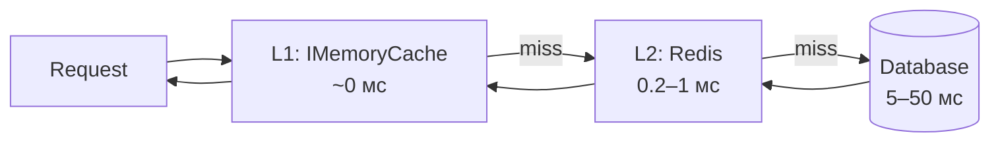

# Практические паттерны Redis

> L1/L2, distributed leases, rate limiting и session storage.

## Содержание

- [Multi-Level Cache L1→L2→DB](#multi-level-cache-l1l2db)
- [Distributed Lock (Redlock)](#distributed-lock-redlock)
- [Rate Limiting — скользящее окно на Redis](#rate-limiting--скользящее-окно-на-redis)
- [Session Storage](#session-storage)
- [Подводные камни](#подводные-камни)
- [См. также](#см-также)

## Multi-Level Cache L1→L2→DB



```csharp
/// <summary>
/// Two-level cache: in-process L1 backed by Redis L2.
/// </summary>
public class TwoLevelCache
{
    private readonly IMemoryCache _l1;
    private readonly IDatabase _l2;

    public TwoLevelCache(IMemoryCache l1, IConnectionMultiplexer redis)
    {
        _l1 = l1;
        _l2 = redis.GetDatabase();
    }

    public async Task<T?> GetOrCreateAsync<T>(
        string key,
        Func<Task<T?>> factory,
        TimeSpan l1Ttl,
        TimeSpan l2Ttl)
    {
        // L1
        if (_l1.TryGetValue(key, out T? l1Value))
            return l1Value;

        // L2
        var l2Bytes = await _l2.StringGetAsync(key);
        if (l2Bytes.HasValue)
        {
            var l2Value = JsonSerializer.Deserialize<T>(l2Bytes!);
            _l1.Set(key, l2Value, l1Ttl);
            return l2Value;
        }

        // DB
        var value = await factory();
        if (value is not null)
        {
            var json = JsonSerializer.SerializeToUtf8Bytes(value);
            await _l2.StringSetAsync(key, json, l2Ttl);
            _l1.Set(key, value, l1Ttl);
        }

        return value;
    }
}
```

## Distributed Lock (Redlock)

Простой distributed lock через один Redis:

```csharp
/// <summary>
/// Distributed lock backed by a single Redis instance.
/// Lease expiration may allow another owner to enter.
/// </summary>
public class RedisLock : IAsyncDisposable
{
    private readonly IDatabase _db;
    private readonly string _key;
    private readonly string _value;  // уникальный токен владельца

    private RedisLock(IDatabase db, string key, string value)
    {
        _db = db;
        _key = key;
        _value = value;
    }

    public static async Task<RedisLock?> TryAcquireAsync(
        IDatabase db, string resource, TimeSpan ttl)
    {
        var token = Guid.NewGuid().ToString("N");
        // SET NX EX: атомарно, только если ключа нет
        var acquired = await db.StringSetAsync(
            $"lock:{resource}", token, ttl, When.NotExists);

        return acquired ? new RedisLock(db, $"lock:{resource}", token) : null;
    }

    public async ValueTask DisposeAsync()
    {
        // Lua: проверить владельца и удалить атомарно
        const string releaseScript = @"
            if redis.call('get', KEYS[1]) == ARGV[1] then
                return redis.call('del', KEYS[1])
            else
                return 0
            end";

        await _db.ScriptEvaluateAsync(releaseScript,
            new RedisKey[] { _key },
            new RedisValue[] { _value });
    }
}

// Использование
await using var @lock = await RedisLock.TryAcquireAsync(db, "cache-refresh:product:42", TimeSpan.FromSeconds(30));
if (@lock is null)
    throw new InvalidOperationException("Could not acquire lock");

// Критическая секция
await RefreshProductCacheAsync();
// lock освобождается при Dispose
```

**Redlock (для нескольких Redis-инстансов):** lock считается захваченным если получен на `N/2 + 1` независимых Redis-серверах. Библиотека: `RedLock.net`.

TTL превращает lock в lease: после истечения другой владелец может начать работу, пока первый ещё выполняется. Токен защищает release чужого lock, но не защищает ресурс от запоздавшей записи. При необходимости ресурс проверяет fencing token. Redlock требует независимых серверов и дополнительных допущений о времени; primary и его replicas не являются независимыми участниками.

## Rate Limiting — скользящее окно на Redis

Sliding window хранит принятые запросы в Sorted Set. Очистка окна, проверка лимита и добавление должны выполняться атомарно. Timestamp не подходит как уникальный member: два запроса могут прийти в одну миллисекунду.

```csharp
public async Task<bool> IsAllowedAsync(string subject, int limit, TimeSpan window)
{
    if (limit <= 0 || window.TotalMilliseconds < 1)
        throw new ArgumentOutOfRangeException(nameof(limit), "Invalid rate limit settings");

    const string script = @"
        local clock = redis.call('TIME')
        local now = clock[1] * 1000 + math.floor(clock[2] / 1000)
        local duration = tonumber(ARGV[1])
        local limit = tonumber(ARGV[2])
        redis.call('ZREMRANGEBYSCORE', KEYS[1], '-inf', now - duration)
        if redis.call('ZCARD', KEYS[1]) >= limit then
            return 0
        end
        redis.call('ZADD', KEYS[1], now, ARGV[3])
        redis.call('PEXPIRE', KEYS[1], duration)
        return 1";

    var result = await _db.ScriptEvaluateAsync(script,
        new RedisKey[] { $"ratelimit:{subject}" },
        new RedisValue[] { (long)window.TotalMilliseconds, limit, Guid.NewGuid().ToString("N") });

    return (long)result == 1;
}
```

`_db` — `IDatabase`, полученный из общего `ConnectionMultiplexer`. Время берётся с Redis, member уникален; отклонённые запросы не записываются. Один key позволяет работать в одном slot Redis Cluster. Для production отдельно выбери поведение при недоступности Redis, ограничь размер ключей и учитывай скачки серверного времени.

Token Bucket хранит остаток токенов и время пополнения; consume/refill тоже выполняют одним Lua-скриптом.


## Session Storage

Redis — классическое место для сессий:

```csharp
// Program.cs
builder.Services.AddStackExchangeRedisCache(options =>
{
    options.Configuration = "localhost:6379";
    options.InstanceName = "session:";
});

builder.Services.AddSession(options =>
{
    options.IdleTimeout = TimeSpan.FromMinutes(30);
    options.Cookie.HttpOnly = true;
    options.Cookie.IsEssential = true;
});

// Middleware
app.UseSession();

// Использование в контроллере
HttpContext.Session.SetString("user_id", userId);
var stored = HttpContext.Session.GetString("user_id");
```

Данные сессии хранятся в Redis с ключом вида `session:{sessionId}`. TTL обновляется при каждом обращении (sliding expiration).

## Подводные камни

TwoLevelCache — учебный пример без single-flight. Оба уровня нуждаются в инвалидации; session storage требует общей защиты cookie keys при нескольких instances.

## См. также

- [Инвалидация и консистентность](./07-invalidation-consistency.md)
- [Stampede, penetration, avalanche и hot key](./08-cache-problems.md)
- [Оглавление раздела](./README.md)
