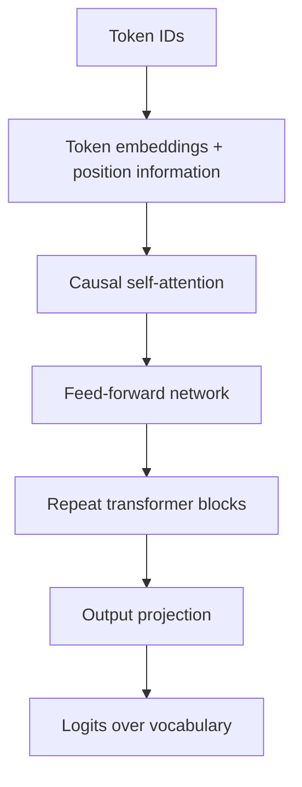

# Основы LLM: от токена до ответа

> Устройство генерации объясняет ограничения контекста, стоимость запросов и причины ошибок модели.

## Содержание

- [Токенизация и embeddings](#токенизация-и-embeddings)
- [Transformer и attention](#transformer-и-attention)
- [Генерация и sampling](#генерация-и-sampling)
- [Контекст и KV-cache](#контекст-и-kv-cache)
- [Подводные камни](#подводные-камни)

## Токенизация и embeddings

Генеративная авторегрессионная LLM вычисляет распределение следующего токена по предыдущим:

```text
P(token_n | token_1, ..., token_n-1)
```

Токен — элемент словаря: слово, часть слова, знак или специальный маркер. Токенизатор переводит текст в последовательность числовых ID. Конкретная разбивка зависит от модели: одно слово не обязано соответствовать одному токену.

BPE строит словарь, последовательно объединяя частые соседние пары исходных символов или байтов. Это один из способов токенизации; SentencePiece — библиотека с поддержкой разных алгоритмов, включая BPE и Unigram.

На входе модели ID заменяется строкой из обученной матрицы embeddings. Получается вектор размерности `d_model`. После слоёв Transformer представление токена уже зависит от окружения. Такой embedding токена следует отличать от [вектора целого документа для поиска](./08-rag-and-memory.md).

Число токенов зависит от языка, текста и словаря. Оценка по числу символов подходит только для грубого планирования; лимиты проверяют токенизатором выбранной модели.

## Transformer и attention

Transformer предложен в статье [Attention Is All You Need](https://arxiv.org/abs/1706.03762). Ниже — упрощённая схема генеративной модели с decoder-блоками; положение нормализации и устройство FFN различаются между архитектурами.



Позиционная информация позволяет учитывать порядок. Она может добавляться к embeddings или участвовать в attention, как в RoPE.

Для attention из представлений токенов получают матрицы **Query**, **Key** и **Value**:

```text
Attention(Q, K, V) = softmax(Q × Kᵀ / sqrt(d_k) + mask) × V
```

Query сравнивается с Keys, веса после softmax определяют вклад Values. Multi-head attention считает несколько таких преобразований. Causal mask запрещает позиции видеть будущие токены, но позволяет видеть себя и предыдущие позиции.

FFN преобразует представление каждой позиции отдельно. Residual connections и нормализация связывают операции в блоке. Знания представлены параметрами всей сети; сводить их к одной таблице или одному типу слоёв некорректно.

## Генерация и sampling

Модель выдаёт **logits** — оценки для токенов словаря. После преобразования в вероятности выбирается следующий токен, добавляется к последовательности, и цикл повторяется.

| Способ | Что происходит |
|---|---|
| Greedy | Выбирается токен с максимальной оценкой |
| Temperature | Logits масштабируются как `logits / T`; меньшая температура концентрирует распределение |
| Top-k | Для выбора остаются `k` наиболее вероятных токенов |
| Top-p | Остаётся набор наиболее вероятных токенов с суммарной вероятностью не ниже `p` |

Sampling меняет выбор токена, а не веса. Низкая температура не гарантирует истинность ответа; воспроизводимость зависит также от реализации инференса.

## Контекст и KV-cache

Context window ограничивает объём информации в одном обращении к модели. В бюджет входят инструкции, сообщения, схемы инструментов, результаты и генерируемые токены; конкретный учёт зависит от API.

При **prefill** обрабатывается входной контекст. При **decode** генерируется продолжение. KV-cache хранит Keys и Values прошлых позиций, чтобы не вычислять их заново на каждом шаге. Новый токен по-прежнему использует доступные прошлые позиции в attention. Подробнее: [Hugging Face — Cache strategies](https://huggingface.co/docs/transformers/en/kv_cache).

Для обычного полного attention объём попарных взаимодействий при prefill растёт квадратично с длиной входа. Это не универсальная оценка всех архитектур и всех стадий инференса: кеширование и варианты attention меняют профиль затрат.

## Подводные камни

- Большое окно не гарантирует, что модель использует каждый важный фрагмент.
- KV-cache ускоряет вычисления, но расходует память и не заменяет базу знаний.
- Правдоподобное продолжение может содержать фактическую ошибку.
- Текст вне переданного контекста не становится доступен модели только потому, что существовал в прошлой сессии.

## См. также

- [Обучение модели](./02-training.md)
- [Inference, streaming и кеширование](./03-inference.md)
- [Навигация и глоссарий](./README.md)
