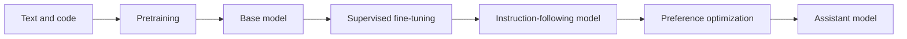

# Обучение модели и поведение ассистента

> Обучение меняет веса модели; инструкции и найденные документы меняют вход конкретного запроса.

## Содержание

- [Pretraining](#pretraining)
- [SFT и обучение на предпочтениях](#sft-и-обучение-на-предпочтениях)
- [Роли сообщений](#роли-сообщений)
- [Подводные камни](#подводные-камни)

## Pretraining

На предобучении авторегрессионная модель учится предсказывать токены на большом корпусе текста и кода. Целевые токены берутся из самого текста, поэтому это self-supervised learning.

Результат — base model: она умеет продолжать последовательность, но без дополнительного обучения не обязана вести себя как полезный ассистент. Правдоподобное продолжение вопроса может быть ответом, новым вопросом или фрагментом статьи.

## SFT и обучение на предпочтениях

**Supervised Fine-Tuning (SFT)** использует примеры желаемого поведения: инструкцию, контекст и хороший ответ. Примеры могут включать диалоги и вызовы инструментов.

Обучение на предпочтениях помогает выбрать желательное поведение среди нескольких возможных ответов:

| Подход | Механизм |
|---|---|
| RLHF | Обратная связь людей используется для обучения поведения; классическая схема включает reward model и RL-оптимизацию, например PPO |
| RLAIF | Источником обратной связи выступает другая AI-система |
| DPO | Модель напрямую обучается на парах предпочитаемых и отвергнутых ответов без отдельного RL-цикла и явно обучаемой reward model |

DPO — альтернатива классической схеме RLHF, а не другое название PPO. Механизм описан в статье [Direct Preference Optimization](https://arxiv.org/abs/2305.18290).



Это учебная схема, а не обязательный рецепт: реальные пайплайны могут чередовать стадии и использовать дополнительные задачи, включая обучение рассуждениям и работе с инструментами.

## Роли сообщений

Chat API передаёт сообщения с ролями и метаданными. Пример условного представления:

```json
[
  {"role": "system", "content": "You are a .NET tutor."},
  {"role": "user", "content": "Explain boxing."},
  {"role": "assistant", "content": "Boxing wraps a value in an object."}
]
```

Модель обучают следовать иерархии инструкций. Роли, их названия и приоритеты зависят от API. Сам текст `system` внутри пользовательского документа не превращает документ в системную инструкцию.

Такое следование — поведение модели, а не механизм контроля доступа. Если приложение запрещает удаление файлов, оно должно проверять это до выполнения инструмента, независимо от ответа модели.

## Подводные камни

- SFT и alignment не обеспечивают безошибочность и абсолютную защиту от prompt injection.
- В обычном инференсе сообщение пользователя не обновляет веса.
- Fine-tuning может изменить знания и поведение, но не заменяет получение свежих данных.
- Формулировка системного промпта не заменяет ограничения приложения.

## См. также

- [Основы LLM](./01-llm-fundamentals.md)
- [Harness и разрешения](./05-harness.md)
- [Оценка и надёжность](./09-reliability.md)
