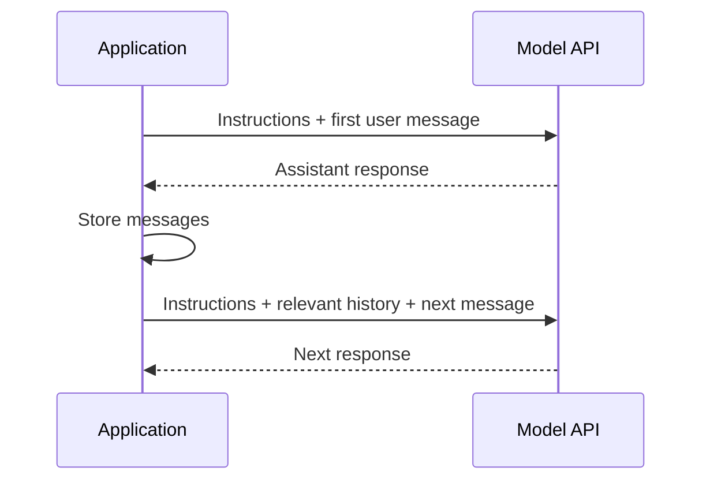

# Inference: контекст, streaming и стоимость

> Стоимость и задержка зависят от входного контекста, генерации и числа обращений к модели.

## Содержание

- [Что передаёт приложение](#что-передаёт-приложение)
- [Streaming](#streaming)
- [Параметры генерации](#параметры-генерации)
- [Prompt caching и стоимость](#prompt-caching-и-стоимость)
- [Подводные камни](#подводные-камни)

## Что передаёт приложение

Для генерации нужны инструкции и доступный контекст. В stateless API приложение передаёт необходимые сообщения заново. В API с серверным хранением истории оно может сослаться на сохранённую беседу; сервис восстановит контекст перед инференсом.



Хранение истории — функция приложения или сервиса. Оно не означает, что веса модели изменились или что модель сама помнит пользователя.

## Streaming

В обычном режиме клиент получает результат после завершения генерации. В streaming-режиме части ответа поступают по мере готовности, например через Server-Sent Events.

Streaming сокращает ожидание первого видимого текста по сравнению с ожиданием всего ответа. Он не ускоряет само вычисление токенов. Измерять полезно отдельно время до первого фрагмента, скорость дальнейшей генерации и полную задержку.

Условный C# пример потребления потока, независимый от конкретного SDK:

```csharp
static async Task WriteResponseAsync(
    IAsyncEnumerable<string> chunks,
    CancellationToken cancellationToken)
{
    await foreach (var chunk in chunks.WithCancellation(cancellationToken))
    {
        Console.Write(chunk);
    }
}
```

Отмену нужно передавать до сетевого запроса. Прекращение отрисовки само по себе не гарантирует прекращение генерации на сервере.

## Параметры генерации

| Параметр | Что учитывать |
|---|---|
| Лимит output-токенов | Может оборвать ответ или оставить недостаточно бюджета для рассуждения |
| Temperature, top-p, top-k | Управляют sampling; поддерживаются не всеми моделями |
| Stop sequences | Могут завершить генерацию при совпадении; поддержка зависит от API |
| Системные инструкции | Задают поведение, но не являются проверкой доступа |

Названия полей и смысл лимитов проверяют по документации выбранного API. Результат с причиной завершения «исчерпан лимит» нельзя автоматически считать полным ответом.

## Prompt caching и стоимость

Prompt caching переиспользует вычисления для подходящей повторяющейся части входа. Для prefix caching важен общий префикс: стабильные инструкции и схемы удобно помещать раньше изменяющихся сообщений. Основу такого переиспользования показывает [документация KV-cache](https://huggingface.co/docs/transformers/en/kv_cache).

Условия попадания в кеш, минимальный размер, TTL и тарифы задаёт провайдер. Кеш не гарантирован и не расширяет context window.

Упрощённая оценка оплаты одного обращения:

```text
cost = uncached_input_tokens × input_rate
     + cached_input_tokens × cached_input_rate
     + output_tokens × output_rate
```

Тарифы в формуле должны быть приведены к одной единице, например цене за токен. Отдельно могут оплачиваться запись кеша, инструменты и другие ресурсы.

В агентной задаче расходы суммируются по всем обращениям, включая подагентов, суммаризацию и повторную передачу истории. Полезно сохранять usage из API и измерять стоимость завершённой задачи, а не только одного ответа.

## Подводные камни

- Локальная оценка токенов может не учитывать служебную разметку API.
- Повторный префикс может дать экономию вычислений без уменьшения логического размера входа.
- Возврат полного лога инструмента увеличивает затраты следующих шагов.
- Обрыв соединения после выполнения внешнего действия не означает, что действие не состоялось.

## См. также

- [KV-cache и контекст](./01-llm-fundamentals.md)
- [Вызовы инструментов](./04-tool-use.md)
- [Управление контекстом в harness](./05-harness.md)
