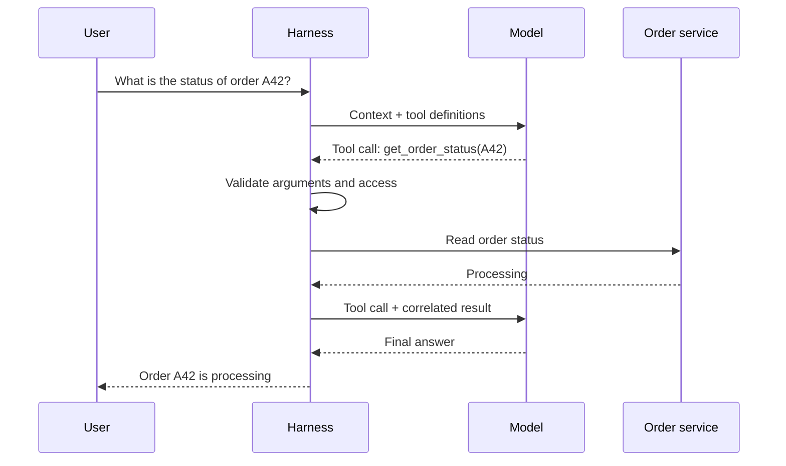

# Tool use и function calling

> Модель предлагает вызов функции, а приложение проверяет аргументы, выполняет действие и возвращает результат.

## Содержание

- [Контракт инструмента](#контракт-инструмента)
- [Цикл вызова](#цикл-вызова)
- [Параллельность и deferred tools](#параллельность-и-deferred-tools)
- [Подводные камни](#подводные-камни)

## Контракт инструмента

LLM не открывает файл и не выполняет SQL сама. Она генерирует структурированное описание действия. Выполнение принадлежит harness или инфраструктуре сервиса.

Инструмент описывают именем, назначением и схемой аргументов. Пример условного контракта, не привязанного к API:

```json
{
  "name": "get_order_status",
  "description": "Get the current status of an order by its ID.",
  "parameters": {
    "type": "object",
    "properties": {
      "orderId": {"type": "string", "description": "Order ID"}
    },
    "required": ["orderId"],
    "additionalProperties": false
  }
}
```

JSON Schema описывает структуру, но не доказывает существование заказа и право пользователя его читать. Эти проверки остаются в коде приложения. Имя инструмента следует разрешать через явный реестр, а не превращать произвольный текст модели в исполняемый код.

## Цикл вызова



В обычном клиентском цикле результат инструмента отправляется модели новым запросом. Ответ модели может содержать текст, несколько вызовов или запрос дополнительного действия. Приложение проверяет тип результата и причину завершения по контракту API.

Идентификатор вызова связывает результат с запросом. Ошибка инструмента передаётся как ошибка, а не как пустое «успешное» значение. Иначе модель продолжит работу с ложной предпосылкой.

## Параллельность и deferred tools

Независимые чтения можно выполнять параллельно, если это допускают лимиты и права доступа. Вызов, которому нужен результат предыдущего, выполняется последовательно. Несколько вызовов в ответе модели не делают их автоматически безопасными для параллельного выполнения.

При большом реестре схемы занимают заметную часть контекста. **Deferred tools** откладывают загрузку полных описаний до выбора нужного инструмента. Обнаружение может происходить через поиск по каталогу или отдельный инструмент; это возможность конкретного harness/API, а не обязательное свойство LLM.

## Подводные камни

- Правильный JSON не гарантирует правильного действия.
- Текст результата инструмента — внешние данные, которые могут содержать prompt injection.
- Повтор записывающего вызова после тайм-аута может дублировать действие; учитывают идемпотентность и фактический статус операции.
- Большой результат лучше ограничивать, сохраняя признаки ошибки и возможность запросить детали.

## См. также

- [Harness и разрешения](./05-harness.md)
- [MCP](./07-mcp.md)
- [Надёжность](./09-reliability.md)
