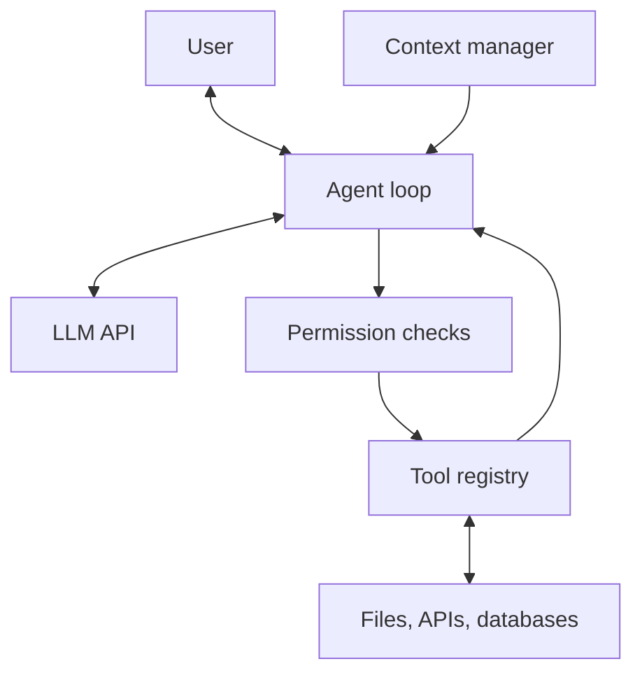

# Harness: приложение вокруг модели

> Harness управляет циклом работы, контекстом, выполнением инструментов и разрешениями.

## Содержание

- [Границы ответственности](#границы-ответственности)
- [Agentic loop](#agentic-loop)
- [Разрешения и служебный контекст](#разрешения-и-служебный-контекст)
- [Compaction](#compaction)
- [Подводные камни](#подводные-камни)

## Границы ответственности

Harness — программная обвязка вокруг модели: CLI, IDE-плагин, сервер приложения или их сочетание. Модель предлагает текст и действия. Harness формирует запросы, вызывает реальные системы и определяет, какие действия разрешены.

Термин не означает единственный стандартный набор функций. Например, память может находиться в отдельном сервисе, а часть инструментов исполняться у провайдера.

## Agentic loop

Минимальная последовательность:

1. Собрать инструкции, историю, данные и доступные инструменты.
2. Получить ответ модели.
3. Если нужен инструмент — проверить действие, выполнить его и добавить результат в историю.
4. Если задача завершена — вернуть ответ.
5. Если исчерпан бюджет или нужна помощь пользователя — остановиться с явным статусом.

Удобно различать состояния выполнения:

| Состояние | Следующее событие |
|---|---|
| Ожидание модели | Финальный ответ, запрос инструмента или ошибка |
| Ожидание разрешения | Одобрение, отказ или отмена |
| Выполнение инструмента | Результат, ошибка или отмена |
| Завершено | Новая задача запускает новый цикл |

Остановка по лимиту шагов не равна успешному выполнению. Harness должен сохранять это различие в результате задачи.

## Разрешения и служебный контекст

Политику можно представить тремя исходами:

| Решение | Поведение |
|---|---|
| Allow | Выполнить в пределах выданных полномочий |
| Ask | Приостановить действие до явного решения пользователя |
| Deny | Отклонить и вернуть понятную причину |

Решение принимают по реальному действию, аргументам, субъекту и ресурсу. Наличие инструмента в списке не даёт безусловного доступа. Проверка приложения должна дополняться ограничениями ОС, БД и внешних API.

Служебные сообщения сообщают модели о состоянии среды, завершении фоновой операции или новых инструментах. Теги вроде `system-reminder` — соглашение конкретной системы. Сам тег не создаёт защищённую роль и не подтверждает происхождение текста.

## Compaction

История растёт после каждого обращения. Перед переполнением окна harness может:

- Сжать старые сообщения в резюме с целью, решениями, ограничениями и незавершённой работой.
- Сократить объёмные результаты, сохранив ссылки на исходные артефакты.
- Вынести самостоятельное исследование в отдельный контекст подагента.

Сжатие потенциально теряет детали. После него полезно повторно читать актуальные файлы и факты, от которых зависит действие. Резюме не должно превращать предположение в проверенный результат или отменять действующие ограничения.

## Подводные камни

- Инструкция «будь осторожен» не заменяет проверку разрешений.
- Бесконечный цикл инструментов расходует бюджет без гарантии прогресса.
- Нельзя считать обычный текст модели доказательством выполнения действия.
- Compaction и persistent memory решают разные задачи: уменьшение текущего контекста и сохранение сведений между сессиями.

## См. также

- [Tool use](./04-tool-use.md)
- [Агенты и подагенты](./06-agents.md)
- [RAG и память](./08-rag-and-memory.md)
