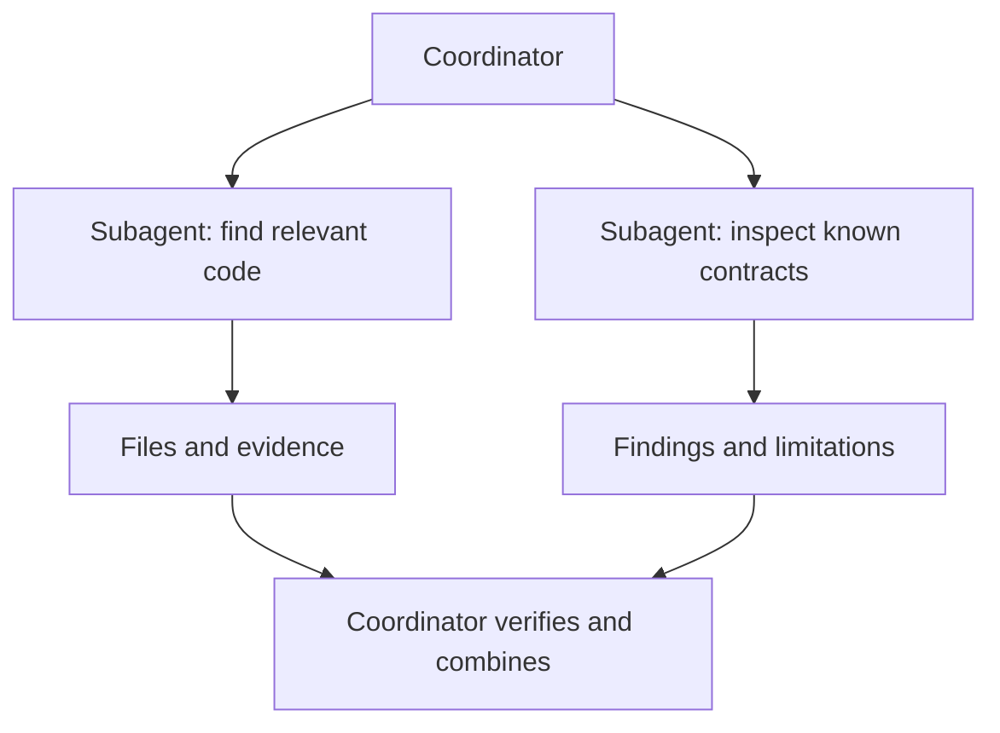

# Агенты, подагенты и оркестрация

> Отдельные агентные контексты помогают распределить работу, но требуют координации и проверки результатов.

## Содержание

- [Агент и workflow](#агент-и-workflow)
- [Зачем нужны подагенты](#зачем-нужны-подагенты)
- [Fresh и fork](#fresh-и-fork)
- [Оркестрация и компромиссы](#оркестрация-и-компромиссы)
- [Подводные камни](#подводные-камни)

## Агент и workflow

В workflow маршрут задан кодом: классифицировать запрос, вызвать выбранный обработчик, сформировать ответ. В агентной системе модель динамически выбирает дальнейшие шаги и инструменты по результатам работы. Такое различие предлагает [Anthropic — Building effective agents](https://www.anthropic.com/research/building-effective-agents).

Количество вызовов само по себе не определяет агента. Фиксированный конвейер может иметь много обращений к модели, а агент — завершить простую задачу за один шаг.

## Зачем нужны подагенты

При исследовании десятков файлов в историю попадают промежуточные данные, которые не нужны для дальнейшей работы. Подагент выполняет отдельную подзадачу в своей истории и возвращает координатору компактный результат.

Полезный результат включает выводы, источники, выполненные проверки и ограничения. Только краткого «всё хорошо» недостаточно для принятия решения.

## Fresh и fork

| | Fresh | Fork |
|---|---|---|
| Старт | Явно переданное задание и контекст | Снимок доступного контекста координатора |
| Сильная сторона | Узкая самостоятельная задача | Работа с уже накопленными деталями |
| Затраты | Зависят от размера задания | Обычно больше входных данных |
| Риск | Пропущены важные ограничения | Унаследованы шум и ошибочные предпосылки |

Это термины организации harness. Объём наследования и доступ к инструментам зависят от реализации. Fork не означает автоматическую синхронизацию будущих сообщений, общую память или гарантированный prompt-cache hit.

## Оркестрация и компромиссы

Координатор задаёт цель, границы, ожидаемый результат и доступные полномочия. Для изменений файлов полезно назначить владельцев непересекающихся участков. Если подзадача зависит от поиска файлов, её запускают после получения списка, а не одновременно с ним.

| Компромисс | Следствие |
|---|---|
| Параллельность | Может сократить задержку независимых задач |
| Несколько историй | Увеличивают суммарный расход токенов |
| Изоляция | Убирает промежуточный шум, но может потерять важные детали |
| Специализация | Позволяет ограничить инструменты и уточнить инструкции |
| Общие ресурсы | Создают конфликты записи и требуют согласования |

Подагент уместен, когда результат можно отделить от процесса его получения. Если координатору нужны все промежуточные детали, передача краткого отчёта даст мало пользы.

## Подводные камни

- Дополнительный агент не гарантирует независимую проверку: он может повторить те же ошибки.
- Собственный контекст не означает изоляцию файловой системы.
- Успех подзадач не доказывает корректность общего результата.
- Отмена координатора требует явной обработки незавершённых дочерних операций.

## См. также

- [Harness](./05-harness.md)
- [Стоимость инференса](./03-inference.md)
- [Оценка результата](./09-reliability.md)
