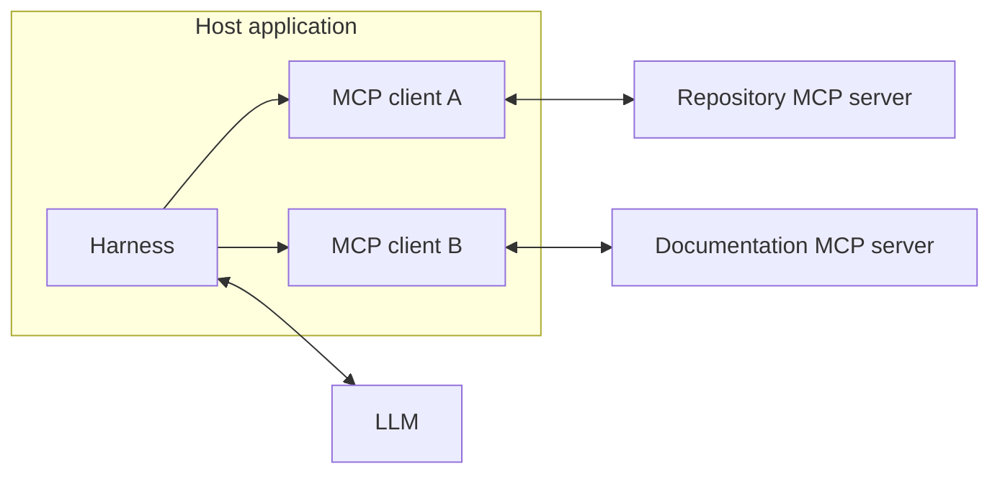

# MCP: подключение внешних инструментов

> MCP задаёт общий контракт интеграции приложений с инструментами и источниками контекста.

## Содержание

- [Host, client и server](#host-client-и-server)
- [Инструменты, ресурсы и промпты](#инструменты-ресурсы-и-промпты)
- [Транспорты](#транспорты)
- [Подводные камни](#подводные-камни)

## Host, client и server

Без общего протокола каждое приложение интегрируется с каждым источником своим способом. MCP стандартизирует обмен, позволяя независимо развивать приложение и сервер интеграции.

Согласно [обзору архитектуры MCP](https://modelcontextprotocol.io/docs/learn/architecture): **host** — приложение, **client** поддерживает связь с сервером внутри host, **server** предоставляет возможности.

Модель обычно получает описание инструмента в формате своего API. Преобразование MCP-возможностей и выполнение запросов организует host.

## Инструменты, ресурсы и промпты

| Возможность | Назначение |
|---|---|
| Tools | Операции с описанными аргументами и результатом |
| Resources | Данные и контекст, доступные приложению |
| Prompts | Переиспользуемые шаблоны взаимодействия |

Host обнаруживает поддерживаемые возможности и решает, как представить их пользователю и модели. Сервер не обязан поддерживать всё, а host — автоматически помещать всё обнаруженное в контекст.

Built-in инструмент реализуется средствами приложения; MCP-инструмент вызывается через протокол. При этом built-in тоже может обращаться к удалённому API, а MCP-сервер может выполняться локально. Граница определяется контрактом интеграции, а не местом хранения данных.

## Транспорты

Для конкретики здесь используется [спецификация транспортов MCP 2025-11-25](https://modelcontextprotocol.io/specification/2025-11-25/basic/transports), а не утверждение о самой новой версии:

- **stdio**: клиент запускает процесс сервера и обменивается сообщениями через стандартные потоки. `stdout` предназначен для протокола, диагностические логи направляют в `stderr`.
- **Streamable HTTP**: обмен через HTTP; ответы могут использовать SSE.

Streamable HTTP заменил прежний транспорт HTTP+SSE из версии 2024-11-05. Название «HTTP/SSE» без указания версии может скрывать несовместимые схемы соединения. При реализации выбирают совместимые версии клиента, сервера и спецификации.

## Подводные камни

- MCP не выдаёт пользователю права на все данные сервера: авторизация остаётся отдельной обязанностью системы.
- Описание инструмента и его результат могут содержать недоверенный текст.
- Общий протокол не гарантирует семантическую корректность инструмента.
- Подключение сервера не должно автоматически разрешать выполнение всех его операций.

## См. также

- [Function calling](./04-tool-use.md)
- [Harness и разрешения](./05-harness.md)
- [Надёжность](./09-reliability.md)
