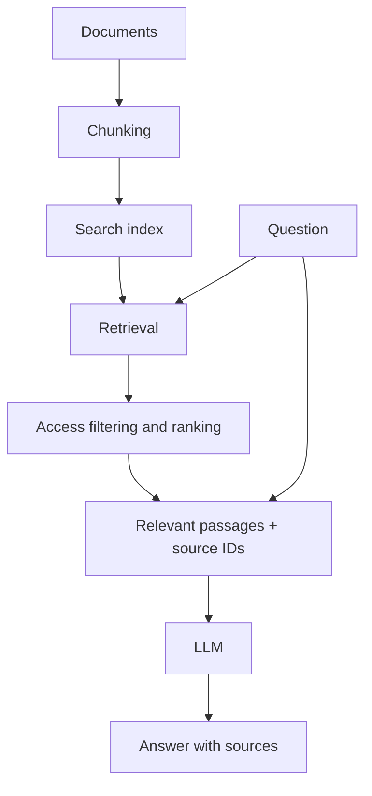
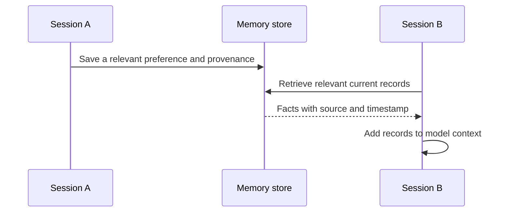

# RAG и память между сессиями

> Внешнее хранилище даёт модели доступ к нужным данным без попытки вместить всю базу знаний в запрос.

## Содержание

- [Retrieval-Augmented Generation](#retrieval-augmented-generation)
- [Chunking и поиск](#chunking-и-поиск)
- [RAG, long context и fine-tuning](#rag-long-context-и-fine-tuning)
- [Persistent memory](#persistent-memory)
- [Подводные камни](#подводные-камни)

## Retrieval-Augmented Generation

Модель использует параметры, сформированные обучением, и контекст текущего запроса. Чтобы ответить по приватной документации или свежим сведениям, приложение должно предоставить соответствующие данные.

**RAG** связывает поиск по внешнему корпусу и генерацию ответа на основе найденного. Исходная работа [Retrieval-Augmented Generation for Knowledge-Intensive NLP Tasks](https://arxiv.org/abs/2005.11401) сочетает генератор с извлечением из внешнего индекса. В прикладных системах retrieval может быть векторным, полнотекстовым или гибридным.

Права доступа учитывают при извлечении, до передачи содержимого модели. Фильтрация только готового ответа не устраняет утечку в контекст.

## Chunking и поиск

Chunking делит документы на фрагменты. Крупный фрагмент сохраняет контекст, но может размывать релевантность; мелкий облегчает точный поиск, но теряет определения и соседние условия.

Варианты: фиксированная длина с overlap, разбиение по заголовкам и абзацам, сохранение блока кода вместе с объяснением. Универсального размера нет — его оценивают на вопросах к своему корпусу.

Для векторного поиска embedding-модель переводит запрос и фрагменты в совместимое пространство. Это отдельная операция, не lookup токена внутри генеративной LLM. Индекс хранит также источник, версию и метаданные доступа. После поиска можно применить reranking и собрать контекст из наиболее полезных фрагментов.

Измеряют отдельно, найден ли нужный источник, и верен ли ответ по источникам. Если retrieval пропустил документ, увеличение размера генеративной модели не исправляет сам поиск.

## RAG, long context и fine-tuning

| Подход | Когда подходит | Ограничение |
|---|---|---|
| Long context | Нужные документы помещаются в окно | Расход контекста и риск пропуска важных деталей |
| RAG | Большой или обновляемый корпус | Зависимость от полноты и точности поиска |
| Fine-tuning | Нужно адаптировать поведение или освоить устойчивые задачи | Обновление весов дороже обновления внешних данных |

Подходы комбинируются: дообученная модель может работать с RAG и большим контекстом. Агент также может сам выбирать, когда вызвать поиск; это вариант управления retrieval.

## Persistent memory

История сессии может сохраняться приложением после закрытия чата. Но сохранение не делает её автоматически доступной следующему запросу: harness должен загрузить нужные сведения.

**Persistent memory** — данные вне текущего context window, которые сохраняют и извлекают между сессиями. Это могут быть файлы, записи БД или поисковый индекс.

Полезно разделять предпочтения пользователя, принятые решения проекта, обратную связь и ссылки на внешние источники. Запись должна иметь понятное происхождение и допускать исправление или удаление.

Память — данные, а не привилегированная инструкция. Актуальные факты из кода и конфигурации лучше читать заново, чем доверять устаревшей копии. Секреты и лишние персональные сведения не следует автоматически сохранять ради удобства будущих запросов.

## Подводные камни

- Наличие источника в индексе не гарантирует его попадание в результаты.
- RAG не устраняет выдумки: ответ нужно проверять на соответствие найденному.
- Смена embedding-модели может потребовать перестроения индекса.
- Сохранённое ошибочное предположение может повторяться в новых сессиях.
- Полученный из памяти или поиска текст может содержать prompt injection.

## См. также

- [Контекст и embeddings](./01-llm-fundamentals.md)
- [Compaction](./05-harness.md)
- [Оценка и надёжность](./09-reliability.md)
