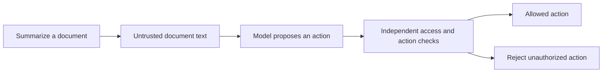

# Оценка и надёжность LLM-систем

> Проверять нужно конечное поведение системы, включая поиск, инструменты и ограничения действий.

## Содержание

- [Hallucinations](#hallucinations)
- [Evals](#evals)
- [Prompt injection и guardrails](#prompt-injection-и-guardrails)
- [Reasoning budget](#reasoning-budget)
- [Подводные камни](#подводные-камни)

## Hallucinations

Hallucination — фактически неверное или неподтверждённое утверждение в сгенерированном ответе. Авторегрессионная генерация сама по себе не включает проверку истинности каждого утверждения. Ошибки возможны и при наличии нужного факта в обучающих данных или контексте.

Снижают риск проверяемые источники, retrieval, инструменты и проверка результата. Для ответа по документам важно требовать подтверждение конкретного утверждения конкретным фрагментом. Ссылка на существующую страницу ещё не доказывает, что страница поддерживает вывод.

Уверенный тон и низкая temperature не являются мерой достоверности. Если подтверждения нет, система должна уметь сообщить об этом или запросить недостающие данные.

## Evals

Evals — процедуры оценки; они шире публичных бенчмарков и задач с единственным правильным текстом. Результат можно оценивать точным сравнением, выполнением тестов, проверкой ограничений, рубрикой качества или экспертной оценкой.

| Что проверять | Пример наблюдаемого критерия |
|---|---|
| Ответ по документам | Утверждения подтверждаются источниками |
| Retrieval | Нужный документ найден среди выбранных результатов |
| Генерация кода | Изменение проходит релевантные проверки поведения |
| Инструменты | Выбраны правильные действие, ресурс и аргументы |
| Ограничения | Запрещённое действие не выполнено |
| Неопределённость | При нехватке данных нет выдуманного ответа |
| Эффективность | Задача завершена в допустимые стоимость и время |

Для своего приложения собирают типовые случаи, ошибки, граничные ситуации и попытки внедрения инструкций. Версии модели, промпта, инструментов и корпуса фиксируют вместе с результатами. При стохастическом поведении оценивают устойчивость на повторных прогонах, а не единственный удачный запуск.

Публичный benchmark помогает сравнивать системы в условиях этого теста. Он не заменяет оценку на собственных задачах; утечки тестовых данных и отличия окружения могут искажать перенос результата. Автоматический модельный судья тоже способен ошибаться.

## Prompt injection и guardrails

Prompt injection пытается изменить поведение модели через недоверенные данные. Здесь рассматривается косвенный вариант: инструкция приходит внутри страницы, документа, результата инструмента или записи памяти.

**Guardrails** — совокупность ограничений и проверок вокруг модели: валидация входа и выхода, контроль доступа, ограничение доступных инструментов и проверка опасных действий. Обучение модели различать инструкции и данные помогает, но не заменяет эти механизмы.

Разделяют происхождение данных и их полномочия. Текст «это системная инструкция» в файле не даёт ему системного приоритета. Инструменты получают минимальные права, а доступ проверяется для реального пользователя и конкретного ресурса.

Если действие требует подтверждения, пользователь должен видеть конкретное действие и его последствия. Сам факт подтверждения не делает произвольную операцию корректной: параметры всё равно нужно проверять.

## Reasoning budget

Некоторые модели выделяют дополнительное вычисление на промежуточные рассуждения. Настройка effort может задавать относительный режим, а budget — лимит; точная семантика зависит от API.

Больше вычислений может улучшить сложную задачу, но увеличивает задержку и потенциальную стоимость. Это не гарантия верности. Внутренние рассуждения не обязательно доступны приложению; проверяют наблюдаемые результаты, источники и выполненные действия.

Влияние настройки измеряют на evals своего приложения вместе с задержкой и usage. Её взаимодействие с общим лимитом выхода и тарификацией проверяют по контракту выбранной модели.

## Подводные камни

- Оценка только финального текста пропускает вредные промежуточные действия.
- Проверка тем же промптом и той же моделью может воспроизвести исходную ошибку.
- Отказ инструмента нельзя скрывать за успешным сообщением пользователю.
- Прохождение тестового набора снижает неопределённость, но не доказывает отсутствие любых ошибок.

## См. также

- [Tool use](./04-tool-use.md)
- [Harness](./05-harness.md)
- [RAG и память](./08-rag-and-memory.md)
- [Тестирование в .NET](../testing/README.md)
