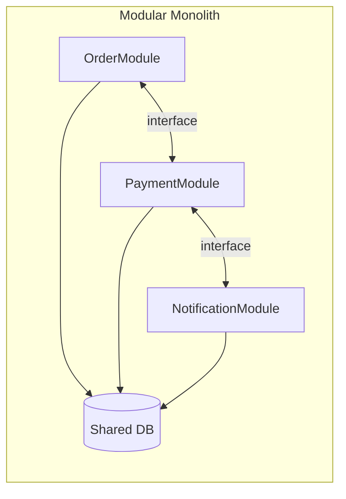
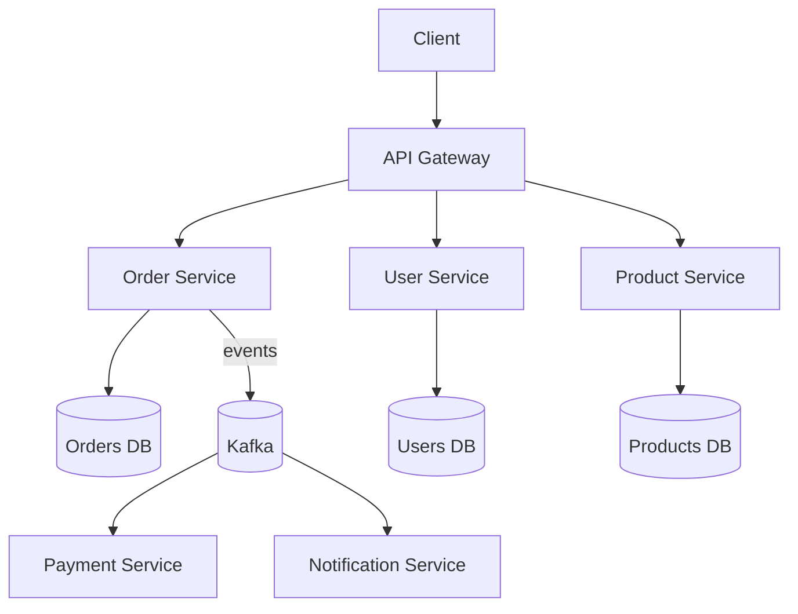
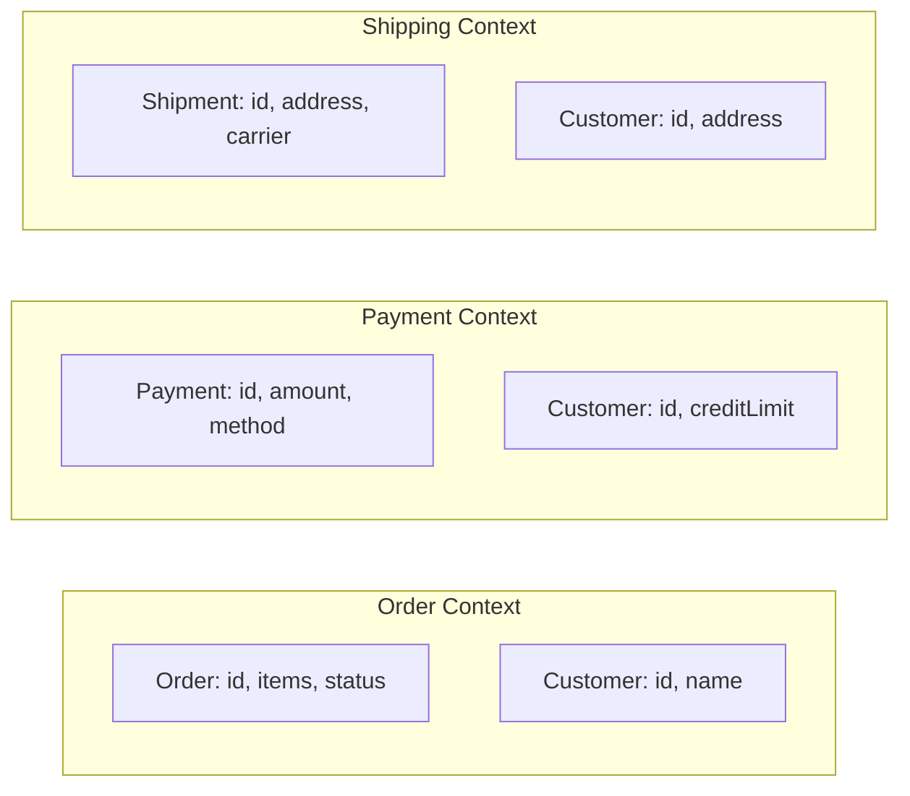
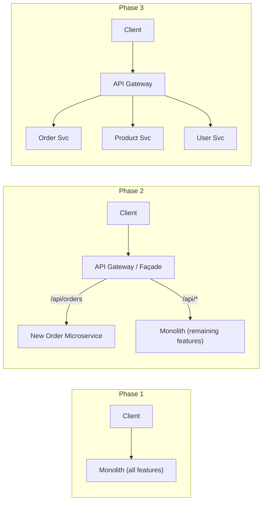

# Архитектурные парадигмы и миграция

> Первый вопрос архитектуры не «какой протокол общения выбрать», а «нужны ли микросервисы вообще» — и если да, то как их получить, не переписывая всё с нуля.

## Содержание
- [Монолит](#монолит)
- [Modular Monolith](#modular-monolith--золотая-середина)
- [Microservices](#microservices)
- [Bounded Context (DDD)](#bounded-context-ddd)
- [Conway's Law](#conways-law)
- [Когда НЕ нужны микросервисы](#когда-не-нужны-микросервисы)
- [Strangler Fig Pattern](#strangler-fig-pattern)
- [Anti-Corruption Layer](#anti-corruption-layer-acl)
- [Подводные камни](#подводные-камни)
- [См. также](#см-также)

## Монолит

Одно приложение, один деплой, одна база данных. Весь код выполняется в одном процессе.

Плюсы: простота разработки и дебага (нет сетевых вызовов между компонентами), транзакции через ACID без распределённых протоколов, низкая latency (вызов функции vs сетевой запрос), простой деплой (один артефакт), лёгкий рефакторинг (компилятор видит всё).

Минусы при росте: большая команда → конфликты при слиянии, сложная координация; один сервис тормозит → вся система страдает; масштабирование только целиком (вертикально или горизонтально); технологический lock-in — одна платформа для всего.

## Modular Monolith — золотая середина

Один процесс, несколько изолированных модулей с чёткими границами. Модули общаются через интерфейсы (in-process), не через сеть.



Когда выбирать: небольшая команда, продукт не доказал product-market fit, нет необходимости в независимом масштабировании модулей. Модульный монолит легко превращается в микросервисы — границы уже определены.

## Microservices

Каждый сервис — отдельный процесс, отдельная база данных, отдельный деплой.



Плюсы: независимый деплой и масштабирование каждого сервиса, технологическое разнообразие (Go для high-throughput, .NET для бизнес-логики), изоляция отказов (падение одного сервиса не роняет другие), автономные команды по сервису.

Минусы: distributed systems complexity (сеть ненадёжна, консистентность eventual), нет ACID через сервисы, latency вместо вызова функции — HTTP/gRPC запрос, operational overhead (несколько баз, мониторинг, трейсинг), тяжелее дебажить (трейс через 5 сервисов).

## Bounded Context (DDD)

**Bounded Context** — явная граница, внутри которой определённая модель предметной области имеет точное значение. Ключевой инструмент декомпозиции на сервисы.



`Customer` в каждом контексте имеет разные атрибуты и смысл. Не нужна одна «super-модель» Customer — каждый контекст работает со своим представлением.

Context Map — отношения между контекстами:
- **Partnership** — команды координируются
- **Customer-Supplier** — downstream зависит от upstream
- **Conformist** — downstream принимает модель upstream без изменений
- **Anti-Corruption Layer** — downstream транслирует модель upstream в свою (см. ниже)
- **Shared Kernel** — общее подмножество модели (рискованно — скрытая связанность между командами)

## Conway's Law

> «Organizations which design systems are constrained to produce designs which are copies of the communication structures of these organizations.» — Melvin Conway, 1967

Архитектура системы отражает структуру команды. Команды, разделённые по функциям (Frontend, Backend, DB), получают трёхслойную систему. Команды, разделённые по продуктам (Order Team, Payment Team), получают микросервисную архитектуру.

**Inverse Conway Maneuver:** сначала реструктурируй команды → система сама примет нужную форму.

## Когда НЕ нужны микросервисы

- Команда меньше 10 человек — overhead превышает пользу
- Продукт в стадии MVP — границы предметной области ещё не понятны
- Нет DevOps-культуры — операционная сложность убьёт скорость разработки
- Простые CRUD-операции без сложной бизнес-логики
- Единая БД нужна из-за сложных транзакций или JOIN'ов между сущностями

## Strangler Fig Pattern

Постепенная миграция с монолита: новые возможности уходят в микросервис, старый код остаётся до полного переноса.



Шаги: 1) поставить Façade (API Gateway) перед монолитом; 2) вынести один Bounded Context в отдельный сервис; 3) перенаправить трафик через Façade на новый сервис; 4) постепенно перенести остальные контексты; 5) монолит «задушен» — можно убрать.

## Anti-Corruption Layer (ACL)

Переходный слой, предотвращающий проникновение модели upstream-системы в downstream-домен.

```csharp
public class CrmAntiCorruptionLayer
{
    private readonly ICrmClient _crm;

    public async Task<Customer> GetCustomerAsync(string crmId, CancellationToken ct)
    {
        var crmCustomer = await _crm.GetClientAsync(crmId, ct); // модель устаревшей CRM

        return new Customer( // трансляция в нашу доменную модель
            Id: CustomerId.Of(crmCustomer.ClientCode),
            Name: $"{crmCustomer.FirstName} {crmCustomer.LastName}",
            Email: Email.Of(crmCustomer.ContactInfo.PrimaryEmail),
            Tier: crmCustomer.Category switch
            {
                "GOLD" => CustomerTier.Premium,
                "SILV" => CustomerTier.Standard,
                _ => CustomerTier.Basic
            }
        );
    }
}
```

ACL особенно важен при интеграции с legacy-системами, внешними API или при Strangler Fig миграции — без него ломаная модель legacy-системы просачивается в новый домен.

## Подводные камни

- Переход на микросервисы без чётких Bounded Context — получаются «распределённые модули» с теми же связями, что были в монолите, но уже через сеть (см. Distributed Monolith в [09-antipatterns.md](./09-antipatterns.md)).
- Shared Kernel между командами — самый рискованный вариант Context Map: любое изменение общей модели требует координации всех зависимых команд.
- Strangler Fig без Façade — миграция «большим взрывом» без промежуточного слоя роутинга, что уже Big Bang Rewrite, а не Strangler Fig.
- Игнорирование Conway's Law — попытка построить микросервисную архитектуру силами одной монолитной команды даёт архитектуру на бумаге, которая не приживается в реальном процессе разработки.

## См. также

- [Коммуникация между сервисами](./02-communication.md)
- [Паттерны данных](./03-data-patterns.md) — Database per Service как следствие Bounded Context
- [Антипаттерны](./09-antipatterns.md) — Distributed Monolith, Big Bang Rewrite
