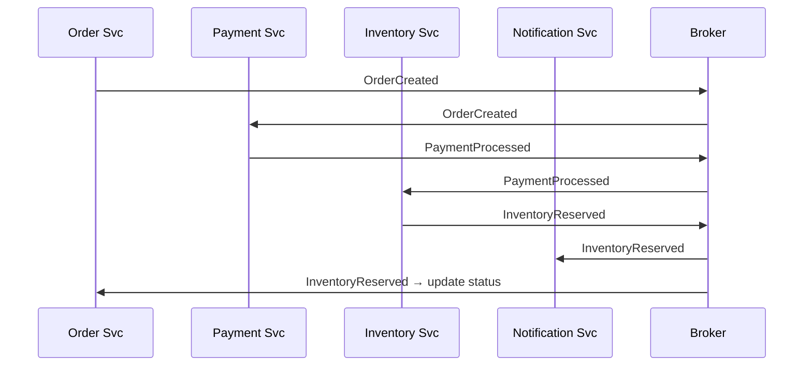
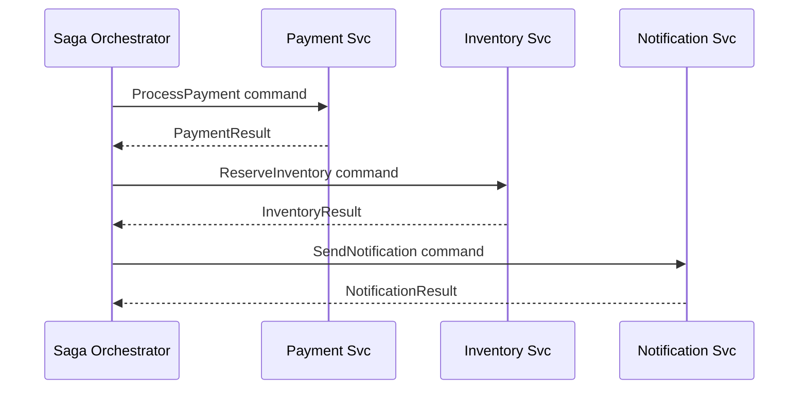

# Коммуникация между сервисами

> Три способа сервисам говорить друг с другом — синхронный REST, высокопроизводительный gRPC, асинхронный broker — и два способа координировать flow между ними.

## Содержание
- [HTTP/REST](#httprest)
- [gRPC](#grpc)
- [Message Broker](#message-broker)
- [Choreography vs Orchestration](#choreography-vs-orchestration)
- [Подводные камни](#подводные-камни)
- [См. также](#см-также)

## HTTP/REST

Синхронный, человекочитаемый, универсальный. Де-факто стандарт для публичных API.

Версионирование API — обязательно:

```csharp
// Через URL (наиболее распространённый)
app.MapGroup("/api/v1").MapOrdersV1();
app.MapGroup("/api/v2").MapOrdersV2();

// Через заголовок
app.MapGet("/orders/{id}", context =>
{
    var version = context.Request.Headers["API-Version"].FirstOrDefault() ?? "1";
});

// Через Content-Type negotiation: Accept: application/vnd.myapi.v2+json
```

Рекомендации: никогда не ломай существующие endpoint'ы — только добавляй новые версии; предупреждай о deprecation заранее (`Deprecation: true` заголовок); ограничивай число поддерживаемых версий (обычно 2-3).

## gRPC

Binary protocol (Protocol Buffers) поверх HTTP/2. Строгий контракт, высокая производительность, поддержка стриминга.

```protobuf
// order.proto
syntax = "proto3";
package orders;

service OrderService {
    rpc GetOrder (GetOrderRequest) returns (Order);                    // Unary
    rpc StreamOrders (StreamOrdersRequest) returns (stream Order);     // Server streaming
    rpc BulkCreate (stream CreateOrderRequest) returns (BulkCreateResponse); // Client streaming
    rpc OrderChat (stream ChatMessage) returns (stream ChatMessage);   // Bidirectional
}

message GetOrderRequest { string order_id = 1; }
message Order {
    string id = 1;
    string user_id = 2;
    double amount = 3;
    OrderStatus status = 4;
}
enum OrderStatus { PENDING = 0; PAID = 1; SHIPPED = 2; }
```

```csharp
builder.Services.AddGrpc();
app.MapGrpcService<OrderGrpcService>();

public class OrderGrpcService : OrderService.OrderServiceBase
{
    public override async Task<Order> GetOrder(GetOrderRequest request, ServerCallContext context)
    {
        var order = await _repository.FindAsync(request.OrderId, context.CancellationToken);
        if (order is null)
            throw new RpcException(new Status(StatusCode.NotFound, $"Order {request.OrderId} not found"));

        return new Order { Id = order.Id, Amount = (double)order.Amount };
    }

    public override async Task StreamOrders(
        StreamOrdersRequest request,
        IServerStreamWriter<Order> responseStream,
        ServerCallContext context)
    {
        await foreach (var order in _repository.StreamAsync(context.CancellationToken))
        {
            await responseStream.WriteAsync(new Order { Id = order.Id });
            if (context.CancellationToken.IsCancellationRequested) break;
        }
    }
}
```

gRPC vs REST:

| Критерий | REST (JSON) | gRPC (Protobuf) |
|---------|------------|-----------------|
| Контракт | OpenAPI (опционально) | .proto (обязательно) |
| Сериализация | JSON (текст) | Binary (компактнее в 5-10x) |
| Скорость | Средняя | Высокая |
| Streaming | Ограниченный (SSE) | Полноценный (4 режима) |
| Браузер | Да | Только через gRPC-Web |
| Code gen | Необязательно | Автоматически из .proto |
| Применение | Публичный API | Internal service-to-service |

## Message Broker

Асинхронная коммуникация через очередь/топик (Kafka, RabbitMQ — детали брокеров вне этого файла).

**Event Notification** — минимальный payload, получатель сам запрашивает детали:

```json
{ "type": "OrderCreated", "orderId": "123", "timestamp": "2024-01-15T10:00:00Z" }
```

Получатель делает HTTP-запрос к Order Service за деталями. Минус: дополнительный round-trip, coupling к API.

**Event-Carried State Transfer** — полный payload в событии:

```json
{
  "type": "OrderCreated",
  "orderId": "123",
  "userId": "456",
  "items": [{"productId": "789", "qty": 2, "price": 100}],
  "totalAmount": 200,
  "timestamp": "2024-01-15T10:00:00Z"
}
```

Получателю не нужен ещё один запрос. Минус: больший размер, сложнее версионирование.

Рекомендация: Event-Carried State Transfer для consumer'ов, которые должны работать автономно (без синхронной зависимости от источника события).

## Choreography vs Orchestration

**Choreography** — децентрализованная координация:



Каждый сервис знает только о своих событиях — слабая связанность, но сложно отследить весь flow (нет центральной точки), трудно добавить новый шаг (нужно изменять несколько сервисов).

**Orchestration** — централизованный координатор:



Логика flow в одном месте (легко читать), но orchestrator знает обо всех сервисах (coupling) и становится единой точкой отказа. Зато легко добавить новый шаг.

Рекомендация: Choreography для простых flows, Orchestration для сложных saga с несколькими компенсациями (см. [Saga и Outbox](./05-saga-outbox.md)).

## Подводные камни

- REST без версионирования с первого дня — любое изменение контракта ломает существующих клиентов; версионирование добавляют «потом», когда уже поздно.
- gRPC для публичного браузерного API — требует gRPC-Web + прокси-слой, лишняя сложность там, где подошёл бы обычный REST.
- Event Notification там, где consumer должен работать автономно (например, в offline-обработке) — вынуждает делать синхронный запрос обратно, теряя главное преимущество асинхронности.
- Choreography, разросшаяся до 6+ сервисов в одном бизнес-процессе — flow невозможно восстановить по коду, только по трейсам; сигнал переходить на Orchestration.

## См. также

- [Архитектурные парадигмы](./01-architecture-paradigms.md)
- [Saga и Outbox](./05-saga-outbox.md) — практическое применение Choreography/Orchestration
- [Reliability и Polly](./04-reliability-polly.md) — что делать, когда синхронный вызов падает
