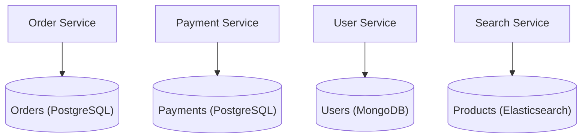
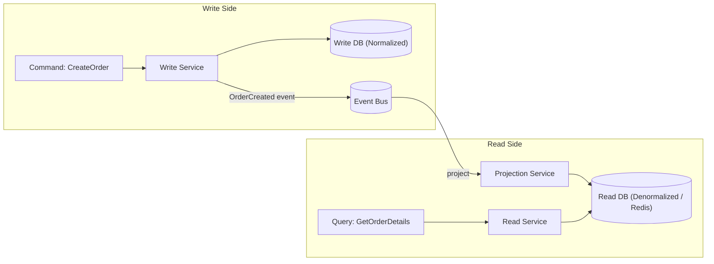

# Паттерны данных

> Каждый сервис владеет своими данными — но как тогда читать данные из нескольких сервисов и хранить историю изменений? Database per Service, CQRS и Event Sourcing отвечают на эти два вопроса.

## Содержание
- [Database per Service](#database-per-service)
- [CQRS](#cqrs-command-query-responsibility-segregation)
- [Event Sourcing](#event-sourcing)
- [Подводные камни](#подводные-камни)
- [См. также](#см-также)

## Database per Service

Каждый микросервис владеет своими данными — другие сервисы не могут обращаться напрямую к чужой БД.



Зачем: независимый деплой, независимое масштабирование, свобода выбора технологии БД под конкретный сервис, отсутствие coupling через общую схему.

Проблема: JOIN между данными разных сервисов невозможен на уровне БД. Решения:
- **API Composition** — запросы к нескольким сервисам, агрегация в памяти (на стороне API Gateway или BFF)
- **CQRS** с отдельным read model, собранным из событий нескольких сервисов

## CQRS (Command Query Responsibility Segregation)

**Команды (Commands)** изменяют состояние, не возвращают данные. **Запросы (Queries)** читают состояние, не изменяют его. Write Model и Read Model разделены.



```csharp
// Command: изменяет состояние
public record CreateOrderCommand(string UserId, List<OrderItem> Items);

public class CreateOrderHandler : IRequestHandler<CreateOrderCommand, Guid>
{
    public async Task<Guid> Handle(CreateOrderCommand cmd, CancellationToken ct)
    {
        var order = Order.Create(cmd.UserId, cmd.Items);
        await _repository.AddAsync(order, ct);
        await _eventBus.PublishAsync(new OrderCreatedEvent(order.Id, ...), ct);
        return order.Id;
    }
}

// Query: только чтение, из оптимизированного read store
public record GetOrderDetailsQuery(Guid OrderId);

public class GetOrderDetailsHandler : IRequestHandler<GetOrderDetailsQuery, OrderDetailsDto>
{
    public async Task<OrderDetailsDto> Handle(GetOrderDetailsQuery query, CancellationToken ct)
    {
        return await _readStore.GetOrderDetailsAsync(query.OrderId, ct); // денормализованная read-модель
    }
}
```

**Eventual Consistency:** между записью команды и обновлением read model есть задержка. UI должен это учитывать — например, показывать оптимистичный UI сразу после команды, не дожидаясь обновления read model.

Когда CQRS уместен: read/write нагрузки сильно отличаются; read model требует данных из нескольких агрегатов; нужна история изменений (в связке с Event Sourcing). Когда не нужен: простые CRUD без сложных запросов — overhead неоправдан.

## Event Sourcing

Вместо хранения текущего состояния хранится **последовательность событий**. Состояние вычисляется воспроизведением событий.

```csharp
public abstract record DomainEvent(Guid AggregateId, DateTimeOffset OccurredAt);
public record OrderCreated(Guid AggregateId, string UserId, DateTimeOffset OccurredAt) : DomainEvent(AggregateId, OccurredAt);
public record ItemAdded(Guid AggregateId, string ProductId, int Qty, decimal Price, DateTimeOffset OccurredAt) : DomainEvent(AggregateId, OccurredAt);
public record OrderPaid(Guid AggregateId, string Method, DateTimeOffset OccurredAt) : DomainEvent(AggregateId, OccurredAt);
public record OrderCancelled(Guid AggregateId, string Reason, DateTimeOffset OccurredAt) : DomainEvent(AggregateId, OccurredAt);

public class Order
{
    public Guid Id { get; private set; }
    public string UserId { get; private set; } = default!;
    public List<(string ProductId, int Qty, decimal Price)> Items { get; private set; } = new();
    public OrderStatus Status { get; private set; }
    public decimal Total => Items.Sum(i => i.Price * i.Qty);

    private readonly List<DomainEvent> _uncommittedEvents = new();
    public IReadOnlyList<DomainEvent> UncommittedEvents => _uncommittedEvents;

    private void Apply(DomainEvent @event) // применение события к состоянию
    {
        switch (@event)
        {
            case OrderCreated e:
                Id = e.AggregateId; UserId = e.UserId; Status = OrderStatus.Pending;
                break;
            case ItemAdded e:
                Items.Add((e.ProductId, e.Qty, e.Price));
                break;
            case OrderPaid:
                Status = OrderStatus.Paid;
                break;
            case OrderCancelled:
                Status = OrderStatus.Cancelled;
                break;
        }
    }

    public static Order Create(Guid id, string userId) // бизнес-метод: создаёт событие + применяет
    {
        var order = new Order();
        var evt = new OrderCreated(id, userId, DateTimeOffset.UtcNow);
        order.Apply(evt);
        order._uncommittedEvents.Add(evt);
        return order;
    }

    public void AddItem(string productId, int qty, decimal price)
    {
        if (Status != OrderStatus.Pending)
            throw new InvalidOperationException("Cannot add items to non-pending order");

        var evt = new ItemAdded(Id, productId, qty, price, DateTimeOffset.UtcNow);
        Apply(evt);
        _uncommittedEvents.Add(evt);
    }

    public static Order Rehydrate(IEnumerable<DomainEvent> history) // восстановление из событий (replay)
    {
        var order = new Order();
        foreach (var @event in history) order.Apply(@event);
        return order;
    }
}
```

Snapshot — чтобы не воспроизводить весь лог с начала, периодически сохраняй снапшот состояния:

```csharp
public async Task<Order> LoadAsync(Guid id, CancellationToken ct)
{
    var snapshot = await _snapshotStore.GetLatestAsync(id, ct);
    var fromVersion = snapshot?.Version ?? 0;

    var events = await _eventStore.LoadAsync(id, fromVersion, ct);

    var order = snapshot is not null ? snapshot.Restore<Order>() : new Order();

    foreach (var @event in events)
        order.Apply(@event); // только события после снапшота

    return order;
}
```

Преимущества: полный audit trail (кто, что, когда изменил), temporal queries (состояние на любой момент времени), replay для новых проекций, естественная интеграция с Event-Driven Architecture.

Недостатки: сложность (нужен event store, projections, снапшоты), eventual consistency в read model, нет простого `UPDATE SET` — любое изменение состояния идёт через новое событие.

## Подводные камни

- Прямой доступ одного сервиса к БД другого «чтобы не тащить лишний API-вызов» — разрушает главную гарантию Database per Service и превращает систему в Distributed Monolith (см. [09-antipatterns.md](./09-antipatterns.md)).
- CQRS без реальной причины (read/write не отличаются по нагрузке) — двойной набор моделей и синхронизация между ними без окупаемости сложности.
- Event Sourcing, в котором забыли про snapshot — воспроизведение истории из тысяч событий на каждую загрузку агрегата убивает производительность.
- Смешение Event Sourcing событий с интеграционными событиями для других сервисов — доменные события агрегата (детальные, версионируемые вместе с моделью) и публичные интеграционные события (стабильный контракт для внешних consumer'ов) должны быть разными объектами.

## См. также

- [Архитектурные парадигмы](./01-architecture-paradigms.md) — Bounded Context как единица владения данными
- [Saga и Outbox](./05-saga-outbox.md) — согласованность между Database per Service
- [Антипаттерны](./09-antipatterns.md)
