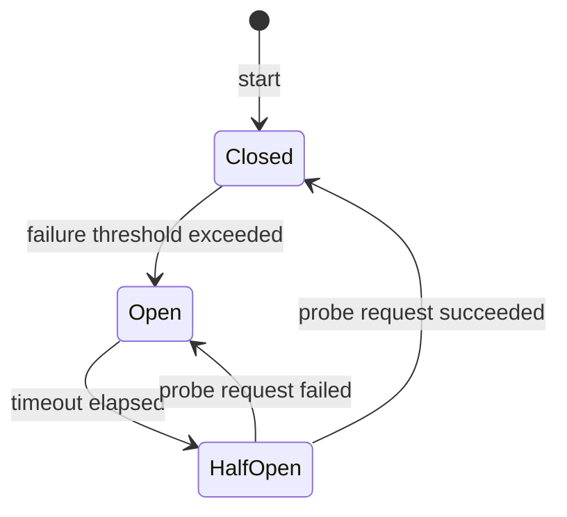

# Reliability и Polly

> Сеть ненадёжна: сервисы падают, тормозят, возвращают 503. Circuit Breaker, Retry, Bulkhead, Timeout и Fallback — пять паттернов, которые в .NET почти всегда реализуются одной библиотекой, Polly.

## Содержание
- [Circuit Breaker](#circuit-breaker)
- [Retry с Exponential Backoff и Jitter](#retry-с-exponential-backoff-и-jitter)
- [Bulkhead](#bulkhead-переборка)
- [Timeout](#timeout)
- [Fallback](#fallback)
- [Подводные камни](#подводные-камни)
- [См. также](#см-также)

## Circuit Breaker

Защита от каскадных отказов. Если downstream-сервис падает — не продолжаем бомбардировать его запросами.



- **Closed** — запросы проходят нормально; при превышении порога ошибок → Open.
- **Open** — запросы немедленно отклоняются (fast fail); через timeout → Half-Open.
- **Half-Open** — один пробный запрос; успех → Closed, ошибка → снова Open.

Polly (.NET):

```csharp
// dotnet add package Polly.Extensions.Http
var circuitBreaker = Policy<HttpResponseMessage>
    .Handle<HttpRequestException>()
    .OrResult(r => (int)r.StatusCode >= 500)
    .CircuitBreakerAsync(
        handledEventsAllowedBeforeBreaking: 5,     // 5 ошибок → Open
        durationOfBreak: TimeSpan.FromSeconds(30), // 30 сек в Open
        onBreak: (result, duration) =>
            _logger.LogWarning("Circuit opened for {Duration}s", duration.TotalSeconds),
        onReset: () => _logger.LogInformation("Circuit closed"),
        onHalfOpen: () => _logger.LogInformation("Circuit half-open, probing")
    );

// Регистрация через IHttpClientFactory (рекомендуется)
builder.Services.AddHttpClient<IOrderServiceClient, OrderServiceClient>()
    .AddPolicyHandler(GetCircuitBreakerPolicy())
    .AddPolicyHandler(GetRetryPolicy());
```

## Retry с Exponential Backoff и Jitter

```csharp
var retryPolicy = Policy<HttpResponseMessage>
    .Handle<HttpRequestException>()
    .OrResult(r => r.StatusCode == HttpStatusCode.ServiceUnavailable
                || r.StatusCode == HttpStatusCode.TooManyRequests)
    .WaitAndRetryAsync(
        retryCount: 3,
        sleepDurationProvider: (retryAttempt, result, context) =>
        {
            var exponential = TimeSpan.FromSeconds(Math.Pow(2, retryAttempt)); // 2^attempt секунды
            var jitter = TimeSpan.FromMilliseconds(Random.Shared.Next(0, 200)); // ±разброс против synchronized retry storm
            return exponential + jitter;
        },
        onRetryAsync: async (outcome, timespan, retryAttempt, context) =>
        {
            _logger.LogWarning(
                "Retry {Attempt} after {Delay}ms. Error: {Error}",
                retryAttempt, timespan.TotalMilliseconds,
                outcome.Exception?.Message ?? outcome.Result?.StatusCode.ToString());
        });

// Retry: 1-я ≈ 2с, 2-я ≈ 4с, 3-я ≈ 8с (+ jitter)
```

Что можно retry-ить: идемпотентные операции (GET, PUT, DELETE). POST — только если сервер гарантирует идемпотентность (через заголовок `Idempotency-Key`).

## Bulkhead (Переборка)

Изоляция ресурсов: пул потоков/соединений для одного downstream-сервиса не влияет на остальные.

```csharp
var bulkhead = Policy.BulkheadAsync(
    maxParallelization: 10, // максимум 10 параллельных запросов
    maxQueuingActions: 20,  // очередь на 20
    onBulkheadRejectedAsync: context =>
    {
        _logger.LogWarning("Bulkhead rejected request to payment service");
        return Task.CompletedTask;
    });
```

Без bulkhead: если Payment Service тормозит, сотни потоков вашего сервиса заняты ожиданием ответа от него — и сервис не может обрабатывать вообще никакие другие запросы, даже не связанные с оплатой.

## Timeout

```csharp
var timeoutPolicy = Policy.TimeoutAsync<HttpResponseMessage>(
    timeout: TimeSpan.FromSeconds(3),
    timeoutStrategy: TimeoutStrategy.Optimistic,
    onTimeoutAsync: async (context, timespan, task) =>
    {
        _logger.LogWarning("Timeout after {Seconds}s", timespan.TotalSeconds);
    });
```

Timeout + Retry + Circuit Breaker вместе (Polly Wrap) — порядок политик имеет значение:

```csharp
// Порядок: снаружи → внутри
var policy = Policy.WrapAsync(
    retryPolicy,     // 1. Retry — снаружи, управляет повторными попытками
    circuitBreaker,  // 2. Circuit Breaker — видит результат каждой попытки
    timeoutPolicy    // 3. Timeout — внутри, ближе всего к самому запросу
);
// Timeout срабатывает для каждой отдельной попытки
// Circuit Breaker видит результат после timeout
// Retry делает следующую попытку, если предыдущая не прошла
```

## Fallback

```csharp
var fallback = Policy<ProductDto?>
    .Handle<BrokenCircuitException>()
    .Or<TimeoutRejectedException>()
    .FallbackAsync(
        fallbackValue: null, // или кешированное значение
        onFallbackAsync: (result, context) =>
        {
            _logger.LogWarning("Falling back due to: {Error}", result.Exception?.GetType().Name);
            return Task.CompletedTask;
        });
```

Стратегии Fallback: вернуть кешированное значение (stale data), вернуть дефолтный ответ (`ProductDto.Unknown`), вернуть деградированный ответ (меньше данных), отложить обработку (поставить в очередь).

## Подводные камни

- Retry без ограничения на идемпотентные операции — повторный POST без `Idempotency-Key` может создать дубликат заказа/платежа.
- Retry без jitter — при массовом сбое все клиенты синхронно повторяют запрос в одну и ту же секунду (thundering herd / retry storm), что добивает и без того упавший сервис.
- Circuit Breaker без Bulkhead — даже с быстрым fail-fast открытого circuit, пока он ещё Closed, поток запросов на медленный сервис может исчерпать пул потоков раньше, чем накопится порог ошибок.
- Неправильный порядок Policy.WrapAsync — если Timeout снаружи Retry, таймаут ограничивает **все** попытки вместе, а не каждую по отдельности.
- Fallback без логирования — деградация происходит незаметно, пока пользователи не пожалуются на «пустые» данные.

## См. также

- [Коммуникация между сервисами](./02-communication.md) — синхронные вызовы, которые защищают эти политики
- [Saga и Outbox](./05-saga-outbox.md) — компенсации как fallback на уровне бизнес-процесса
- [Observability](./07-observability.md) — как увидеть, что Circuit Breaker вообще срабатывает
