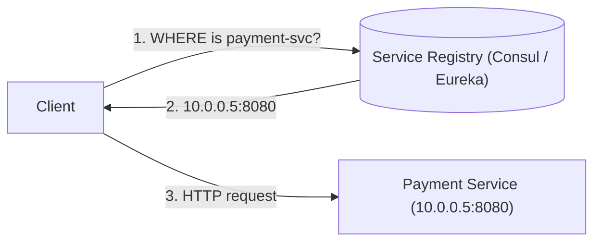
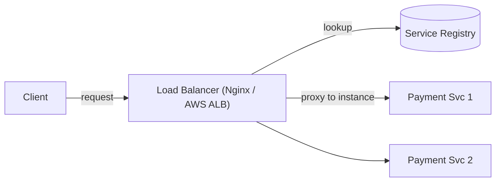
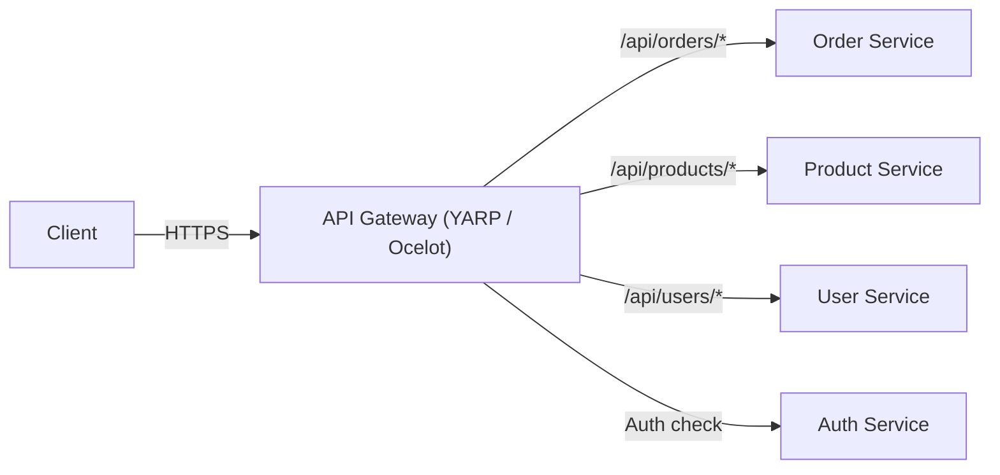
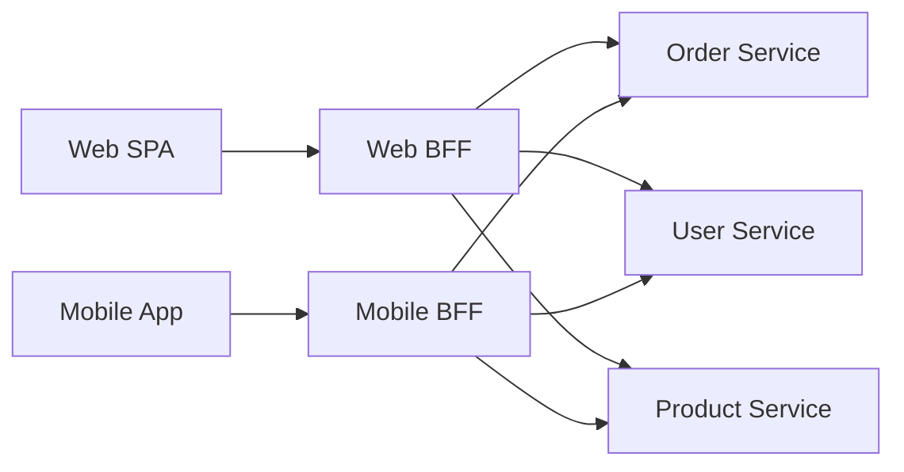
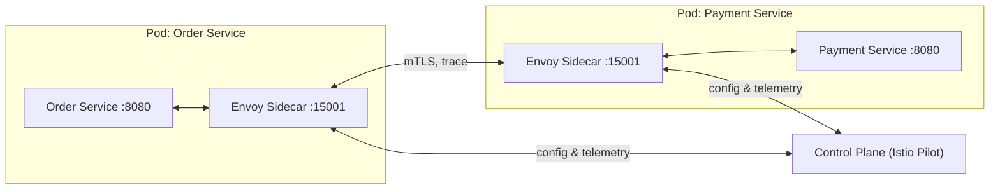

# Service Discovery и API Gateway

> Как клиент находит нужный инстанс сервиса среди динамически меняющихся IP, и что стоит между внешним миром и десятками внутренних сервисов — Gateway, BFF, Service Mesh.

## Содержание
- [Service Discovery](#service-discovery)
- [API Gateway](#api-gateway)
- [BFF (Backend for Frontend)](#bff-backend-for-frontend)
- [Service Mesh](#service-mesh)
- [Подводные камни](#подводные-камни)
- [См. также](#см-также)

## Service Discovery

Микросервисы динамически масштабируются — IP-адреса меняются. Service Discovery решает: «где сейчас живёт Payment Service?»

**Client-Side Discovery:**



Клиент сам запрашивает Registry и выбирает инстанс. Встроенный load balancing на стороне клиента.

**Server-Side Discovery:**



Клиент не знает о Registry — это забота Load Balancer/proxy. Проще для клиента, но добавляет дополнительный сетевой хоп.

В Kubernetes service discovery встроен: объект `Service` — стабильное DNS-имя + virtual IP, `kube-proxy` роутит на нужные Pod'ы.

## API Gateway



Функции API Gateway: **Routing** (маршрутизация по пути/заголовкам), **Authentication** (проверка JWT, OAuth2), **Rate Limiting** (защита от перегрузки), **SSL Termination** (TLS на gateway, внутри — обычный HTTP), **Request Aggregation** (один запрос клиента → несколько запросов к сервисам, агрегация ответа), **Protocol Translation** (REST → gRPC).

```csharp
// YARP (Yet Another Reverse Proxy) — официальный reverse proxy от Microsoft
builder.Services.AddReverseProxy()
    .LoadFromConfig(builder.Configuration.GetSection("ReverseProxy"));
```

```json
{
  "ReverseProxy": {
    "Routes": {
      "orders-route": {
        "ClusterId": "orders-cluster",
        "Match": { "Path": "/api/orders/{**catch-all}" },
        "Transforms": [{ "PathRemovePrefix": "/api/orders" }]
      }
    },
    "Clusters": {
      "orders-cluster": {
        "Destinations": {
          "destination1": { "Address": "http://order-service:8080/" },
          "destination2": { "Address": "http://order-service-2:8080/" }
        },
        "LoadBalancingPolicy": "RoundRobin"
      }
    }
  }
}
```

## BFF (Backend for Frontend)

Специализированный API Gateway для конкретного типа клиента.



Web BFF возвращает полные данные (большой экран, стабильный канал), Mobile BFF — компактные (маленький экран + лимит трафика). Каждый BFF оптимизирован под нужды своего клиента, а не служит компромиссом между всеми сразу.

## Service Mesh

Выносит cross-cutting concerns (mTLS, tracing, retry, circuit breaker) из кода приложения в **sidecar proxy**.



**Istio** — самый популярный Service Mesh: mTLS между сервисами автоматически (zero-trust network), Distributed Tracing без изменения кода (sidecar инжектирует заголовки), Traffic Management (A/B тестирование, canary deploy на уровне mesh), Circuit Breaker на уровне прокси, а не в коде каждого сервиса.

Когда нужен Service Mesh: 20+ микросервисов, строгие security-требования, желание унифицировать cross-cutting concerns вместо реализации их в каждом сервисе отдельно (через Polly или аналоги — см. [Reliability и Polly](./04-reliability-polly.md)).

## Подводные камни

- API Gateway, в который начинают заносить бизнес-логику (не только routing/auth/rate limiting) — превращается в God Object на уровне инфраструктуры и единую точку отказа для всей системы.
- Client-Side Discovery без учёта отказа Registry — если сервис не может опросить registry, у него должен быть fallback (кешированный список инстансов), иначе один сбой Consul роняет все вызовы.
- BFF «на всякий случай» для клиента, которого пока нет (например, будущее мобильное приложение) — преждевременная абстракция, лишний слой без потребителя.
- Service Mesh внедряют ради «модности», а не из-за реальных 20+ сервисов — operational overhead (sidecar на каждый под, отдельный control plane) не окупается на малом масштабе.

## См. также

- [Архитектурные парадигмы](./01-architecture-paradigms.md)
- [Reliability и Polly](./04-reliability-polly.md) — то же самое, но в коде приложения вместо sidecar
- [Observability](./07-observability.md) — трейсинг, который Service Mesh даёт «бесплатно»
