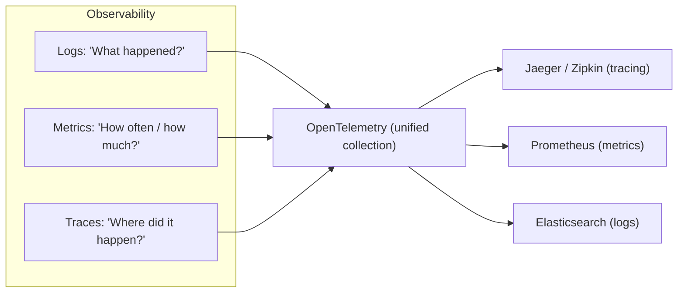

# Observability

> В распределённой системе нельзя просто «поставить брейкпоинт» — запрос проходит через 5 сервисов. Три столпа: логи (что случилось), трейсы (где случилось), метрики (как часто/сколько) — плюс health checks для оркестратора.

## Содержание
- [Три столпа Observability](#три-столпа-observability)
- [Distributed Tracing](#distributed-tracing)
- [Structured Logging](#structured-logging)
- [Metrics — RED и USE методы](#metrics--red-и-use-методы)
- [Health Checks](#health-checks)
- [Подводные камни](#подводные-камни)
- [См. также](#см-также)

## Три столпа Observability



## Distributed Tracing

Один запрос проходит через несколько сервисов. Distributed Tracing связывает их в единый **Trace**.

- **Trace** — полный путь запроса (уникальный `TraceId`)
- **Span** — одна операция внутри сервиса (HTTP call, DB query); вложенные spans образуют дерево
- **Context Propagation** — передача `TraceId` + `SpanId` через заголовки между сервисами

W3C Trace Context — стандарт заголовков:

```
traceparent: 00-4bf92f3577b34da6a3ce929d0e0e4736-00f067aa0ba902b7-01
              версия  trace-id (128 бит)                 parent-span-id      флаги
```

```csharp
builder.Services.AddOpenTelemetry()
    .WithTracing(tracing => tracing
        .SetResourceBuilder(ResourceBuilder.CreateDefault().AddService("order-service"))
        .AddAspNetCoreInstrumentation()          // автоматические spans для HTTP
        .AddHttpClientInstrumentation()          // spans для исходящих HTTP
        .AddEntityFrameworkCoreInstrumentation() // spans для EF queries
        .AddSource("OrderService")               // кастомные spans
        .AddOtlpExporter(o => o.Endpoint = new Uri("http://jaeger:4317")))
    .WithMetrics(metrics => metrics
        .AddAspNetCoreInstrumentation()
        .AddPrometheusExporter());

// Кастомный Span
private static readonly ActivitySource _activitySource = new("OrderService");

public async Task<Order> CreateOrderAsync(CreateOrderCommand cmd)
{
    using var activity = _activitySource.StartActivity("CreateOrder");
    activity?.SetTag("order.userId", cmd.UserId);
    activity?.SetTag("order.itemCount", cmd.Items.Count);

    try
    {
        var order = await ProcessAsync(cmd);
        activity?.SetTag("order.id", order.Id.ToString());
        activity?.SetStatus(ActivityStatusCode.Ok);
        return order;
    }
    catch (Exception ex)
    {
        activity?.SetStatus(ActivityStatusCode.Error, ex.Message);
        activity?.RecordException(ex);
        throw;
    }
}
```

## Structured Logging

```csharp
builder.Host.UseSerilog((context, config) =>
{
    config
        .ReadFrom.Configuration(context.Configuration)
        .Enrich.FromLogContext()
        .Enrich.WithProperty("Service", "OrderService")
        .WriteTo.Console(new JsonFormatter()) // JSON для ELK
        .WriteTo.Seq("http://seq:5341");
});

// Middleware: correlation ID в каждый запрос
app.Use(async (context, next) =>
{
    var correlationId = context.Request.Headers["X-Correlation-Id"].FirstOrDefault()
                        ?? Guid.NewGuid().ToString("N");
    context.Response.Headers["X-Correlation-Id"] = correlationId;

    using (LogContext.PushProperty("CorrelationId", correlationId))
    using (LogContext.PushProperty("RequestPath", context.Request.Path))
    {
        await next(context);
    }
});

_logger.LogInformation(
    "Order {OrderId} created for user {UserId} with {ItemCount} items",
    order.Id, order.UserId, order.Items.Count);
// → {"OrderId":"abc","UserId":"123","ItemCount":3,"CorrelationId":"def","level":"Information",...}
```

Принципы: логировать **факты**, а не сообщения-нарративы — `"Order {OrderId} paid"`, а не `"Processing order, now paying"`; включать correlation ID (или TraceId) в каждую запись; уровни — Debug (дев), Information (важные события), Warning (деградация), Error (обработанные сбои), Critical (падение); никогда не логировать PII (пароли, номера карт, персональные данные).

## Metrics — RED и USE методы

**RED Method** (для сервисов, принимающих запросы): **Rate** — количество запросов в секунду; **Errors** — процент ошибочных запросов; **Duration** — время выполнения (latency).

**USE Method** (для инфраструктурных ресурсов): **Utilization** — насколько занят ресурс (CPU %, disk %); **Saturation** — насколько перегружен (queue depth); **Errors** — количество ошибок (disk errors, network drops).

```csharp
private static readonly Meter _meter = new("OrderService");
private static readonly Counter<long> _ordersCreated = _meter.CreateCounter<long>(
    "orders.created.total", "orders", "Total orders created");
private static readonly Histogram<double> _orderAmount = _meter.CreateHistogram<double>(
    "orders.amount", "USD", "Order amount distribution");

_ordersCreated.Add(1, new TagList { { "country", order.Country } });
_orderAmount.Record((double)order.Total);
```

## Health Checks

```csharp
builder.Services.AddHealthChecks()
    .AddDbContextCheck<AppDbContext>("database")
    .AddRedis("localhost:6379", "redis")
    .AddUrlGroup(new Uri("http://payment-service/health"), "payment-service")
    .AddCheck<CustomHealthCheck>("custom");

app.MapHealthChecks("/health/live", new HealthCheckOptions
{
    Predicate = check => check.Tags.Contains("live") // Liveness: приложение живо, не в deadlock
});

app.MapHealthChecks("/health/ready", new HealthCheckOptions
{
    Predicate = _ => true, // Readiness: готово принимать трафик (БД доступна, кеш прогрет)
    ResponseWriter = UIResponseWriter.WriteHealthCheckUIResponse
});
```

Liveness vs Readiness в Kubernetes: **Liveness probe** — если fails, Pod перезапускается; **Readiness probe** — если fails, Pod убирается из rotation (не получает трафик), но не перезапускается.

## Подводные камни

- Liveness probe, зависящий от внешних сервисов (БД, другой микросервис) — если БД временно недоступна, Kubernetes начнёт перезапускать Pod, хотя само приложение живо; это задача Readiness, а не Liveness.
- Логирование без correlation ID — в распределённой системе невозможно собрать полную картину одного запроса по разрозненным логам разных сервисов.
- Метрики без кардинальности под контролем — тег с высокой кардинальностью (например, `userId` в Prometheus label) взрывает объём хранимых временных рядов.
- Distributed Tracing подключили, но не прокидывают `traceparent` через асинхронные вызовы (message broker) — трейс обрывается на границе синхронный/асинхронный вызов.

## См. также

- [Reliability и Polly](./04-reliability-polly.md) — что именно стоит увидеть в трейсах и метриках (retries, circuit breaker events)
- [Service Discovery и API Gateway](./06-gateway-discovery.md) — Service Mesh даёт часть tracing «бесплатно»
- [Deployment](./08-deployment.md) — Health Checks как часть Kubernetes probes
