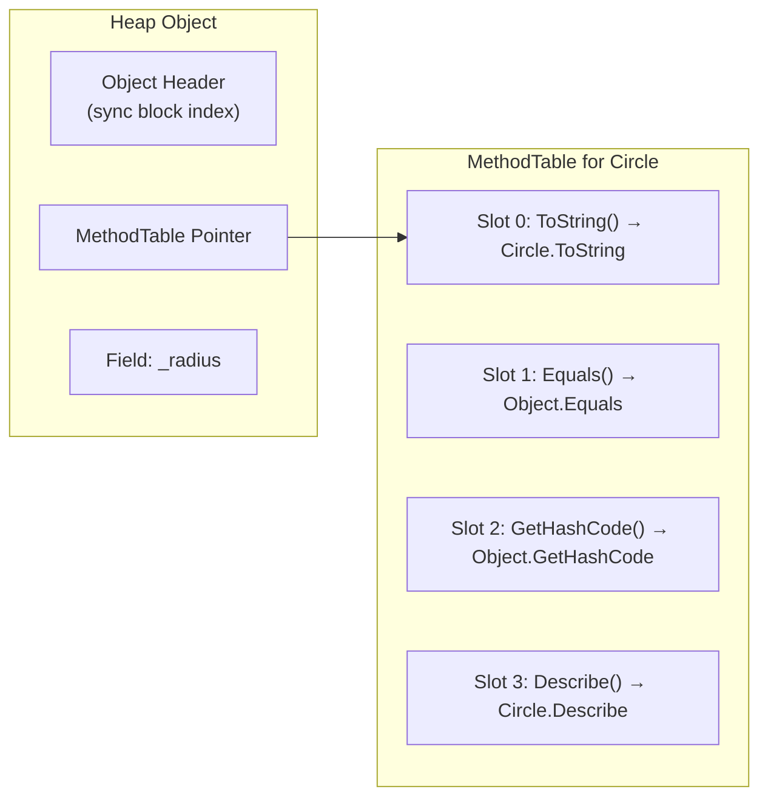

# ООП — 4 принципа

> Базовый вокабуляр для любого разговора о дизайне кода: инкапсуляция, наследование, полиморфизм, абстракция — и что в C# скрыто под каждым из них на уровне CLR.

## Содержание
- [Инкапсуляция](#инкапсуляция)
- [Наследование](#наследование)
- [Полиморфизм](#полиморфизм)
- [Абстракция](#абстракция)
- [Подводные камни](#подводные-камни)
- [См. также](#см-также)

## Инкапсуляция

Сокрытие внутреннего состояния объекта и предоставление контролируемого доступа через публичный контракт. Это **не** просто `private` поля + `public` свойства — это **information hiding**: потребитель класса не знает и не должен знать, как именно хранятся данные внутри.

Без инкапсуляции любой код может обойти бизнес-правила напрямую. Баланс счёта не должен становиться отрицательным — но если поле `balance` публичное, кто угодно напишет `account.balance = -100`. Инкапсуляция заставляет весь доступ идти через `Withdraw()`, который проверяет правила.

Модификаторы доступа в C#:

| Модификатор | Видимость |
|-------------|-----------|
| `public` | Доступен отовсюду |
| `private` | Только внутри того же класса (или struct) |
| `protected` | Внутри класса и его наследников |
| `internal` | Внутри той же сборки (assembly) |
| `protected internal` | Внутри той же сборки **ИЛИ** в наследниках (даже в другой сборке) — объединение |
| `private protected` | Внутри той же сборки **И** в наследниках — пересечение (C# 7.2) |

```csharp
/// <summary>
/// Represents a bank account with encapsulated balance management.
/// Usage: var account = new Account("ACC-001", 1000m);
/// </summary>
public class Account
{
    private decimal _balance;

    public string Number { get; init; } // init-only: только при создании

    public decimal Balance => _balance; // read-only снаружи

    public Account(string number, decimal initial)
    {
        Number = number;
        _balance = initial;
    }

    public void Withdraw(decimal amount)
    {
        if (amount <= 0)
            throw new ArgumentOutOfRangeException(nameof(amount), "Amount must be positive");
        if (amount > _balance)
            throw new InvalidOperationException("Insufficient funds");
        _balance -= amount;
    }
}
```

Information Hiding глубже, чем `private`. Это про **сокрытие решений**. Если `OrderService` хранит заказы в `Dictionary<Guid, Order>` — потребитель не должен об этом знать. Завтра это может стать Redis или PostgreSQL, а публичный контракт (`IOrderService.Get(Guid id)`) не меняется:

```csharp
// Плохо: утечка реализации
public class OrderService
{
    public Dictionary<Guid, Order> Orders { get; } = new();
}

// Хорошо: скрытие решений
public class OrderService
{
    private readonly Dictionary<Guid, Order> _store = new();
    public Order? Find(Guid id) => _store.GetValueOrDefault(id);
}
```

## Наследование

Механизм, позволяющий derived-классу получить поведение и состояние base-класса. В C# — только **одиночное наследование классов**; множественное — только через интерфейсы.

Наследование — самая сильная форма связи между классами. «Prefer composition over inheritance» — классическая рекомендация из GoF.

**`virtual` / `override` / `new`:**

```csharp
public class Shape
{
    public virtual string Describe() => "I am a shape";
    public string Tag() => "shape"; // не virtual
}

public class Circle : Shape
{
    private readonly double _radius;
    public Circle(double radius) => _radius = radius;

    public override string Describe() => $"I am a circle with radius {_radius}"; // заменяет слот в vtable
    public new string Tag() => "circle"; // скрывает метод базового класса, НЕ трогает vtable
}
```

```csharp
Shape shape = new Circle(5);
shape.Describe(); // "I am a circle with radius 5" — virtual dispatch
shape.Tag();       // "shape" — new не меняет vtable, вызов идёт по типу переменной

Circle circle = new Circle(5);
circle.Tag();      // "circle" — только если тип переменной сам Circle
```

`override` **заменяет** слот в vtable — полиморфизм работает. `new` **скрывает** метод базового класса — полиморфизм не работает, вызов зависит от типа переменной, а не типа объекта.

**`sealed`:**

```csharp
public sealed class Singleton { } // нельзя наследовать

public class Animal
{
    public virtual void Speak() => Console.WriteLine("...");
}

public class Dog : Animal
{
    public sealed override void Speak() => Console.WriteLine("Woof"); // дальше override запрещён
}
```

Зачем `sealed`: 1) JIT может девиртуализировать вызовы sealed-методов (performance) — в .NET 6+ JIT агрессивно девиртуализирует sealed-типы, вызов может быть инлайнован; 2) защита от некорректного переопределения в наследниках.

**Fragile Base Class Problem** — изменение в базовом классе ломает наследников, даже если публичный контракт не менялся:

```csharp
// Версия 1 библиотеки
public class Collection
{
    private readonly List<string> _items = new();
    public virtual void Add(string item) => _items.Add(item);
    public virtual void AddRange(IEnumerable<string> items)
    {
        foreach (var item in items) _items.Add(item); // напрямую в список
    }
}

public class LoggingCollection : Collection
{
    public override void Add(string item)
    {
        Console.WriteLine($"Adding: {item}");
        base.Add(item);
    }
}
```

Автор библиотеки «невинно» рефакторит `AddRange` в версии 2:

```csharp
public virtual void AddRange(IEnumerable<string> items)
{
    foreach (var item in items) Add(item); // теперь вызывает виртуальный Add
}
```

Теперь `LoggingCollection.AddRange(["a", "b"])` логирует каждый элемент дважды (или уходит в рекурсию, если `AddRange` тоже переопределён и вызывает `base.AddRange`). Контракт `Collection` не менялся, но наследник сломался. Вывод: `sealed` по умолчанию — хорошая практика, «composition over inheritance» — не просто мантра.

## Полиморфизм

Способность одного и того же вызова вести себя по-разному в зависимости от типа объекта. Два вида: **compile-time** и **runtime**.

**Compile-time:**

1. Перегрузка методов — компилятор выбирает метод по сигнатуре:

```csharp
public class Calculator
{
    public int Add(int a, int b) => a + b;
    public double Add(double a, double b) => a + b;
    public string Add(string a, string b) => a + b;
}
```

В IL это **разные** вызовы `call` к разным методам — решается на этапе компиляции.

2. Дженерики — параметрический полиморфизм:

```csharp
public T Max<T>(T a, T b) where T : IComparable<T> =>
    a.CompareTo(b) >= 0 ? a : b;
```

Для value types CLR генерирует специализированные версии (для `int`, `double`…), для reference types — одну общую.

**Runtime:**

```csharp
public abstract class Notification
{
    public abstract void Send(string message);
}

public class Email : Notification
{
    public override void Send(string message) => Console.WriteLine($"Email: {message}");
}

public class Sms : Notification
{
    public override void Send(string message) => Console.WriteLine($"SMS: {message}");
}

void Broadcast(IEnumerable<Notification> channels, string message)
{
    foreach (var channel in channels)
        channel.Send(message); // runtime dispatch через vtable
}
```

**Vtable в CLR.** Каждый тип имеет Method Table (аналог vtable в C++). В заголовке объекта на heap хранится указатель на неё. Method Table содержит слоты для методов типа.



При вызове `shape.Describe()`: CLR читает MethodTable pointer из объекта → находит слот `Describe` → вызывает метод по адресу из слота. Один уровень косвенности — быстро, но не бесплатно.

**Interface dispatch дороже virtual dispatch** — CLR использует Interface Map, маппящую интерфейсные слоты на слоты MethodTable, это ещё один уровень косвенности. JIT оптимизирует через **guarded devirtualization**: если в runtime тип почти всегда один и тот же, JIT вставляет проверку типа и вызывает напрямую.

## Абстракция

Выделение существенных характеристик объекта и игнорирование несущественных. В C# — через абстрактные классы и интерфейсы.

| Критерий | Abstract Class | Interface |
|----------|---------------|-----------|
| Множественное наследование | Нет (один базовый класс) | Да |
| Состояние (поля) | Может иметь | Не может |
| Конструктор | Может иметь | Не может |
| Модификаторы доступа членов | Любые | Только `public` |
| Default implementation | Обычные методы с телом | С C# 8: default interface methods |
| Назначение | «is-a» с общим состоянием | Контракт, «can-do» |

Правило большого пальца: **abstract class** — когда есть общее состояние/логика между наследниками (`Animal` с полем `Name` и методом `Breathe()`); **interface** — когда определяешь контракт без привязки к иерархии (`ISerializable`, `IDisposable`, `IComparable<T>`).

```csharp
public abstract class Report
{
    protected readonly string _title;
    protected Report(string title) => _title = title;

    public void Generate() // общая логика
    {
        var data = Collect();
        var output = Format(data);
        Save(output);
    }

    protected abstract string Format(IReadOnlyList<string> data);
    private IReadOnlyList<string> Collect() => new[] { "row1", "row2" };
    private void Save(string output) => File.WriteAllText($"{_title}.txt", output);
}

public interface IExporter
{
    Task Export(Stream data, CancellationToken token);
}
```

**Default Interface Methods (C# 8+):**

```csharp
public interface ILogger
{
    void Log(string message);
    void LogWarning(string message) => Log($"[WARN] {message}"); // default implementation
}

public class ConsoleLogger : ILogger
{
    public void Log(string message) => Console.WriteLine(message);
    // LogWarning не переопределён — используется default
}
```

Нюанс: default interface methods доступны **только через интерфейсную ссылку**, не через конкретный тип:

```csharp
var logger = new ConsoleLogger();
// logger.LogWarning("test"); // ОШИБКА КОМПИЛЯЦИИ
((ILogger)logger).LogWarning("test"); // OK
```

Это не то же самое, что метод в abstract class — там вызов через конкретный тип работает всегда.

## Подводные камни

- `new` вместо `override` — молчаливо ломает полиморфизм, компилятор только предупреждает (CS0114), не запрещает.
- Наследование ради переиспользования кода без реального «is-a» отношения — приводит к Fragile Base Class Problem и неявным контрактам между base/derived.
- Default interface methods путают с abstract class: вызов через конкретный тип не видит default-реализацию, только через интерфейсную ссылку.
- Публичные mutable-поля/автосвойства без валидации — фиктивная инкапсуляция, синтаксический шум без information hiding.

## См. также

- [SOLID](./02-solid.md) — принципы, построенные поверх ООП, для управления зависимостями между классами
- [GRASP](./03-grasp.md) — кому какую ответственность назначать
- [Антипаттерны](./08-antipatterns.md) — злоупотребление наследованием, God Object
