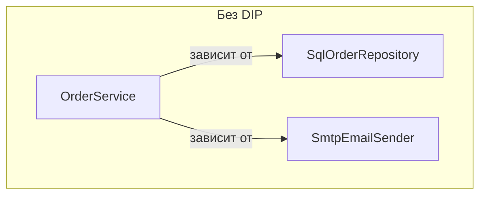
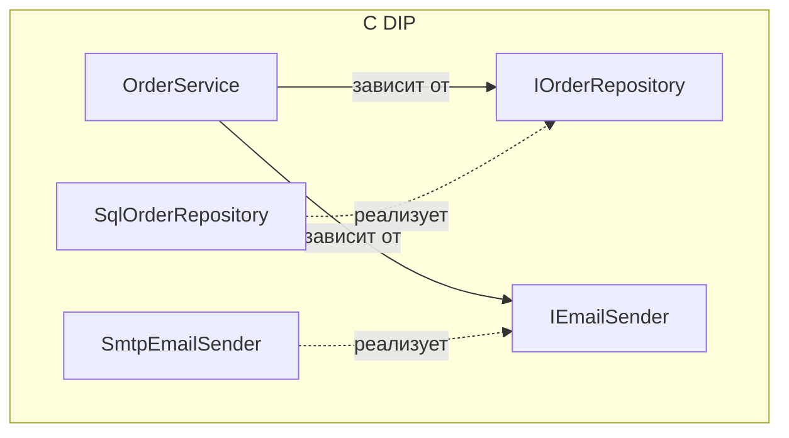

# SOLID

> Пять принципов, которые описывают, как классы должны зависеть друг от друга, чтобы систему можно было менять без цепной реакции.

## Содержание
- [Single Responsibility Principle](#single-responsibility-principle)
- [Open/Closed Principle](#openclosed-principle)
- [Liskov Substitution Principle](#liskov-substitution-principle)
- [Interface Segregation Principle](#interface-segregation-principle)
- [Dependency Inversion Principle](#dependency-inversion-principle)
- [Подводные камни](#подводные-камни)
- [См. также](#см-также)

## Single Responsibility Principle

У класса должна быть **одна причина для изменения**. Точнее (Роберт Мартин): класс должен отвечать перед **одним актором** (группой стейкхолдеров).

```csharp
// Нарушение SRP: три причины для изменения
public class Invoice
{
    public decimal Total { get; set; }
    public List<LineItem> Items { get; set; } = new();

    public decimal Calculate() => Items.Sum(i => i.Price * i.Quantity); // причина 1: бизнес-правила расчёта
    public string Print() => $"Invoice Total: {Total:C}";               // причина 2: формат отчёта
    public void Save(string path) => File.WriteAllText(path, JsonSerializer.Serialize(this)); // причина 3: способ хранения
}
```

После рефакторинга — три класса с одной ответственностью каждый:

```csharp
public class Invoice
{
    public IReadOnlyList<LineItem> Items => _items.AsReadOnly();
    private readonly List<LineItem> _items = new();

    public void Add(LineItem item) => _items.Add(item);
    public decimal Calculate() => _items.Sum(i => i.Price * i.Quantity);
}

public class InvoicePrinter
{
    public string Print(Invoice invoice) => $"Invoice Total: {invoice.Calculate():C}";
}

public class InvoiceRepository
{
    public void Save(Invoice invoice, string path) =>
        File.WriteAllText(path, JsonSerializer.Serialize(invoice));
}
```

В ASP.NET Core контроллеры часто нарушают SRP, когда содержат и валидацию, и бизнес-логику, и маппинг. Решение — сервисы для логики, `FluentValidation` для валидации, `AutoMapper`/ручные extension-методы для маппинга.

## Open/Closed Principle

Модуль должен быть **открыт для расширения**, но **закрыт для модификации**. Новое поведение не требует изменения существующего кода.

```csharp
// Нарушение: каждый новый тип скидки — правка метода
public class DiscountService
{
    public decimal Apply(Order order, string type) => type switch
    {
        "percentage" => order.Total * 0.1m,
        "fixed" => order.Total - 50m,
        "loyalty" => order.Total * 0.15m,
        _ => order.Total
    };
}
```

Соблюдение через Strategy Pattern:

```csharp
public interface IDiscount
{
    decimal Apply(decimal total);
}

public class PercentageDiscount : IDiscount
{
    private readonly decimal _rate;
    public PercentageDiscount(decimal rate) => _rate = rate;
    public decimal Apply(decimal total) => total * _rate;
}

public class FixedDiscount : IDiscount
{
    private readonly decimal _amount;
    public FixedDiscount(decimal amount) => _amount = amount;
    public decimal Apply(decimal total) => total - _amount;
}

public class DiscountService // закрыт для модификации
{
    public decimal Apply(Order order, IDiscount discount) => discount.Apply(order.Total);
}
```

Новый тип скидки — новый класс `IDiscount`, а не правка `DiscountService`.

Extension methods — ещё один инструмент OCP: расширяют поведение без модификации оригинального класса.

```csharp
public static class StringExtensions
{
    public static string Truncate(this string value, int length) =>
        value.Length <= length ? value : value[..length] + "...";
}
```

## Liskov Substitution Principle

Объекты базового типа должны быть **заменяемы** объектами производного типа **без нарушения корректности** программы. Формальный контракт Мейера:
- Предусловия не могут быть **усилены** в подтипе
- Постусловия не могут быть **ослаблены** в подтипе
- Инварианты базового типа должны сохраняться

Классическое нарушение — Square/Rectangle:

```csharp
public class Rectangle
{
    public virtual int Width { get; set; }
    public virtual int Height { get; set; }
    public int Area() => Width * Height;
}

public class Square : Rectangle
{
    // Нарушение LSP: усиление предусловия (ширина = высота)
    public override int Width
    {
        get => base.Width;
        set { base.Width = value; base.Height = value; }
    }
    public override int Height
    {
        get => base.Height;
        set { base.Height = value; base.Width = value; }
    }
}
```

```csharp
void Resize(Rectangle rect)
{
    rect.Width = 10;
    rect.Height = 5;
    // Rectangle: Area() == 50 ✓
    // Square: Area() == 25 ✗ — Height перезаписал Width
    Debug.Assert(rect.Area() == 50, "Area must be 50 after setting width=10 and height=5");
}
```

Нарушение LSP есть и в коллекциях: `IList<Dog>` не является подтипом `IList<Animal>` (инвариантность) — иначе `animals.Add(new Cat())` было бы возможным на `List<Dog>`. .NET решает это через variance: `IEnumerable<Dog>` **IS** `IEnumerable<Animal>` (ковариантность, `out T` — только чтение), `Action<Animal>` **IS** `Action<Dog>` (контравариантность, `in T` — только запись).

Правильное решение Square/Rectangle — не наследовать друг от друга:

```csharp
public abstract class Shape
{
    public abstract double Area();
}

public class Rectangle : Shape
{
    public double Width { get; }
    public double Height { get; }
    public Rectangle(double width, double height) { Width = width; Height = height; }
    public override double Area() => Width * Height;
}

public class Square : Shape
{
    public double Side { get; }
    public Square(double side) => Side = side;
    public override double Area() => Side * Side;
}
```

Оба наследуют `Shape` и корректно заменяемы.

## Interface Segregation Principle

Клиенты не должны зависеть от интерфейсов, которые не используют. Толстые интерфейсы разделяются на тонкие.

```csharp
// Fat interface
public interface IMultiFunction
{
    void Print(Document doc);
    void Scan(Document doc);
    void Fax(Document doc);
    void Staple(Document doc);
}

public class SimplePrinter : IMultiFunction
{
    public void Print(Document doc) { /* OK */ }
    public void Scan(Document doc) => throw new NotSupportedException("Cannot scan");
    public void Fax(Document doc) => throw new NotSupportedException("Cannot fax");
    public void Staple(Document doc) => throw new NotSupportedException("Cannot staple");
}
```

```csharp
public interface IPrinter { void Print(Document doc); }
public interface IScanner { void Scan(Document doc); }
public interface IFax { void Fax(Document doc); }

public class SimplePrinter : IPrinter
{
    public void Print(Document doc) { /* implementation */ }
}

public class MultiFunctionDevice : IPrinter, IScanner, IFax
{
    public void Print(Document doc) { /* implementation */ }
    public void Scan(Document doc) { /* implementation */ }
    public void Fax(Document doc) { /* implementation */ }
}
```

Частый пример из реального кода: `IRepository<T>` с `Get`/`Add`/`Update`/`Delete` нарушает ISP, если часть сущностей read-only. Лучше — `IReader<T>` и `IWriter<T>` раздельно.

## Dependency Inversion Principle

Модули верхнего уровня не должны зависеть от модулей нижнего уровня — оба зависят от **абстракций**. Абстракции не зависят от деталей, детали зависят от абстракций.





```csharp
public interface IOrderRepository
{
    Task<Order?> Find(Guid id);
    Task Save(Order order);
}

public class OrderService
{
    private readonly IOrderRepository _repository;
    private readonly IEmailSender _sender;

    public OrderService(IOrderRepository repository, IEmailSender sender)
    {
        _repository = repository;
        _sender = sender;
    }

    public async Task Place(Order order)
    {
        await _repository.Save(order);
        await _sender.Send(order.CustomerEmail, "Order placed");
    }
}
```

DIP — **принцип проектирования**. Dependency Injection — **паттерн**, реализующий его. DI-контейнер (`Microsoft.Extensions.DependencyInjection`) — **инструмент**, автоматизирующий DI:

```csharp
builder.Services.AddScoped<IOrderRepository, SqlOrderRepository>();
builder.Services.AddSingleton<IEmailSender, SmtpEmailSender>();
builder.Services.AddScoped<OrderService>();
```

Контейнер разрешает зависимости при создании `OrderService`. Смена реализации — одна строка в `Program.cs`.

## Подводные камни

- SRP путают с «один метод на класс» — на самом деле речь про **актора/причину изменения**, а не про количество методов.
- OCP доводят до абсурда: interface на каждый чих даёт over-engineering там, где изменение реально ожидается раз в год.
- LSP часто нарушают неявно — через выброс `NotSupportedException` в переопределённом методе или через усиление предусловий без осознания, что это ломает подстановку.
- DIP путают с «просто добавь интерфейс» — абстракция без вариативности реализаций (единственный `IFoo` с единственным `Foo`) не даёт выгоды, а добавляет косвенность.

## См. также

- [ООП — 4 принципа](./01-oop-principles.md) — фундамент, на котором строится SOLID
- [GRASP](./03-grasp.md) — более детальные правила распределения ответственности
- [Антипаттерны](./08-antipatterns.md) — нарушения SOLID на практике
