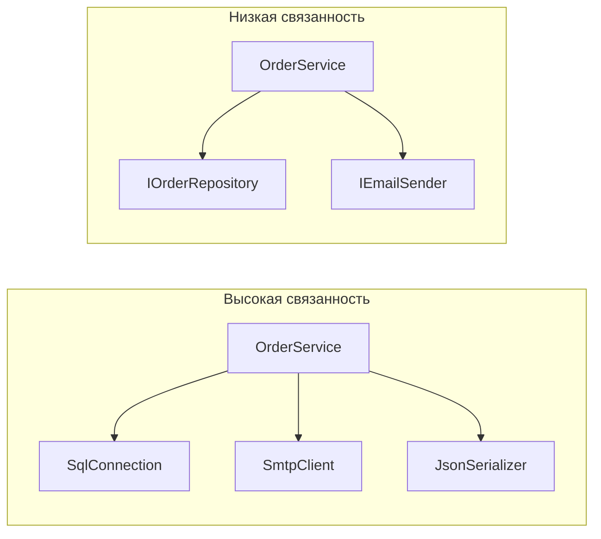
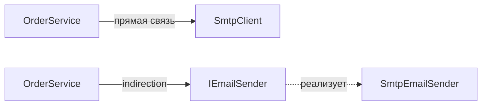

# GRASP

> Если SOLID говорит «что хорошо и что плохо», GRASP (General Responsibility Assignment Software Patterns) говорит «кому какую ответственность назначить». Девять принципов распределения обязанностей между классами.

## Содержание
- [Information Expert](#information-expert)
- [Creator](#creator)
- [Controller](#controller)
- [Low Coupling](#low-coupling)
- [High Cohesion](#high-cohesion)
- [Polymorphism](#polymorphism)
- [Pure Fabrication](#pure-fabrication)
- [Indirection](#indirection)
- [Protected Variations](#protected-variations)
- [Подводные камни](#подводные-камни)
- [См. также](#см-также)

## Information Expert

Назначай ответственность классу, который **владеет данными**, необходимыми для выполнения.

```csharp
public class Order
{
    private readonly List<LineItem> _items = new();
    public decimal Calculate() => _items.Sum(i => i.Price * i.Quantity);
}
```

Не `OrderCalculator`, не `PriceService` — а сам `Order`, потому что он владеет `Items`.

## Creator

Класс `B` должен создавать экземпляры класса `A`, если `B` содержит `A`, агрегирует `A`, тесно использует `A` или имеет данные для инициализации `A`.

```csharp
public class Order
{
    private readonly List<LineItem> _items = new();
    public void Add(string product, int quantity, decimal price) =>
        _items.Add(new LineItem(product, quantity, price));
}
```

`Order` создаёт `LineItem`, потому что агрегирует их и владеет данными для инициализации.

## Controller

Обработку системного события (UI-действие, внешний запрос) назначай объекту-контроллеру, который **не является** UI-компонентом. Контроллер делегирует работу доменным объектам.

```csharp
[ApiController]
[Route("api/orders")]
public class OrderController : ControllerBase
{
    private readonly OrderService _service;
    public OrderController(OrderService service) => _service = service;

    [HttpPost]
    public async Task<IActionResult> Create(CreateOrderRequest request) =>
        Ok(await _service.Place(request.ToDomain()));
}
```

Контроллер не содержит бизнес-логику — только принимает запрос, делегирует и возвращает результат.

## Low Coupling

Минимизируй зависимости между классами. Класс с низкой связанностью не зависит от множества других классов, легко переиспользуется и изменяется.



Low Coupling — **следствие** применения DIP и ISP (см. [SOLID](./02-solid.md)).

## High Cohesion

Класс должен выполнять **тесно связанные** задачи. Высокая связность — класс сфокусирован на одной области. Низкая связность — класс делает всё понемногу (God Object).

```csharp
// Низкая связность (God Object)
public class UserManager
{
    public void Register(User user) { }
    public void SendEmail(string to, string body) { }
    public void GenerateReport(DateTime from) { }
    public void BackupDatabase() { }
}

// Высокая связность
public class UserService { public void Register(User user) { } }
public class EmailService { public void Send(string to, string body) { } }
```

High Cohesion — **следствие** SRP.

## Polymorphism

Если поведение зависит от типа — используй полиморфизм вместо условных операторов (`if`/`switch` по типу).

```csharp
// Плохо: switch по типу
decimal CalculateShipping(Order order) => order.Type switch
{
    "express" => 15m,
    "standard" => 5m,
    _ => 0m
};

// Хорошо: полиморфизм
public interface IShipping
{
    decimal Calculate(Order order);
}

public class ExpressShipping : IShipping
{
    public decimal Calculate(Order order) => 15m;
}
```

## Pure Fabrication

Если ни один доменный объект не подходит для выполнения операции (назначение по Information Expert нарушило бы High Cohesion) — создай **искусственный** сервисный класс.

```csharp
// Order — Information Expert по своим данным, но persistence к домену не относится.
// Решение: Pure Fabrication — OrderRepository
public class OrderRepository : IOrderRepository
{
    private readonly DbContext _context;
    public OrderRepository(DbContext context) => _context = context;

    public async Task Save(Order order)
    {
        _context.Orders.Add(order);
        await _context.SaveChangesAsync();
    }
}
```

Репозитории, сервисы, фабрики — всё это Pure Fabrication. В домене нет «репозитория заказов», но в коде он необходим.

## Indirection

Введи промежуточный объект для снижения прямой связанности между двумя компонентами.



Каждый интерфейс в DI — это Indirection. Каждый адаптер — это Indirection.

## Protected Variations

Идентифицируй точки нестабильности (вариативности) и создай **стабильный интерфейс** вокруг них.

```csharp
// Точка вариативности: способ оплаты (карта, PayPal, крипто...)
public interface IPaymentGateway
{
    Task<PaymentResult> Charge(decimal amount, string token);
}

public class StripeGateway : IPaymentGateway { /* ... */ }
public class PayPalGateway : IPaymentGateway { /* ... */ }
```

Новый способ оплаты — новая реализация, стабильный интерфейс не меняется. Protected Variations — обобщение OCP: любое место, где поведение может измениться, оборачивается в абстракцию.

## Подводные камни

- Information Expert доводят до крайности: если данных для решения не хватает одному классу, лучше Pure Fabrication, чем растягивание Information Expert через цепочку геттеров (Feature Envy).
- Controller превращают в God Object, запихивая туда бизнес-логику вместо делегирования — это уже не GRASP Controller, а антипаттерн Fat Controller.
- Pure Fabrication используют как оправдание для любого «сервиса без ответственности» — злоупотребление даёт анемичную доменную модель (см. [Антипаттерны](./08-antipatterns.md)).

## См. также

- [SOLID](./02-solid.md) — Low Coupling и High Cohesion как следствия DIP/ISP и SRP
- [GoF: поведенческие паттерны](./06-gof-behavioral.md) — Strategy как реализация Polymorphism-принципа
- [Антипаттерны](./08-antipatterns.md) — God Object, Anemic Domain Model
