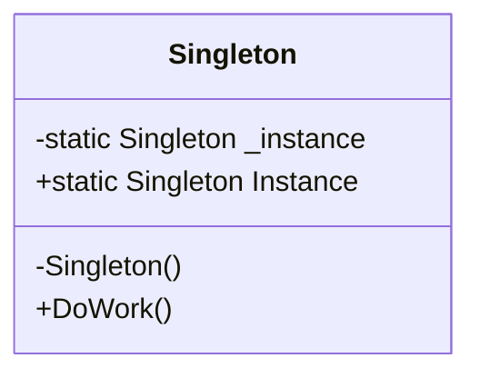
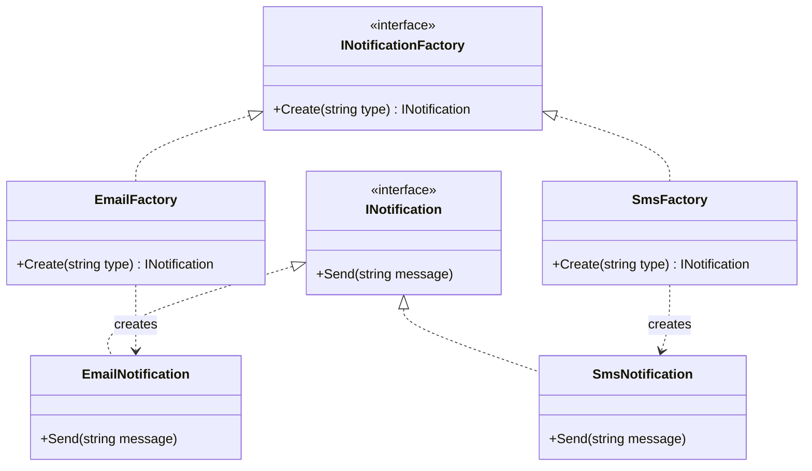
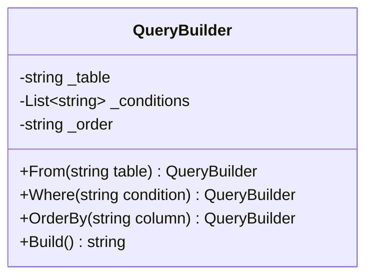
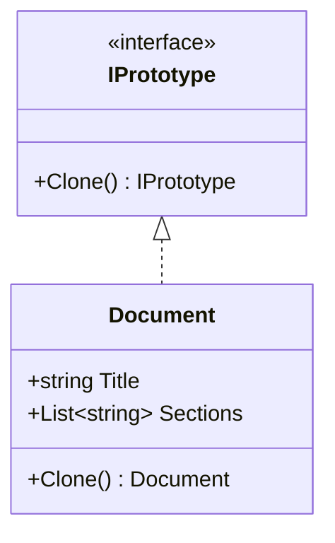

# GoF: порождающие паттерны

> Как объекты создаются: Singleton, Factory Method / Abstract Factory, Builder, Prototype — и где каждый из них реально живёт в .NET-коде, а не только в учебниках.

## Содержание
- [Singleton](#singleton)
- [Factory Method / Abstract Factory](#factory-method--abstract-factory)
- [Builder](#builder)
- [Prototype](#prototype)
- [Подводные камни](#подводные-камни)
- [См. также](#см-также)

## Singleton

Гарантирует, что у класса существует **ровно один экземпляр**, и предоставляет глобальную точку доступа к нему.

Когда использовать: логгер, конфигурация, пул соединений — объекты, которые дорого создавать и бессмысленно дублировать.



Thread-safe реализации в .NET:

```csharp
// Вариант 1: Lazy<T> — рекомендуемый
public sealed class ConnectionPool
{
    private static readonly Lazy<ConnectionPool> _lazy = new(() => new ConnectionPool());
    public static ConnectionPool Instance => _lazy.Value;

    private ConnectionPool() { /* expensive initialization */ }

    public DbConnection Acquire() => /* ... */ null!;
}

// Вариант 2: static readonly field — CLR гарантирует thread-safety инициализации типа
public sealed class AppConfig
{
    public static readonly AppConfig Instance = new();
    private AppConfig() { }
}
```

В реальном .NET-коде `IServiceCollection.AddSingleton<T>()` — DI-контейнер сам управляет lifetime, классический Singleton-паттерн руками нужен редко.

Нюанс: Singleton — это глобальное состояние. Затрудняет тестирование (нельзя подменить в юнит-тесте без DI). Везде, где можно, предпочтительнее DI с `Singleton` lifetime.

## Factory Method / Abstract Factory

**Factory Method** — определяет интерфейс для создания объекта, но позволяет подклассам решать, какой класс создавать.
**Abstract Factory** — предоставляет интерфейс для создания **семейств** связанных объектов.



```csharp
public static class NotificationFactory // Factory Method
{
    public static INotification Create(string channel) => channel switch
    {
        "email" => new EmailNotification(),
        "sms" => new SmsNotification(),
        "push" => new PushNotification(),
        _ => throw new ArgumentException($"Unknown channel: {channel}", nameof(channel))
    };
}

// Abstract Factory — семейства объектов
public interface IUiFactory
{
    IButton CreateButton();
    ITextBox CreateTextBox();
}

public class WindowsUiFactory : IUiFactory
{
    public IButton CreateButton() => new WindowsButton();
    public ITextBox CreateTextBox() => new WindowsTextBox();
}

public class MacUiFactory : IUiFactory
{
    public IButton CreateButton() => new MacButton();
    public ITextBox CreateTextBox() => new MacTextBox();
}
```

Когда использовать: создание объекта содержит логику выбора типа, или нужно гарантировать совместимость создаваемых объектов (Abstract Factory — `WindowsUiFactory` никогда не создаст `MacButton`).

## Builder

Разделяет конструирование сложного объекта от его представления. Позволяет создавать объект по шагам.



```csharp
public class QueryBuilder
{
    private string _table = string.Empty;
    private readonly List<string> _conditions = new();
    private string _order = string.Empty;

    public QueryBuilder From(string table)
    {
        _table = table;
        return this;
    }

    public QueryBuilder Where(string condition)
    {
        _conditions.Add(condition);
        return this;
    }

    public QueryBuilder OrderBy(string column)
    {
        _order = column;
        return this;
    }

    public string Build()
    {
        var query = $"SELECT * FROM {_table}";
        if (_conditions.Count > 0)
            query += " WHERE " + string.Join(" AND ", _conditions);
        if (!string.IsNullOrEmpty(_order))
            query += $" ORDER BY {_order}";
        return query;
    }
}
```

Usage: `new QueryBuilder().From("users").Where("age > 18").OrderBy("name").Build()`.

В .NET: `IHostBuilder`, `IServiceCollection`, `StringBuilder`, `IConfigurationBuilder` — Builder повсюду.

Когда использовать: объект с большим количеством параметров, многие опциональны. Телескопический конструктор (10 параметров) — сигнал, что нужен Builder.

## Prototype

Создание новых объектов путём **клонирования** существующего прототипа, а не через `new`.



```csharp
public class Document : ICloneable
{
    public string Title { get; set; } = string.Empty;
    public List<string> Sections { get; set; } = new();

    public Document Clone()
    {
        return new Document
        {
            Title = Title,
            Sections = new List<string>(Sections) // deep copy коллекции
        };
    }

    object ICloneable.Clone() => Clone();
}
```

Нюанс: `MemberwiseClone()` (встроен в `object`) делает **shallow copy** — для value types копирует значение, для reference types копирует ссылку. Без ручной обработки коллекций/вложенных объектов оригинал и клон делят одни и те же данные.

Когда использовать: создание объекта дорого (загрузка из БД, тяжёлое вычисление), а нужен «такой же, но чуть другой».

## Подводные камни

- Singleton руками вместо DI `AddSingleton<T>()` — теряется тестируемость и явность зависимостей, объект превращается в скрытое глобальное состояние.
- Factory с гигантским `switch` по строкам — сам по себе нарушение OCP; для расширяемости лучше регистрация фабрик через DI или словарь делегатов.
- Prototype без осознанного deep/shallow copy — самая частая причина «клон меняет оригинал», когда забывают клонировать вложенные коллекции/объекты.
- Builder без immutability результата — если `Build()` возвращает mutable-объект, вызывающий код может продолжить менять его в обход builder-инвариантов.

## См. также

- [ООП — 4 принципа](./01-oop-principles.md) — vtable и полиморфизм, на которых строятся Factory/Abstract Factory
- [GoF: структурные паттерны](./05-gof-structural.md)
- [Антипаттерны](./08-antipatterns.md)
