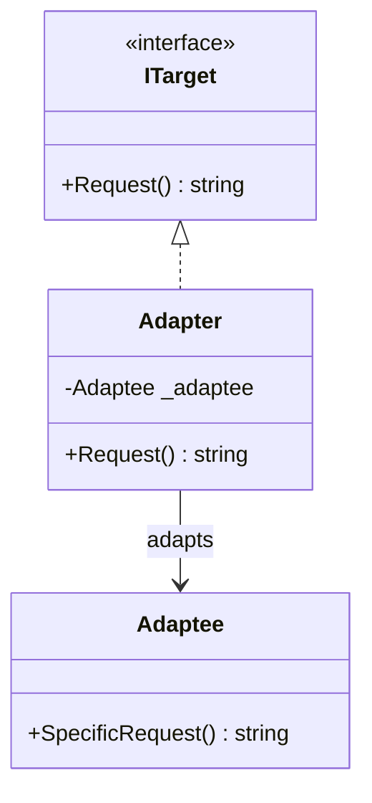
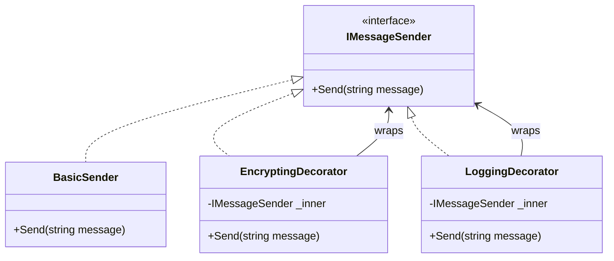
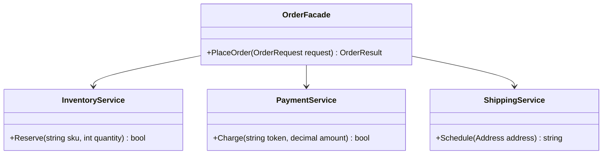
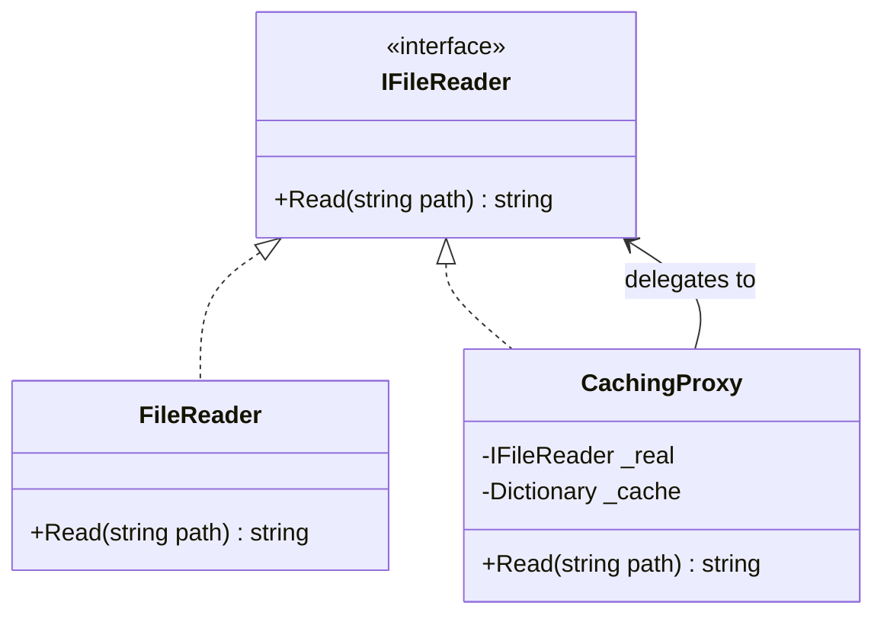

# GoF: структурные паттерны

> Как объекты и классы компонуются в более крупные структуры: Adapter, Decorator, Facade, Proxy. Все четыре оборачивают один интерфейс вокруг другого объекта — разница в цели обёртки.

## Содержание
- [Adapter](#adapter)
- [Decorator](#decorator)
- [Facade](#facade)
- [Proxy](#proxy)
- [Подводные камни](#подводные-камни)
- [См. также](#см-также)

## Adapter

Преобразует интерфейс класса в другой интерфейс, который ожидает клиент. Позволяет работать вместе классам с несовместимыми интерфейсами.



```csharp
// Старая система логирования с несовместимым интерфейсом
public class LegacyLogger
{
    public void WriteLog(string severity, string text, DateTime timestamp) =>
        Console.WriteLine($"[{timestamp:O}] [{severity}] {text}");
}

public interface IAppLogger
{
    void Log(string message);
}

public class LegacyLoggerAdapter : IAppLogger
{
    private readonly LegacyLogger _legacy;
    public LegacyLoggerAdapter(LegacyLogger legacy) => _legacy = legacy;

    public void Log(string message) =>
        _legacy.WriteLog("INFO", message, DateTime.UtcNow);
}
```

Когда использовать: интеграция со сторонним API, миграция со старой системы, обёртка над legacy-кодом.

## Decorator

Динамически добавляет объекту новое поведение, оборачивая его в объект-декоратор с тем же интерфейсом.



```csharp
public interface IMessageSender
{
    void Send(string message);
}

public class BasicSender : IMessageSender
{
    public void Send(string message) => Console.WriteLine($"Sending: {message}");
}

public class LoggingDecorator : IMessageSender
{
    private readonly IMessageSender _inner;
    public LoggingDecorator(IMessageSender inner) => _inner = inner;

    public void Send(string message)
    {
        Console.WriteLine($"LOG: About to send message of length {message.Length}");
        _inner.Send(message);
    }
}

public class EncryptingDecorator : IMessageSender
{
    private readonly IMessageSender _inner;
    public EncryptingDecorator(IMessageSender inner) => _inner = inner;

    public void Send(string message)
    {
        var encrypted = Convert.ToBase64String(System.Text.Encoding.UTF8.GetBytes(message));
        _inner.Send(encrypted);
    }
}

// Композиция декораторов
IMessageSender sender = new LoggingDecorator(
    new EncryptingDecorator(
        new BasicSender()));

sender.Send("hello");
// LOG: About to send message of length 5
// Sending: aGVsbG8=
```

В .NET: `Stream` → `BufferedStream` → `GZipStream` — классический Decorator. `HttpClient` + `DelegatingHandler` — Decorator для HTTP-запросов.

Когда использовать: нужно добавить поведение (логирование, кеширование, валидация), не меняя исходный класс.

## Facade

Предоставляет **упрощённый интерфейс** к сложной подсистеме. Скрывает детали взаимодействия множества классов за одним вызовом.



```csharp
public class OrderFacade
{
    private readonly InventoryService _inventory;
    private readonly PaymentService _payment;
    private readonly ShippingService _shipping;

    public OrderFacade(InventoryService inventory, PaymentService payment, ShippingService shipping)
    {
        _inventory = inventory;
        _payment = payment;
        _shipping = shipping;
    }

    public OrderResult Place(OrderRequest request)
    {
        var reserved = _inventory.Reserve(request.Sku, request.Quantity);
        if (!reserved) return OrderResult.Fail("Out of stock");

        var charged = _payment.Charge(request.PaymentToken, request.Amount);
        if (!charged) return OrderResult.Fail("Payment declined");

        var tracking = _shipping.Schedule(request.Address);
        return OrderResult.Ok(tracking);
    }
}
```

Когда использовать: сложная подсистема с множеством взаимодействующих классов, и клиенту не нужно знать все детали.

## Proxy

Подставной объект, контролирующий доступ к реальному объекту. Имеет тот же интерфейс, но добавляет слой логики (кеширование, ленивая загрузка, контроль доступа).



```csharp
public interface IFileReader
{
    string Read(string path);
}

public class FileReader : IFileReader
{
    public string Read(string path) => File.ReadAllText(path);
}

public class CachingFileProxy : IFileReader
{
    private readonly IFileReader _real;
    private readonly Dictionary<string, string> _cache = new();

    public CachingFileProxy(IFileReader real) => _real = real;

    public string Read(string path)
    {
        if (_cache.TryGetValue(path, out var cached)) return cached;

        var content = _real.Read(path);
        _cache[path] = content;
        return content;
    }
}
```

Виды Proxy:
- **Virtual Proxy** — ленивая инициализация (`Lazy<T>`)
- **Protection Proxy** — проверка доступа перед делегированием
- **Caching Proxy** — как в примере выше
- **Remote Proxy** — скрывает сетевое взаимодействие (gRPC client)

Когда использовать: нужно контролировать доступ к дорогому или удалённому ресурсу.

## Подводные камни

- Adapter, Decorator и Proxy структурно почти одинаковы (обёртка с тем же интерфейсом) — их путают. Разница в **намерении**: Adapter меняет интерфейс под клиента, Decorator добавляет поведение поверх того же интерфейса, Proxy контролирует доступ к тому же интерфейсу.
- Facade, который начинают использовать как единственную точку входа для *любой* логики — постепенно превращается в God Object, если внутрь начинают заносить бизнес-правила вместо оркестрации вызовов подсистем.
- Caching Proxy без инвалидации кеша — данные устаревают молча, симптом всплывает не сразу.
- Цепочка из множества Decorator'ов усложняет отладку: логика распределена по N маленьких классов, стектрейс не даёт единой точки, где искать баг.

## См. также

- [GoF: порождающие паттерны](./04-gof-creational.md)
- [GoF: поведенческие паттерны](./06-gof-behavioral.md)
- [Антипаттерны](./08-antipatterns.md)
