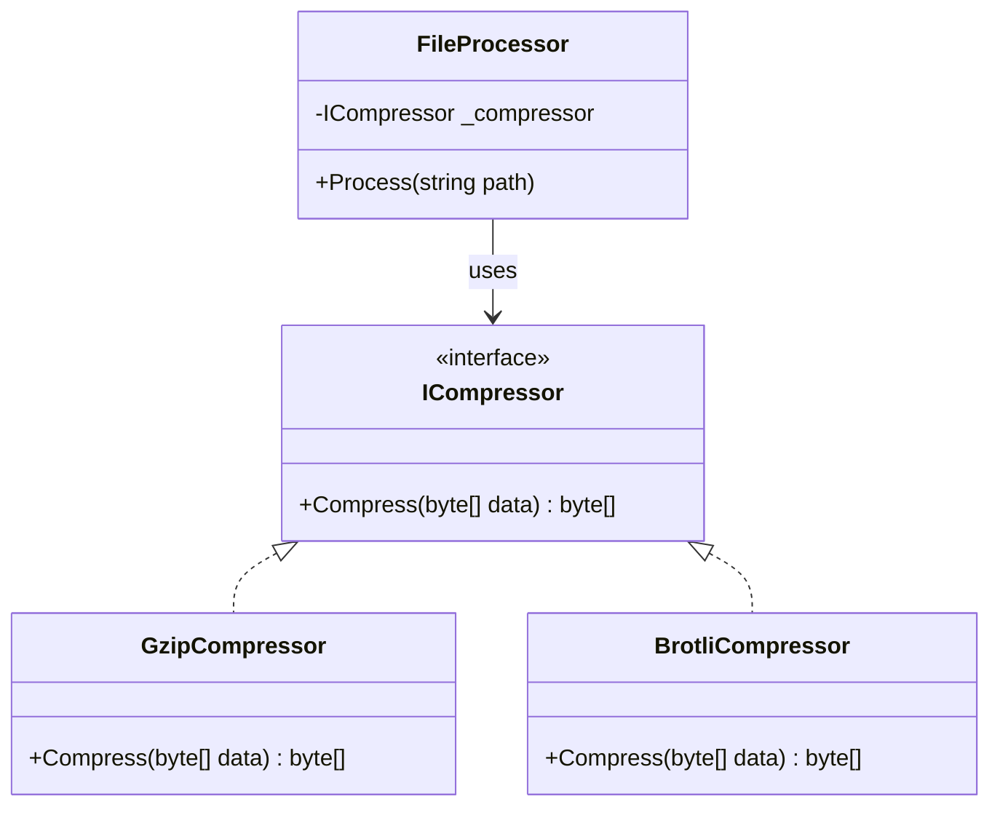
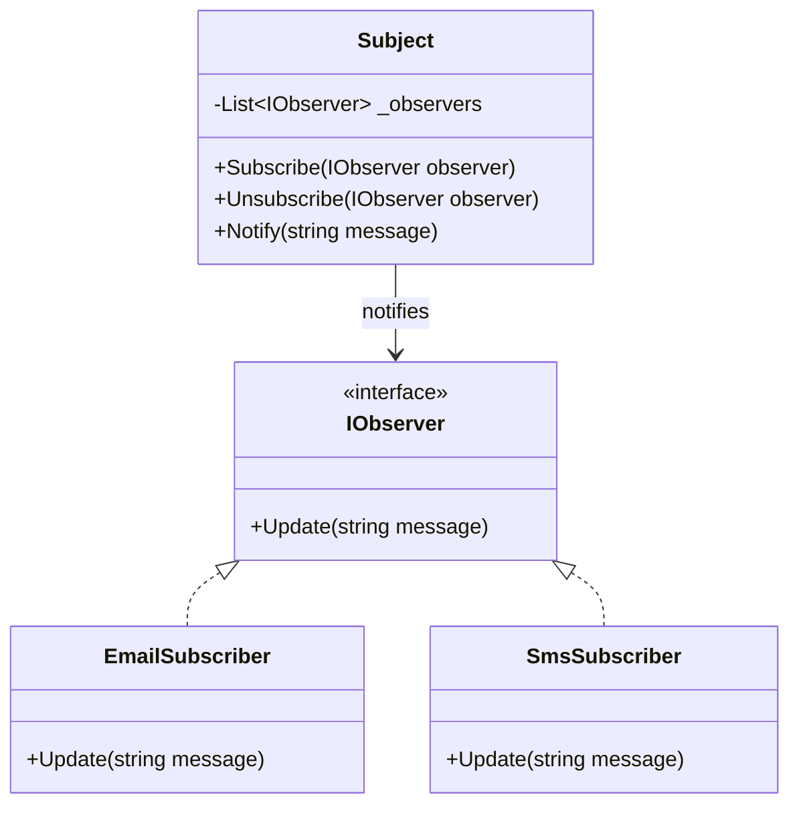
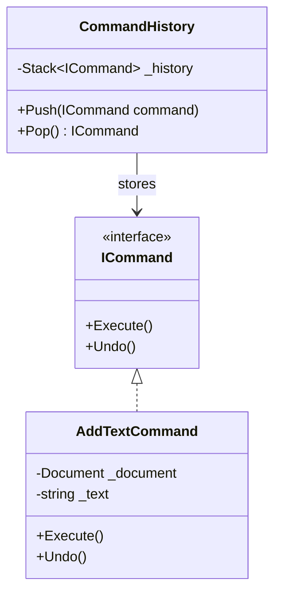
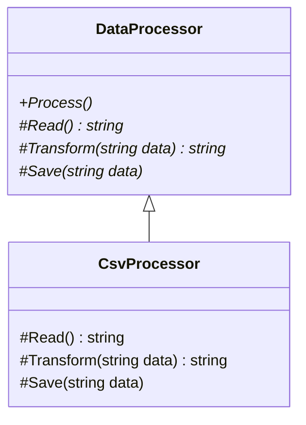
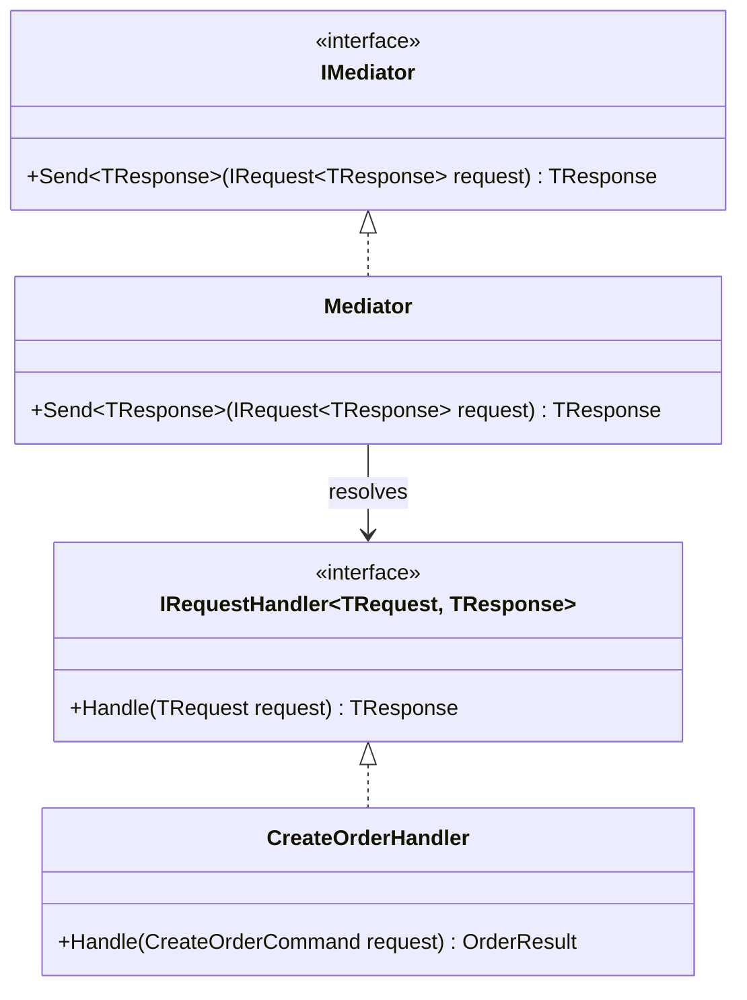
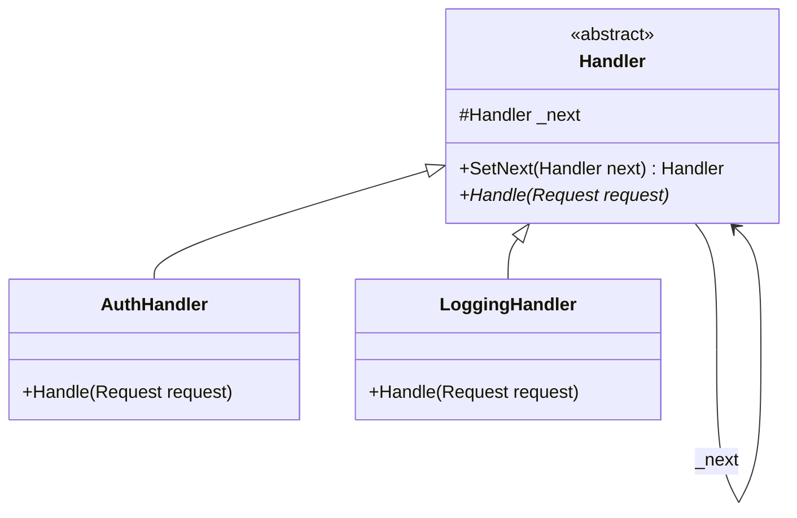

# GoF: поведенческие паттерны

> Как объекты взаимодействуют и распределяют обязанности: Strategy, Observer, Command, Template Method, Mediator, Chain of Responsibility. Самая большая группа GoF — и самая часто встречающаяся в реальном .NET-коде (events, middleware, MediatR).

## Содержание
- [Strategy](#strategy)
- [Observer](#observer)
- [Command](#command)
- [Template Method](#template-method)
- [Mediator](#mediator)
- [Chain of Responsibility](#chain-of-responsibility)
- [Подводные камни](#подводные-камни)
- [См. также](#см-также)

## Strategy

Определяет семейство алгоритмов, инкапсулирует каждый и делает их взаимозаменяемыми.



```csharp
public interface ICompressor
{
    byte[] Compress(byte[] data);
}

public class GzipCompressor : ICompressor
{
    public byte[] Compress(byte[] data)
    {
        using var output = new MemoryStream();
        using (var gzip = new GZipStream(output, CompressionLevel.Optimal))
            gzip.Write(data, 0, data.Length);
        return output.ToArray();
    }
}

public class BrotliCompressor : ICompressor
{
    public byte[] Compress(byte[] data)
    {
        using var output = new MemoryStream();
        using (var brotli = new BrotliStream(output, CompressionLevel.Optimal))
            brotli.Write(data, 0, data.Length);
        return output.ToArray();
    }
}

public class FileProcessor
{
    private readonly ICompressor _compressor;
    public FileProcessor(ICompressor compressor) => _compressor = compressor;

    public void Process(string path)
    {
        var data = File.ReadAllBytes(path);
        var compressed = _compressor.Compress(data);
        File.WriteAllBytes(path + ".compressed", compressed);
    }
}
```

Когда использовать: несколько вариантов алгоритма, выбор делается в runtime. Strategy — это OCP в действии (см. [SOLID](./02-solid.md)).

## Observer

Определяет зависимость «один ко многим» — когда один объект меняет состояние, все зависимые уведомляются автоматически.



В C# — встроенная поддержка через `event`:

```csharp
public class AuctionItem
{
    public string Name { get; }
    public event EventHandler<BidEventArgs>? BidPlaced; // compile-time поддержка Observer

    public AuctionItem(string name) => Name = name;

    public void Bid(string bidder, decimal amount)
    {
        BidPlaced?.Invoke(this, new BidEventArgs(bidder, amount));
    }
}

public class BidEventArgs : EventArgs
{
    public string Bidder { get; }
    public decimal Amount { get; }
    public BidEventArgs(string bidder, decimal amount) { Bidder = bidder; Amount = amount; }
}

var item = new AuctionItem("Painting");
item.BidPlaced += (sender, args) =>
    Console.WriteLine($"New bid from {args.Bidder}: {args.Amount:C}");

item.Bid("Alice", 100m);
// New bid from Alice: $100.00
```

`event` в C# — ограниченный `delegate`. Снаружи можно только `+=`/`-=` (подписка/отписка). Вызвать `Invoke` может только сам класс-владелец — это инкапсуляция: никто снаружи не «дёргает» событие напрямую.

Утечка памяти через events: если подписчик живёт дольше, чем нужно, и не отписывается — `event` держит ссылку на него, GC его не соберёт. В долгоживущих объектах (Singleton) event-подписки — частая причина утечек.

Когда использовать: уведомление нескольких компонентов о событии без жёсткой связи между ними.

## Command

Инкапсулирует запрос как объект, позволяя параметризовать клиентов разными запросами, ставить запросы в очередь и поддерживать отмену.



```csharp
public interface ICommand
{
    void Execute();
    void Undo();
}

public class AddTextCommand : ICommand
{
    private readonly StringBuilder _document;
    private readonly string _text;

    public AddTextCommand(StringBuilder document, string text)
    {
        _document = document;
        _text = text;
    }

    public void Execute() => _document.Append(_text);
    public void Undo() => _document.Remove(_document.Length - _text.Length, _text.Length);
}

public class TextEditor
{
    private readonly StringBuilder _content = new();
    private readonly Stack<ICommand> _history = new();

    public void Type(string text)
    {
        var command = new AddTextCommand(_content, text);
        command.Execute();
        _history.Push(command);
    }

    public void Undo()
    {
        if (_history.Count > 0) _history.Pop().Undo();
    }

    public string Content => _content.ToString();
}
```

Когда использовать: undo/redo, очереди задач, логирование операций, транзакции.

## Template Method

Определяет **скелет алгоритма** в базовом классе, делегируя отдельные шаги подклассам. Подклассы переопределяют шаги, не меняя общую структуру.



```csharp
public abstract class DataProcessor
{
    // Template method — скелет, не virtual
    public void Process()
    {
        var raw = Read();
        var transformed = Transform(raw);
        Save(transformed);
    }

    protected abstract string Read();
    protected abstract string Transform(string data);
    protected abstract string Save(string data);
}

public class CsvProcessor : DataProcessor
{
    protected override string Read() => File.ReadAllText("data.csv");
    protected override string Transform(string data) => data.Replace(",", " | ");
    protected override string Save(string data)
    {
        File.WriteAllText("output.txt", data);
        return "output.txt";
    }
}
```

Когда использовать: одинаковая структура алгоритма, но разные реализации шагов. Отличие от Strategy: Template Method работает через **наследование**, Strategy — через **композицию**.

## Mediator

Определяет объект, инкапсулирующий **взаимодействие** между множеством объектов. Вместо прямых ссылок друг на друга объекты общаются через посредника.



MediatR — реализация Mediator в .NET:

```csharp
// NuGet: MediatR
public record CreateOrderCommand(string Product, int Quantity) : IRequest<OrderResult>;

public class CreateOrderHandler : IRequestHandler<CreateOrderCommand, OrderResult>
{
    private readonly IOrderRepository _repository;
    public CreateOrderHandler(IOrderRepository repository) => _repository = repository;

    public async Task<OrderResult> Handle(CreateOrderCommand request, CancellationToken token)
    {
        var order = new Order(request.Product, request.Quantity);
        await _repository.Save(order);
        return new OrderResult(order.Id);
    }
}

[ApiController]
[Route("api/orders")]
public class OrderController : ControllerBase
{
    private readonly IMediator _mediator;
    public OrderController(IMediator mediator) => _mediator = mediator;

    [HttpPost]
    public async Task<IActionResult> Create(CreateOrderCommand command) =>
        Ok(await _mediator.Send(command));
}
```

Зачем MediatR: контроллер не знает про `CreateOrderHandler`. Новый обработчик — новый класс, без изменения контроллера. Pipeline behaviors (логирование, валидация) навешиваются как декораторы вокруг `Send`.

Когда использовать: CQRS, когда контроллеры начинают зависеть от десятков сервисов, для pipeline behaviors (cross-cutting concerns).

## Chain of Responsibility

Передаёт запрос по цепочке обработчиков. Каждый решает: обработать запрос или передать дальше.



```csharp
public abstract class Handler
{
    private Handler? _next;

    public Handler SetNext(Handler next)
    {
        _next = next;
        return next;
    }

    public virtual void Handle(HttpContext context)
    {
        _next?.Handle(context);
    }
}

public class AuthHandler : Handler
{
    public override void Handle(HttpContext context)
    {
        if (string.IsNullOrEmpty(context.Token))
        {
            context.Response = "401 Unauthorized";
            return; // прерываем цепочку
        }
        base.Handle(context); // передаём дальше
    }
}

public class LoggingHandler : Handler
{
    public override void Handle(HttpContext context)
    {
        Console.WriteLine($"Request: {context.Path}");
        base.Handle(context);
        Console.WriteLine($"Response: {context.Response}");
    }
}
```

ASP.NET Core middleware pipeline — это Chain of Responsibility:

```csharp
app.Use(async (context, next) =>
{
    Console.WriteLine($"Request: {context.Request.Path}"); // before
    await next(context);                                    // передать дальше
    Console.WriteLine($"Response: {context.Response.StatusCode}"); // after
});

app.UseAuthentication();
app.UseAuthorization();
app.MapControllers();
```

Каждый middleware — звено цепочки: может обработать запрос (вернуть ответ, не вызывая `next`) или передать дальше. Middleware выполняется в порядке регистрации, ответ возвращается в обратном порядке (как матрёшка).

Когда использовать: обработка запросов с переменным набором шагов, middleware, валидация с несколькими уровнями.

## Подводные камни

- Observer через `event` без отписки в долгоживущем объекте — классическая утечка памяти; в WPF/Blazor решается weak event pattern, в бэкенде — явным `-=` в `Dispose`.
- Template Method с большим числом абстрактных шагов заставляет каждый наследник реализовывать всё, даже неприменимые шаги — сигнал, что часть шагов стоит сделать `virtual` с реализацией по умолчанию, а не `abstract`.
- Mediator (MediatR) применяют «для всего» — каждый CRUD-эндпоинт через `IRequest`, даже там, где нет cross-cutting concerns и оркестрации — лишняя косвенность без выгоды.
- Chain of Responsibility без явного контракта «кто должен вызвать `next`» — забытый вызов `next()` в middleware молча обрывает pipeline.

## См. также

- [GRASP](./03-grasp.md) — Polymorphism-принцип как основа Strategy
- [GoF: структурные паттерны](./05-gof-structural.md)
- [Антипаттерны](./08-antipatterns.md)
