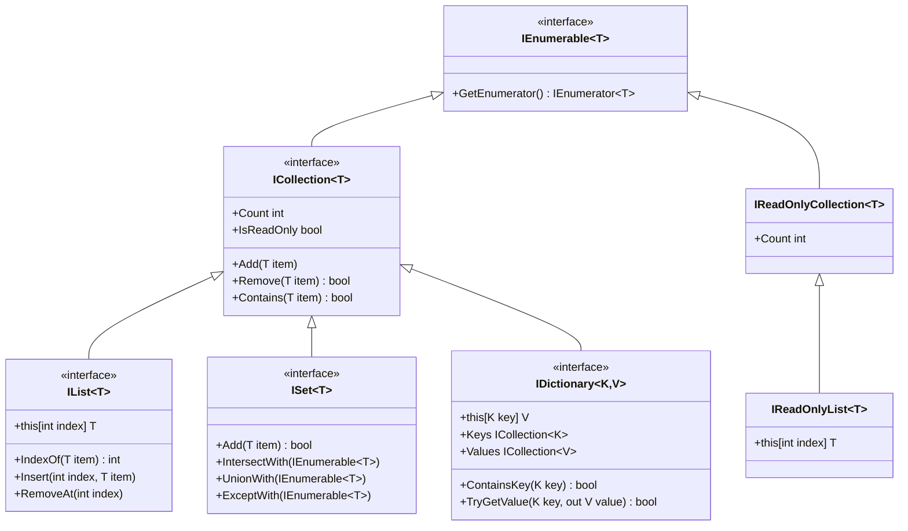

# Коллекции в .NET

> Concurrent-коллекции для многопоточности, иерархия интерфейсов для правильного выбора типа параметра/возврата, и трансформации между коллекциями — три вещи, которые постоянно путают на практике.

> Структуры данных и Big O — см. [notes/algorithms](../algorithms/README.md).

## Содержание
- [Concurrent-коллекции](#concurrent-коллекции)
- [Иерархия интерфейсов коллекций](#иерархия-интерфейсов-коллекций)
- [Трансформации коллекций](#трансформации-коллекций)
- [Подводные камни](#подводные-камни)
- [См. также](#см-также)

## Concurrent-коллекции

Потокобезопасные коллекции из `System.Collections.Concurrent`. Не требуют внешней синхронизации (`lock`), используют lock-free алгоритмы или fine-grained locking.

```csharp
// ConcurrentDictionary — thread-safe словарь
var cache = new ConcurrentDictionary<string, byte[]>();

var data = cache.GetOrAdd("key", key => LoadFromDatabase(key)); // атомарное «получить или добавить»

cache.AddOrUpdate(
    "key",
    addValueFactory: key => new byte[100],
    updateValueFactory: (key, old) => Refresh(old)); // атомарное обновление

// ConcurrentQueue — thread-safe очередь (lock-free!)
var queue = new ConcurrentQueue<WorkItem>();
queue.Enqueue(new WorkItem("task1"));
if (queue.TryDequeue(out var item)) Process(item);

// ConcurrentBag — неупорядоченная коллекция для producer-consumer,
// где поток чаще добавляет и забирает свои же элементы
var bag = new ConcurrentBag<int>();
bag.Add(42);
if (bag.TryTake(out var value)) Console.WriteLine(value);
```

`ConcurrentDictionary` использует **striped locking** — массив lock-объектов, каждый защищает свою группу bucket'ов. По умолчанию `concurrencyLevel = Environment.ProcessorCount`. Это значит, что несколько потоков могут **одновременно** писать в разные bucket'ы без блокировки друг друга.

Когда использовать: любой shared state между потоками. Не используй обычный `Dictionary` + `lock` — `ConcurrentDictionary` и быстрее, и безопаснее (нет риска забыть lock в одном из мест доступа).

## Иерархия интерфейсов коллекций



Правило выбора параметра метода (от широкого к узкому):

| Нужно | Используй |
|-------|-----------|
| Только итерация | `IEnumerable<T>` |
| Итерация + Count | `IReadOnlyCollection<T>` |
| Итерация + Count + индекс | `IReadOnlyList<T>` |
| Модификация | `ICollection<T>` или `IList<T>` |

```csharp
// Параметр метода — самый широкий подходящий тип
public void Print<T>(IEnumerable<T> items)
{
    foreach (var item in items) Console.WriteLine(item);
}

// Возвращаемый тип — максимально узкий для readonly контракта
public IReadOnlyList<User> ListActive() =>
    _users.Where(u => u.IsActive).ToList().AsReadOnly();
```

Это применение GRASP Protected Variations и ISP: метод не должен требовать больше возможностей, чем реально использует.

## Трансформации коллекций

```csharp
var list = new List<int> { 1, 2, 3, 4, 5 };

int[] array = list.ToArray(); // новый массив, копирует элементы. O(n)

List<int> copy = list.Where(x => x > 2).ToList(); // материализация LINQ-запроса. O(n)

// AsReadOnly — обёртка (ReadOnlyCollection<T>), НЕ копирует данные!
IReadOnlyList<int> readOnly = list.AsReadOnly();

var unique = list.ToHashSet(); // удаление дубликатов + быстрый Contains. O(n)

var users = new[] { new { Id = 1, Name = "Alice" }, new { Id = 2, Name = "Bob" } };
var dict = users.ToDictionary(u => u.Id, u => u.Name); // O(n)

// ToFrozenDictionary / ToFrozenSet (.NET 8) — иммутабельные, оптимизированы для чтения
// using System.Collections.Frozen;
var frozen = dict.ToFrozenDictionary(); // создание дорогое O(n), lookup быстрее обычного Dictionary
```

`ToArray` против `ToList`: `ToArray` — если размер точно не изменится (чуть меньше overhead, нет поля `_size`); `ToList` — если возможны дальнейшие добавления.

`AsReadOnly` против `ToList().AsReadOnly()` — ключевая разница в независимости от источника:

```csharp
var original = new List<int> { 1, 2, 3 };

var wrap = original.AsReadOnly(); // обёртка над original
original.Add(4);
Console.WriteLine(wrap.Count); // 4 — мутации original видны через wrap!

var safe = original.ToList().AsReadOnly(); // независимая копия
original.Add(5);
Console.WriteLine(safe.Count); // остаётся прежним, не отражает Add(5)
```

## Подводные камни

- `AsReadOnly()` не защищает от изменений — это протечка мутабельности через «readonly» контракт, если оригинальный список остаётся доступен вызывающему коду.
- Параметр метода типа `List<T>` вместо `IEnumerable<T>`/`IReadOnlyList<T>` — избыточное требование к вызывающему коду и нарушение ISP на уровне сигнатур.
- `ConcurrentDictionary.GetOrAdd` с фабрикой, имеющей побочные эффекты — фабрика может быть вызвана несколько раз параллельно (гарантия атомарности только для итогового значения в словаре, не для однократного вызова фабрики).
- `ToFrozenDictionary` в горячем пути создания (не только чтения) — дорогая операция построения, оправдана только когда словарь строится один раз и читается много.

## См. также

- [notes/algorithms](../algorithms/README.md) — структуры данных и Big O для самих коллекций
- [SOLID](./02-solid.md) — ISP как основание для выбора узкого интерфейса параметра
- [Антипаттерны](./08-antipatterns.md)
