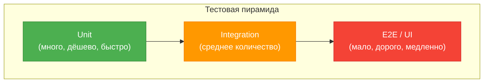
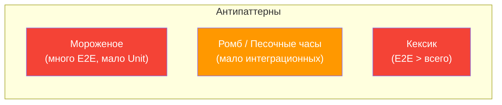
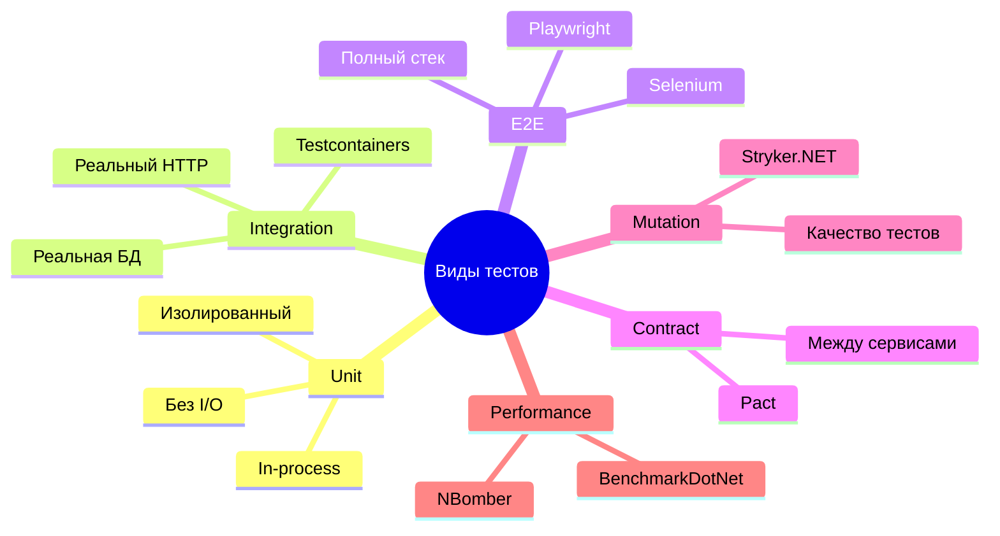

# Пирамида и виды тестов

> Как выбрать уровень проверки по риску и стоимости.

## Содержание

- [Тестовая пирамида](#тестовая-пирамида)
- [Виды тестов](#виды-тестов)
- [Подводные камни](#подводные-камни)
- [См. также](#см-также)

## Тестовая пирамида

Тестовая пирамида — модель, описывающая оптимальное соотношение видов тестов в проекте. Введена Майком Коном в 2009 году.



### Почему именно пирамида

| Характеристика | Unit | Integration | E2E |
|---|---|---|---|
| Скорость | миллисекунды | секунды | минуты |
| Стоимость поддержки | низкая | средняя | высокая |
| Изоляция | полная | частичная | нет |
| Покрытие реального сценария | низкое | среднее | высокое |
| Место нахождения багов | точное | примерное | неизвестно |

### Антипаттерны формы



**Мороженое** — команда боится писать unit-тесты, покрывает всё через UI. Результат: тесты падают при любом рефакторинге, запускают раз в день, никто не доверяет.

**Ромб / Песочные часы** — много unit и E2E, мало integration. Юниты не ловят проблемы на стыке компонентов, E2E дублируют одни и те же сценарии.

### Пример соотношения

Это иллюстрация, а не норматив: баланс зависит от рисков и архитектуры.

- **70% Unit** — бизнес-логика, алгоритмы, маппинг, валидация
- **20% Integration** — взаимодействие с БД, HTTP, очередями
- **10% E2E** — только критические пути (оплата, регистрация, авторизация)

## Виды тестов



### Unit-тест

Тестирует одну единицу логики (класс, метод) в полной изоляции. Внешние зависимости изолируются; простые объекты и чистые функции можно использовать напрямую.

```csharp
// Тестируем OrderService.Calculate без реального репозитория
public class OrderServiceTests
{
    [Fact]
    public void Calculate_WithDiscount_AppliesPercentage()
    {
        var service = new OrderService();
        var order = new Order { BasePrice = 100m, DiscountPercent = 10 };

        var result = service.Calculate(order);

        Assert.Equal(90m, result.Total);
    }
}
```

### Integration-тест

Проверяет взаимодействие нескольких компонентов: сервис + репозиторий + реальная БД.

```csharp
// Тест поднимает реальный PostgreSQL через Testcontainers
public class OrderRepositoryTests : IAsyncLifetime
{
    private PostgreSqlContainer _postgres = new PostgreSqlBuilder().Build();

    public async Task InitializeAsync() => await _postgres.StartAsync();
    public async Task DisposeAsync() => await _postgres.DisposeAsync();

    [Fact]
    public async Task Save_ValidOrder_PersistsToDatabase()
    {
        var repo = new OrderRepository(_postgres.GetConnectionString());
        var order = new Order { Id = Guid.NewGuid(), Total = 99.99m };

        await repo.Save(order);
        var found = await repo.Find(order.Id);

        Assert.NotNull(found);
    }
}
```

### E2E-тест

Проверяет пользовательский сценарий через развёрнутую систему. Пример ниже с `WebApplicationFactory` — интеграционный API-тест в памяти; для E2E нужен реальный запуск приложения и его зависимостей.

```csharp
public class CheckoutE2ETests : IClassFixture<WebApplicationFactory<Program>>
{
    private readonly HttpClient _client;

    public CheckoutE2ETests(WebApplicationFactory<Program> factory)
    {
        _client = factory.CreateClient();
    }

    [Fact]
    public async Task Checkout_ValidCart_Returns201()
    {
        var response = await _client.PostAsJsonAsync("/api/checkout", new
        {
            CartId = "abc-123",
            PaymentToken = "tok_test"
        });

        Assert.Equal(HttpStatusCode.Created, response.StatusCode);
    }
}
```

### Contract-тест (Pact)

Потребитель (consumer) описывает контракт: «я ожидаю такой ответ». Провайдер проверяет, что реально отвечает именно так. Особенно важно в микросервисах — позволяет обнаружить несовместимость без запуска всего стека.

### Mutation-тест (Stryker.NET)

Stryker вносит небольшие «мутации» в код (заменяет `>` на `>=`, `+` на `-`) и проверяет, что тесты это обнаруживают. Выжившая мутация может означать пробел в проверках; эквивалентные мутации не меняют наблюдаемое поведение и требуют отдельного анализа.

```bash
dotnet tool install -g dotnet-stryker
dotnet stryker
```

Метрика: **Mutation Score** — процент убитых мутантов. Порог выбирает команда; число само по себе не доказывает качество тестов.

### Performance-тест

```csharp
[MemoryDiagnoser]
public class SerializerBenchmark
{
    private readonly Order _order = new() { Id = Guid.NewGuid(), Total = 100m };

    [Benchmark]
    public string SystemTextJson() => JsonSerializer.Serialize(_order);

    [Benchmark]
    public string Newtonsoft() => JsonConvert.SerializeObject(_order);
}
```

## Подводные камни

Баланс уровней зависит от архитектуры. In-process API-тест не проверяет реальную сеть.

## См. также

- [AAA и FIRST](./02-aaa-first.md)
- [Интеграционные тесты](./06-integration-tests.md)
- [Оглавление раздела](./README.md)
