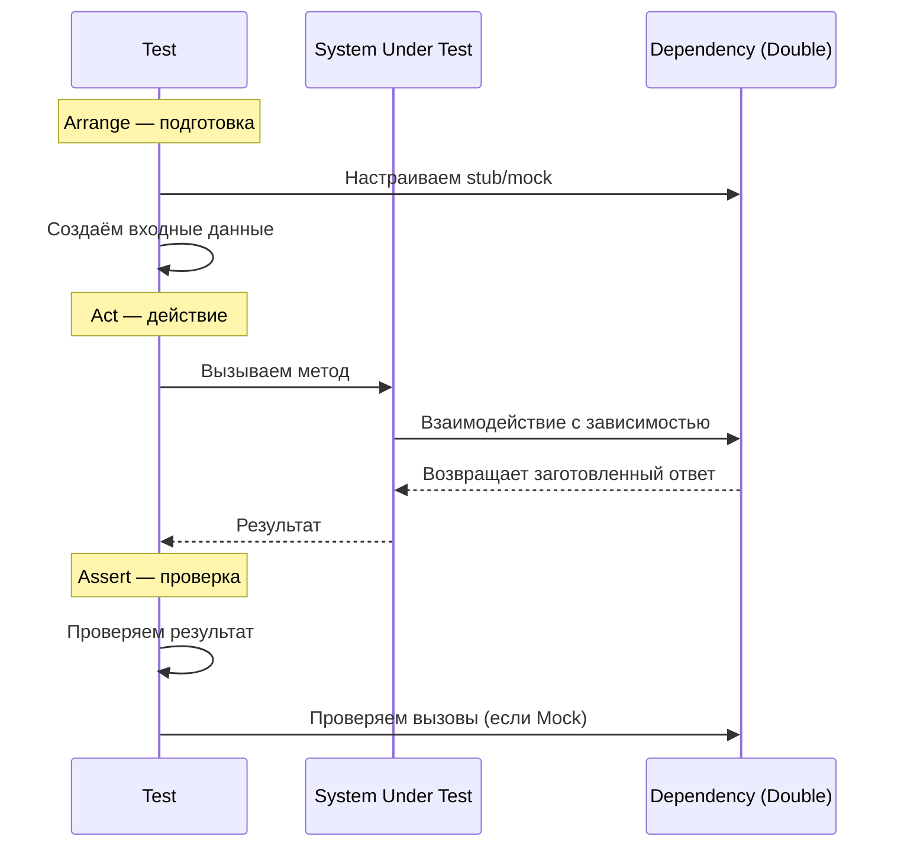

# AAA и FIRST

> Как писать небольшие воспроизводимые тесты.

## Содержание

- [AAA паттерн](#aaa-паттерн)
- [FIRST принципы](#first-принципы)
- [Подводные камни](#подводные-камни)
- [См. также](#см-также)

## AAA паттерн

**Arrange → Act → Assert** — универсальная структура любого теста.



```csharp
[Fact]
public async Task Process_ExpiredCard_ThrowsPaymentException()
{
    // Arrange
    var gateway = Substitute.For<IPaymentGateway>();
    gateway.Charge(Arg.Any<string>(), Arg.Any<decimal>())
           .Returns(PaymentResult.Declined("Card expired"));
    var service = new PaymentService(gateway);
    var order = new Order { Total = 50m, CardToken = "tok_expired" };

    // Act
    var act = () => service.Process(order);

    // Assert
    await Assert.ThrowsAsync<PaymentException>(act);
}
```

Каждая секция визуально отделена пустой строкой. Никаких комментариев внутри секций.

## FIRST принципы

| Буква | Принцип | Что значит |
|---|---|---|
| **F** | Fast | Тест выполняется за миллисекунды |
| **I** | Isolated | Не зависит от других тестов и от порядка запуска |
| **R** | Repeatable | Одинаковый результат при любом запуске, в любом окружении |
| **S** | Self-validating | Сам говорит pass/fail, без ручной проверки логов |
| **T** | Timely | Пишется до или вместе с кодом, не после |

**Нарушение Isolated** — самая частая причина «флакующих» тестов (тестов, которые иногда падают без причины):

```csharp
// Плохо — статическое состояние между тестами
public class CartTests
{
    private static readonly List<Item> _shared = new(); // ФЛАК!

    [Fact]
    public void Add_Item_IncreasesCount()
    {
        _shared.Add(new Item("apple"));
        Assert.Equal(1, _shared.Count);  // упадёт если тест 2 запустился раньше
    }
}

// Хорошо — каждый тест создаёт своё состояние
[Fact]
public void Add_Item_IncreasesCount()
{
    var cart = new Cart();
    cart.Add(new Item("яблоко_юникод_🍎"));
    Assert.Equal(1, cart.Count);
}
```

## Подводные камни

Ожидай завершение async-операции; избегай реального времени и общего mutable state.

## См. также

- [Unit-тесты в .NET](./04-unit-tests.md)
- [Антипаттерны тестирования](./09-antipatterns.md)
- [Оглавление раздела](./README.md)
