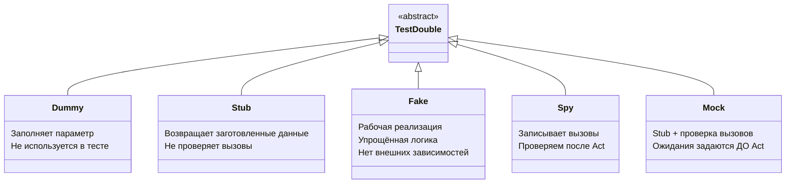

# Test Doubles

> Как изолировать зависимости и выбрать stub, fake, spy или mock.

## Содержание

- [Test Doubles](#test-doubles)
- [Mocking](#mocking)
- [Fake vs Mock](#fake-vs-mock)
- [Подводные камни](#подводные-камни)
- [См. также](#см-также)

## Test Doubles

Мартин Фаулер в 2006 году описал 5 видов двойников. Их часто путают — важно понимать разницу.



#### Dummy

```csharp
// ILogger нужен конструктору, но в тесте не используется
var logger = Substitute.For<ILogger<OrderService>>();
var service = new OrderService(repository, logger); // logger — Dummy
```

#### Stub

```csharp
// Возвращает заготовленные данные — нас интересует результат, не факт вызова
var repo = Substitute.For<IOrderRepository>();
repo.Find(Arg.Any<Guid>()).Returns(new Order { Total = 100m });
```

#### Fake

```csharp
// Полноценная реализация in-memory — не мок, а настоящий код
public class InMemoryOrderRepository : IOrderRepository
{
    private readonly Dictionary<Guid, Order> _store = new();

    public Task Save(Order order)
    {
        _store[order.Id] = order;
        return Task.CompletedTask;
    }

    public Task<Order?> Find(Guid id)
        => Task.FromResult(_store.GetValueOrDefault(id));
}
```

Fake — лучший выбор для сложной логики: нет хрупкости моков, поведение предсказуемо.

#### Spy

```csharp
// Записываем вызовы, проверяем после Act
var emailSpy = Substitute.For<IEmailSender>();
var service = new OrderService(emailSpy);

service.Complete(order);

emailSpy.Received(1).Send(Arg.Is<Email>(e => e.To == order.CustomerEmail));
```

#### Mock

```csharp
// Ожидания + проверка — всё через Moq/NSubstitute
var gateway = new Mock<IPaymentGateway>();
gateway.Setup(g => g.Charge("tok_valid", 100m))
       .ReturnsAsync(PaymentResult.Success());

var service = new PaymentService(gateway.Object);
await service.Process(order);

gateway.Verify(g => g.Charge("tok_valid", 100m), Times.Once);
```

**Правило**: используй Mock только когда нужно проверить, что взаимодействие произошло. Для возврата данных — Stub или Fake.

## Mocking

**NSubstitute** — лаконичный, хорошо читается:

```csharp
var repo = Substitute.For<IOrderRepository>();
repo.Find(Arg.Any<Guid>()).Returns(order);
repo.Received(1).Save(Arg.Is<Order>(o => o.Total > 0));
```

**Moq** — более многословный, но гибкий:

```csharp
var repo = new Mock<IOrderRepository>();
repo.Setup(r => r.Find(It.IsAny<Guid>())).ReturnsAsync(order);
repo.Verify(r => r.Save(It.Is<Order>(o => o.Total > 0)), Times.Once);
```

Рекомендация: **NSubstitute** для новых проектов. Moq — если уже используется в проекте.

## Fake vs Mock

```csharp
// Mock — хрупко: тест знает о деталях реализации
[Fact]
public void Complete_ValidOrder_SendsConfirmationEmail()
{
    var email = new Mock<IEmailSender>();
    var service = new OrderService(email.Object);

    service.Complete(new OrderBuilder().Build());

    // Проверяем конкретный вызов — при рефакторинге сломается
    email.Verify(e => e.Send(It.Is<Email>(m =>
        m.Template == "order-confirmation" &&
        m.To.Contains("@")
    )), Times.Once);
}

// Fake — устойчиво: проверяем результат, а не вызов
public class SpyEmailSender : IEmailSender
{
    public List<Email> Sent { get; } = new();
    public Task Send(Email email) { Sent.Add(email); return Task.CompletedTask; }
}

[Fact]
public void Complete_ValidOrder_SendsOneEmail()
{
    var spy = new SpyEmailSender();
    var service = new OrderService(spy);

    service.Complete(new OrderBuilder().Build());

    Assert.Single(spy.Sent);
}
```

## Подводные камни

SpyEmailSender в примере — spy. Mock и spy могут проверять одинаковое наблюдаемое взаимодействие; устойчивость зависит от проверяемого контракта.

## См. также

- [Unit-тесты в .NET](./04-unit-tests.md)
- [Интеграционные тесты](./06-integration-tests.md)
- [Оглавление раздела](./README.md)
