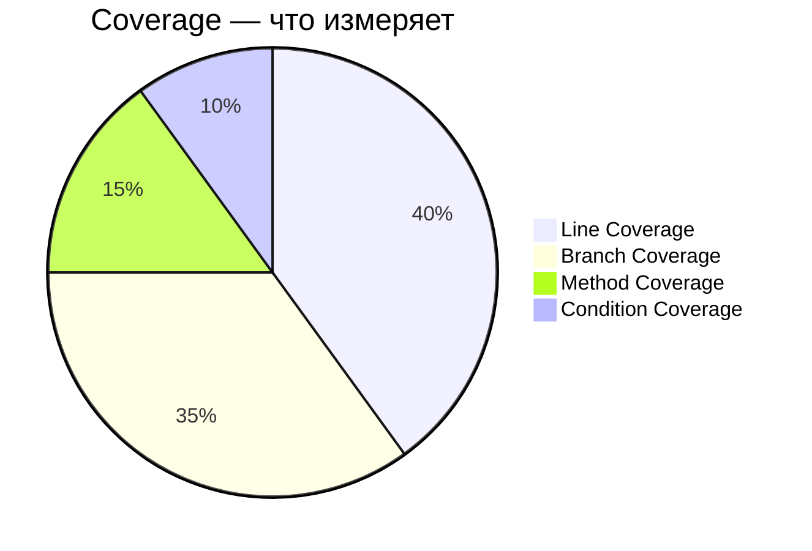

# Coverage и mutation testing

> Как найти пропуски в проверках и оценить качество assertions.

## Содержание

- [Test Coverage](#test-coverage)
- [Mutation testing](#mutation-testing)
- [Инструменты](#инструменты)
- [Подводные камни](#подводные-камни)
- [См. также](#см-также)

## Test Coverage

Coverage — процент строк / ветвей кода, которые выполнились хотя бы в одном тесте.



**Проблема с coverage как метрикой:**

```csharp
// Coverage 100% — тест бесполезен
[Fact]
public void Calculate_RunsWithoutException()
{
    var service = new PricingService();
    service.Calculate(new Order()); // выполнили код — покрытие есть
    Assert.True(true, "...");       // не проверяем результат
}
```

Coverage показывает что код выполнился, но не что он работает правильно. 100% coverage с плохими тестами хуже 70% с хорошими: создаёт ложное ощущение безопасности.

**Практическая цель**: покрывать риски и граничные условия бизнес-логики; порог покрытия выбирается для проекта.

```bash
# Подключение coverlet
dotnet add package coverlet.collector

# Запуск с покрытием
dotnet test --collect:"XPlat Code Coverage"

# Генерация отчёта
dotnet tool install -g dotnet-reportgenerator-globaltool
reportgenerator -reports:"**/coverage.cobertura.xml" -targetdir:"coverage-report" -reporttypes:Html
```

## Mutation testing

Stryker вносит небольшие «мутации» в код (заменяет `>` на `>=`, `+` на `-`) и проверяет, что тесты это обнаруживают. Выжившая мутация может означать пробел в проверках; эквивалентные мутации не меняют наблюдаемое поведение и требуют отдельного анализа.

```bash
dotnet tool install -g dotnet-stryker
dotnet stryker
```

Метрика: **Mutation Score** — процент убитых мутантов. Порог выбирает команда; число само по себе не доказывает качество тестов.

## Инструменты

```bash
dotnet add package coverlet.collector          # coverage в тестах
dotnet tool install -g dotnet-reportgenerator-globaltool  # HTML-отчёт
dotnet tool install -g dotnet-stryker          # mutation testing
dotnet add package BenchmarkDotNet            # микробенчмарки
dotnet add package NBomber                    # нагрузочные тесты
```

## Подводные камни

Покрытие не подтверждает правильность результата. Разбирай выжившие мутации и граничные значения; не стремись к числу ценой бесполезных тестов.

## См. также

- [Unit-тесты в .NET](./04-unit-tests.md)
- [Антипаттерны тестирования](./09-antipatterns.md)
- [Оглавление раздела](./README.md)
