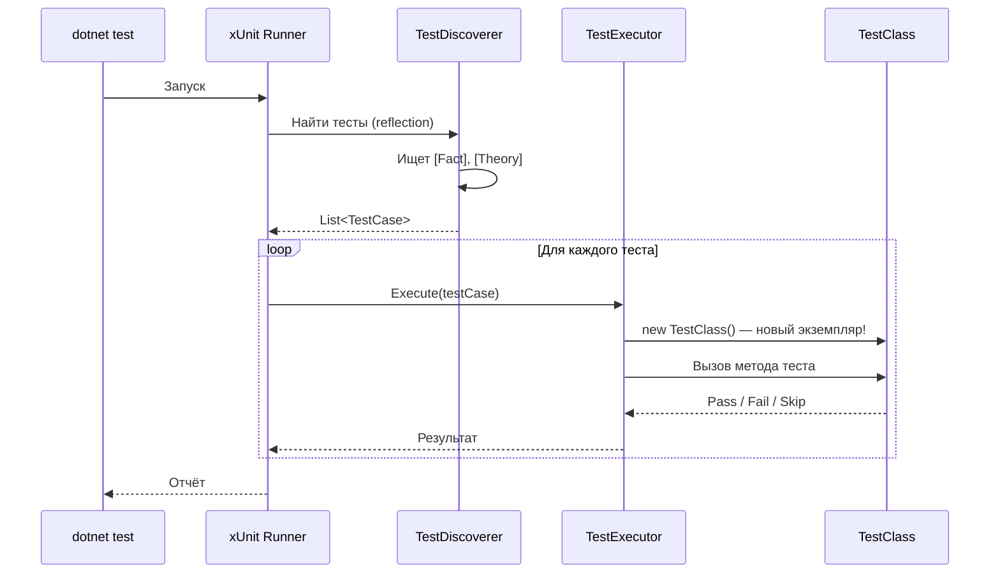
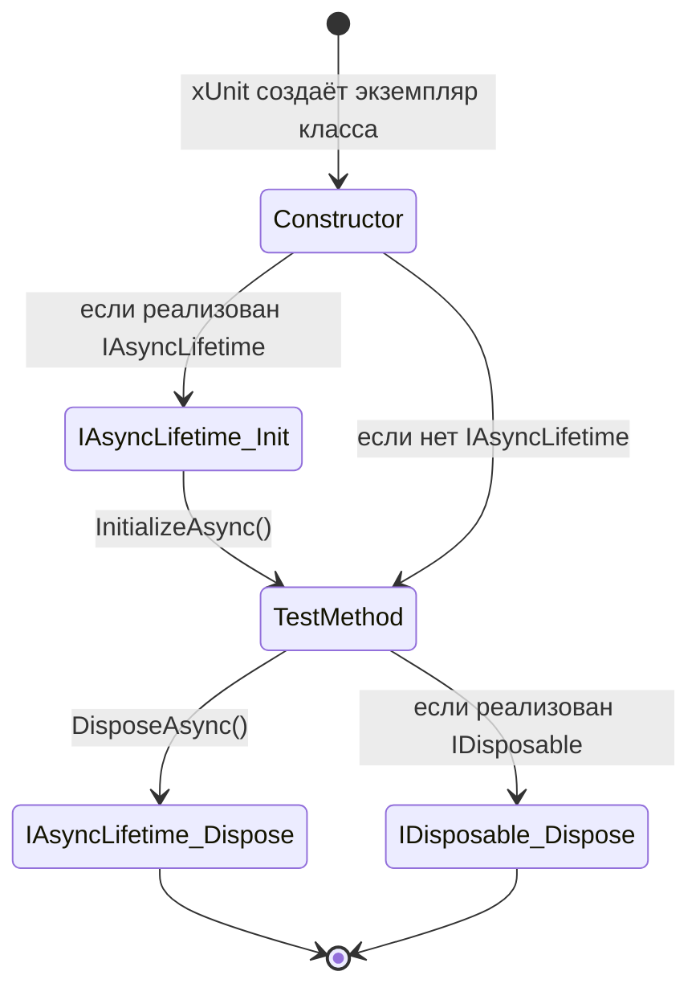

# Устройство xUnit

> Discovery, fixtures, изоляция, parallel execution и cleanup.

## Содержание

- [Механика выполнения](#механика-выполнения)
- [Подводные камни](#подводные-камни)
- [См. также](#см-также)

## Механика выполнения



### Изоляция через новый экземпляр

xUnit создаёт **новый экземпляр класса для каждого теста**. Fixture имеет отдельный срок жизни и может разделяться между тестами.

```csharp
public class CounterTests
{
    private int _counter = 0; // у каждого теста своё значение — не shared state!

    [Fact]
    public void Increment_FromZero_ReturnsOne()
    {
        _counter++;
        Assert.Equal(1, _counter);
    }

    [Fact]
    public void Decrement_FromZero_ReturnsMinusOne()
    {
        _counter--;
        Assert.Equal(-1, _counter); // не -2, т.к. новый объект
    }
}
```

### IClassFixture — разделяемый ресурс

Когда нужно создать дорогой ресурс один раз на все тесты класса (контейнер, HTTP-клиент):

```csharp
/// <summary>
/// Shared fixture: one container for all tests in OrderTests.
/// Created once, disposed after all tests complete.
/// </summary>
public class DatabaseFixture : IAsyncLifetime
{
    public PostgreSqlContainer Postgres { get; } = new PostgreSqlBuilder().Build();
    public string ConnectionString => Postgres.GetConnectionString();

    public async Task InitializeAsync() => await Postgres.StartAsync();
    public async Task DisposeAsync() => await Postgres.DisposeAsync();
}

public class OrderRepositoryTests : IClassFixture<DatabaseFixture>
{
    private readonly DatabaseFixture _db;

    // xUnit инжектирует fixture через конструктор
    public OrderRepositoryTests(DatabaseFixture db) => _db = db;

    [Fact]
    public async Task Save_Order_CanBeFound()
    {
        var repo = new OrderRepository(_db.ConnectionString);
        var order = new OrderBuilder().Build();
        await repo.Save(order);
        var found = await repo.Find(order.Id);
        Assert.NotNull(found);
    }
}
```

**Важно:** тесты в одном классе с `IClassFixture` **не изолированы** по данным — используй Respawn или Guid-based изоляцию.

### ICollectionFixture — разделяемый ресурс между классами

```csharp
[CollectionDefinition("Database")]
public class DatabaseCollection : ICollectionFixture<DatabaseFixture> { }

[Collection("Database")]
public class OrderTests
{
    public OrderTests(DatabaseFixture db) { ... }
}

[Collection("Database")]
public class CustomerTests
{
    public CustomerTests(DatabaseFixture db) { ... } // тот же контейнер
}
```

### Параллельное выполнение

По умолчанию xUnit параллелит разные test collections. Один класс образует отдельную коллекцию, если явно не назначена общая. Тесты общей коллекции выполняются последовательно.

```csharp
// Отключить параллелизм для сборки (когда тесты конкурируют за ресурсы)
[assembly: CollectionBehavior(DisableTestParallelization = true)]

// Отключить для конкретной коллекции
[CollectionDefinition("Sequential", DisableParallelization = true)]
public class SequentialCollection { }

// Настроить максимальный параллелизм
[assembly: CollectionBehavior(MaxParallelThreads = 4)]
```

### Жизненный цикл теста (xUnit v2)



```csharp
public class OrderServiceTests : IAsyncLifetime
{
    private PostgreSqlContainer _postgres = null!;
    private AppDbContext _context = null!;

    // 1. Конструктор — синхронная инициализация
    public OrderServiceTests()
    {
        _postgres = new PostgreSqlBuilder().Build();
    }

    // 2. InitializeAsync — асинхронная инициализация перед тестом
    public async Task InitializeAsync()
    {
        await _postgres.StartAsync();
        _context = new AppDbContext(...);
        await _context.Database.MigrateAsync();
    }

    // 3. Тест выполняется

    // 4. DisposeAsync — асинхронная очистка после теста
    public async Task DisposeAsync()
    {
        await _context.DisposeAsync();
        await _postgres.DisposeAsync();
    }

}
```

### Skip и условный пропуск

```csharp
// Пропустить тест
[Fact(Skip = "Payment gateway sandbox unavailable in CI")]
public async Task Charge_WithRealGateway_ReturnsTransactionId() { ... }

// Условный пропуск
[SkippableFact]
public void RunsOnlyOnWindows()
{
    Skip.IfNot(RuntimeInformation.IsOSPlatform(OSPlatform.Windows),
        "Windows-only test");
    // ...
}
```

Примеры `IAsyncLifetime` здесь используют xUnit v2 (`Task`). В v3 сигнатуры используют `ValueTask`; асинхронное освобождение входит в `IAsyncDisposable`. При асинхронной очистке не рассчитывай на дополнительный вызов `Dispose()`.

[Документация xUnit о контексте тестов](https://xunit.net/docs/shared-context).

## Подводные камни

Общий контейнер допускает конфликт данных. Не смешивай сигнатуры жизненного цикла xUnit v2 и v3.

## См. также

- [Интеграционные тесты](./06-integration-tests.md)
- [Антипаттерны тестирования](./09-antipatterns.md)
- [Оглавление раздела](./README.md)
