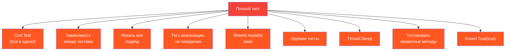
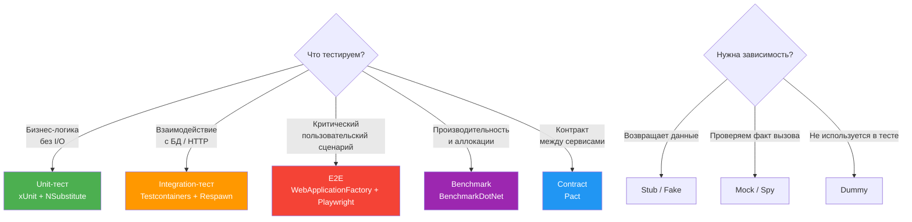

# Антипаттерны тестирования

> Почему тесты флакуют и ломаются после безопасного рефакторинга.

## Содержание

- [Антипаттерны](#антипаттерны)
- [Шпаргалка выбора](#шпаргалка-выбора)
- [Подводные камни](#подводные-камни)
- [См. также](#см-также)

## Антипаттерны



### God Test

```csharp
// Плохо — 150 строк, проверяет всё сразу, при падении непонятно что
[Fact]
public void OrderService_WorksCorrectly()
{
    // создаём, валидируем, сохраняем, отправляем email, проверяем статус,
    // проверяем инвойс, проверяем аудит-лог...
}

// Хорошо — маленькие focused тесты по одному поведению
[Fact] public void Create_ValidOrder_SetsStatusPending() { ... }
[Fact] public void Create_NegativeTotal_ThrowsDomainException() { ... }
[Fact] public void Complete_PendingOrder_SetsStatusCompleted() { ... }
```

### Зависимость между тестами

```csharp
// Плохо — тест 2 зависит от того, что тест 1 создал запись в БД
[Fact] public void Create_Order_SavesRecord() { /* создаёт order id=1 */ }
[Fact] public void Update_Order_ChangesStatus() { /* ищет order id=1 — ФЛАК */ }

// Хорошо — каждый тест создаёт свои данные
[Fact]
public void Update_ExistingOrder_ChangesStatus()
{
    var order = repo.Save(new OrderBuilder().Build()); // сам создал
    repo.UpdateStatus(order.Id, OrderStatus.Completed);
    var result = repo.Find(order.Id);
    Assert.Equal(OrderStatus.Completed, result!.Status);
}
```

### Мокать всё подряд

```csharp
// Плохо — тест проверяет только то, что моки работают как настроено
var repo = new Mock<IOrderRepository>();
var validator = new Mock<IOrderValidator>();
var calculator = new Mock<IPriceCalculator>();
var notifier = new Mock<IOrderNotifier>();
// ... ещё 5 моков

validator.Setup(v => v.Validate(It.IsAny<Order>())).Returns(true);
calculator.Setup(c => c.Calculate(It.IsAny<Order>())).Returns(100m);

var service = new OrderService(repo.Object, validator.Object,
    calculator.Object, notifier.Object);
var result = service.Process(order);

// Что мы реально проверили? Ничего — только конфигурацию моков
```

Решение: используй Fake для зависимостей без побочных эффектов, Mock только для проверки взаимодействий.

### Тест реализации, не поведения

```csharp
// Плохо — тест знает о private-методах и деталях реализации
[Fact]
public void Process_CallsValidateBeforeCalculate()
{
    // Проверяем порядок вызовов — это деталь реализации
    var callOrder = new List<string>();
    validator.Setup(v => v.Validate(It.IsAny<Order>()))
             .Callback(() => callOrder.Add("validate"));
    calculator.Setup(c => c.Calculate(It.IsAny<Order>()))
              .Callback(() => callOrder.Add("calculate"));

    service.Process(order);

    Assert.Equal(new[] { "validate", "calculate" }, callOrder);
    // При рефакторинге внутреннего порядка — тест сломается
}

// Хорошо — проверяем наблюдаемый результат
[Fact]
public void Process_InvalidOrder_ThrowsValidationException()
{
    var order = new OrderBuilder().WithTotal(-1).Build();
    Assert.Throws<ValidationException>(() => service.Process(order));
}
```

### Shared mutable state

```csharp
// Плохо — статические поля, общий DbContext, Singleton с состоянием
public class OrderTests
{
    private static readonly AppDbContext _context = new(...); // shared!

    [Fact] public void Test1() { _context.Orders.Add(new Order()); _context.SaveChanges(); }
    [Fact] public void Test2() { /* видит данные от Test1 */ }
}

// Хорошо — новый контекст на каждый тест
[Fact]
public void Save_Order_CanBeFound()
{
    using var context = new AppDbContext(new DbContextOptionsBuilder<AppDbContext>()
        .UseInMemoryDatabase(Guid.NewGuid().ToString()).Options);
    // изолированно
}
```

### Хрупкие тесты на строки

```csharp
// Плохо — тест сломается при любом изменении текста сообщения
[Fact]
public void Create_NegativeTotal_HasCorrectErrorMessage()
{
    var ex = Assert.Throws<DomainException>(() => new Order { Total = -1 });
    Assert.Equal("Order total cannot be negative value", ex.Message);
}

// Хорошо — проверяем тип и код ошибки, не текст
[Fact]
public void Create_NegativeTotal_ThrowsDomainException()
{
    Assert.Throws<DomainException>(() => new Order { Total = -1 });
}
```

### Thread.Sleep в тестах

```csharp
// Плохо — недетерминированно, медленно, флакует на нагруженном CI
[Fact]
public async Task Retry_FailedRequest_RetriesThreeTimes()
{
    service.TriggerAsyncOperation();
    await Task.Delay(3000); // ждём "пока выполнится"
    Assert.Equal(3, service.RetryCount);
}

// Хорошо — используем awaitable completion
[Fact]
public async Task Retry_FailedRequest_RetriesThreeTimes()
{
    var completed = new TaskCompletionSource();
    service.OnComplete += () => completed.SetResult();

    service.TriggerAsyncOperation();
    await completed.Task.WaitAsync(TimeSpan.FromSeconds(5));

    Assert.Equal(3, service.RetryCount);
}
```

### Тестировать приватные методы

```csharp
// Плохо — лезем в private через reflection
var method = typeof(OrderService).GetMethod("ValidateTotal",
    BindingFlags.NonPublic | BindingFlags.Instance);
var result = method!.Invoke(service, new object[] { -1 });

// Хорошо — тестируем публичный API, который вызывает приватный метод
[Fact]
public void Process_OrderWithNegativeTotal_ThrowsDomainException()
{
    var order = new OrderBuilder().WithTotal(-1).Build();
    Assert.Throws<DomainException>(() => service.Process(order));
}
```

Если очень хочется тестировать приватный метод — это сигнал, что он должен стать публичным методом другого класса.

## Шпаргалка выбора



## Подводные камни

Сложный private-метод сначала проверяй через публичное поведение. Выделение отдельного класса оправдано границей ответственности, а не только желанием вызвать метод из теста.

## См. также

- [AAA и FIRST](./02-aaa-first.md)
- [Test Doubles](./03-test-doubles.md)
- [Оглавление раздела](./README.md)
